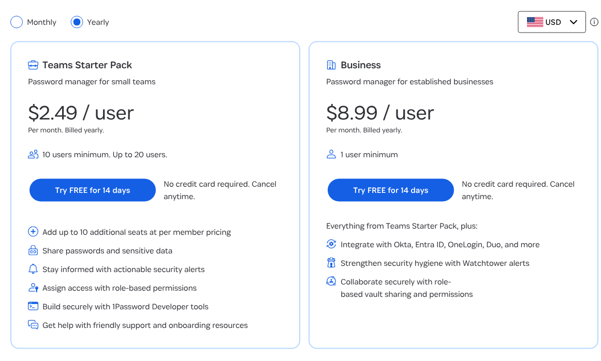

1Password Business lists **$8.99 per user per month when billed yearly** in USD. That is **$107.88 per user for a full year**. Model the annual unit price once and use each organization's billable user count as the subscription line-item quantity.

<Frame caption="1Password's Teams Starter Pack and Business cards with Yearly and USD selected. The guide models Business, not the Starter Pack. Captured November 18, 2026. Source: 1Password's official pricing page, linked below.">
  
</Frame>

[View the original pricing page](https://1password.com/pricing/business).

**Scope:** Direct USD Business base subscription at annual signup or renewal with a stable user count.

**Not modeled:** Teams Starter Pack and extra Starter Pack seats, the monthly option, trials, changes in seat count within a term, marketplace purchases, negotiated discounts and taxes.

## Pricing profile

| Dimension | Modeled offering |
| --- | --- |
| Pricing model | Per-seat, Subscription |
| Industry | Password management |
| Buyer | Business security and IT teams |
| Sales motion | Self-serve |
| Billing mechanics | Per-user annual fee, One-user minimum |

## What 1Password charges

| Item | Published terms | Flexprice implication |
| --- | --- | --- |
| Business display rate | $8.99 per user per month with Yearly selected | $107.88 per user per year |
| Minimum | Business card shows a one-user minimum | Allow a Business quantity of at least one |
| Teams Starter Pack | Different package with 10 included members and separately priced additional seats | Do not use the Starter Pack's displayed per-user equivalent as a Business rate |

## Design takeaways

1. **Use the actual yearly unit price.** The pricing FAQ quotes $107.88 per Business user annually. Set that amount on an annual price; $8.99 is a display convention, not an annual charge. See [the published terms](https://1password.com/pricing/business).
2. **Keep the Starter Pack separate.** A ten-member package and an individual Business seat are different billable units. Give them different catalogue entries rather than multiplying the Starter Pack's displayed equivalent by the Business user count. See [the published terms](https://1password.com/pricing/business).
3. **Treat the minimum as a signup rule.** Business's one-user minimum is a constraint on the quantity selected at subscription creation. It is not an extra fixed fee or one free user. See [the published terms](https://1password.com/pricing/business).

## How 1Password's pricing maps to Flexprice

| 1Password concept | Flexprice configuration |
| --- | --- |
| Business user | Fixed annual price of $107.88 per billable unit |
| Billable quantity | Subscription line-item quantity; no usage meter |
| Billing schedule | One annual period, invoiced in advance |

## Set up the fixed subscription

Use the Flexprice API only in your own test environment. Replace the illustrative IDs with the IDs returned by your setup. Create a [plan](/docs/product-catalogue/plans/create) with `POST /plans`:

```json
{
  "name": "1Password Business Annual example",
  "lookup_key": "1password_pricing_example",
  "description": "Direct USD Business base subscription at annual signup or renewal with a stable user count"
}
```

Create the [fixed price](/docs/product-catalogue/plans/pricing) with `POST /prices`. The amount is in USD, not cents, and is the unit amount for the entire billing period:

```json
{
  "entity_type": "PLAN",
  "entity_id": "plan_1password_example",
  "type": "FIXED",
  "billing_model": "FLAT_FEE",
  "billing_period": "ANNUAL",
  "billing_period_count": 1,
  "invoice_cadence": "ADVANCE",
  "currency": "usd",
  "price_unit_type": "FIAT",
  "amount": "107.88",
  "display_name": "Business Annual Business user"
}
```

Create one customer for the billing account, then call `POST /subscriptions` with that customer, the plan and its fixed price. The [quantity override](/docs/subscriptions/plan-price-overrides) applies to the fixed line item.

```json
{
  "customer_id": "cust_1password_example",
  "plan_id": "plan_1password_example",
  "currency": "usd",
  "billing_period": "ANNUAL",
  "billing_period_count": 1,
  "billing_cycle": "anniversary",
  "start_date": "2026-12-01T00:00:00Z",
  "override_line_items": [
    {
      "price_id": "price_1password_example",
      "quantity": "7"
    }
  ]
}
```

Use the billable users in the Business organization at signup or renewal. This example assumes seven users and no changes within the term.

## Worked bill

$8.99 × 12 = $107.88 per user per year; 7 billable users × $107.88 = $755.16. The invoice base is **$755.16** for quantity **7**, before excluded charges or adjustments.

## Pricing sources

- [1Password pricing](https://1password.com/pricing/business): USD yearly cards, Business's one-user minimum and published $107.88 annual unit rate.
- [1Password billing documentation](https://support.1password.com/manage-subscription/): Subscription management and renewal frequencies.

Pricing checked on 2026-11-18. Recheck the source before implementing. This is illustrative configuration, not a recreation of a full provider invoice.

## Related guide

[Plan price overrides](/docs/subscriptions/plan-price-overrides)
