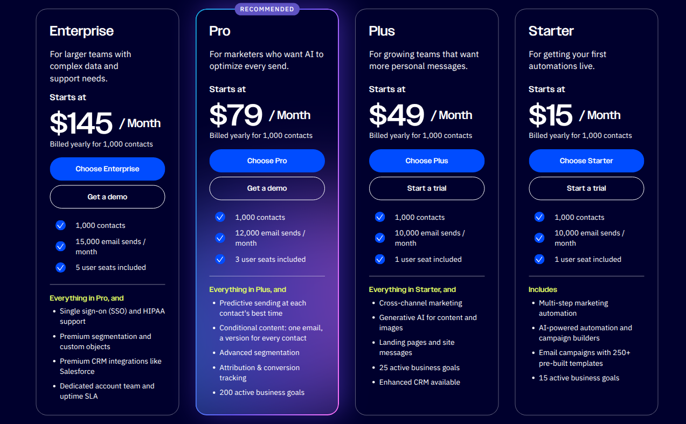

ActiveCampaign shows the Starter annual rate as a monthly equivalent and includes a send allowance that resets each month. Model the subscription fee as a yearly charge and track the monthly allowance separately.

<Frame caption="ActiveCampaign annual plan comparison from the official site, 2026-11-26. This guide models only Starter annual at 1,000 contacts.">
  
</Frame>

[View the official pricing page](https://www.activecampaign.com/pricing).

**Scope:** The USD Starter annual base fee for the 1,000-contact band, with a stable plan and contact band.

**Not modeled:** Monthly subscriptions, higher tiers, add-ons, taxes, trials, and send overage charges or limit increases.

## Pricing profile

| Dimension | Modeled offering |
| --- | --- |
| Pricing model | Subscription; Tiered pricing |
| Industry | Marketing automation |
| Buyer | Small marketing teams |
| Sales motion | Self-serve |
| Billing mechanics | Annual base fee; Contact band; Monthly send reset |

## What ActiveCampaign charges

| Item | Published terms | Flexprice implication |
| --- | --- | --- |
| Annual Starter base | $15 USD per month as displayed, billed yearly for 1,000 contacts | Enter $180 for one annual billing period |
| Contact band | 1,000 contacts at the published starting price | Select one price by band per account |
| Send allocation | 10,000 email sends per month at that band. The monthly reset follows the day of the annual billing cycle | Track monthly entitlement windows independently of the annual price |

## Design takeaways

1. **Keep contact capacity and throughput separate.** The contact band selects the base price and the send allowance controls monthly throughput. An account can stay below 1,000 contacts and still exhaust its send allowance [Published terms](https://www.activecampaign.com/pricing).
2. **Reset usage within an annual term.** Yearly billing still has monthly send windows. A single annual usage counter would let one busy month draw on future monthly allowances [Published terms](https://help.activecampaign.com/hc/en-us/articles/10918125380764).

## How ActiveCampaign's pricing maps to Flexprice

| ActiveCampaign concept | Flexprice configuration |
| --- | --- |
| Starter 1,000-contact band | Fixed annual price of $180.00 USD in advance |

## Configure the plan and subscription

These requests are illustrative. Use your test environment and replace example IDs with the IDs returned by your setup. Create a [plan](/docs/product-catalogue/plans/create) with `POST /plans`:

```json
{
  "name": "ActiveCampaign Starter annual at 1,000 contacts example",
  "lookup_key": "activecampaign_pricing_example",
  "description": "The USD Starter annual base fee for the 1,000-contact band, with a stable plan and contact band"
}
```

Use `POST /prices` for each [fixed recurring price](/docs/product-catalogue/plans/pricing) below. Set the amount in USD for the full billing period.

```json
{
  "entity_type": "PLAN",
  "entity_id": "plan_activecampaign_example",
  "currency": "usd",
  "price_unit_type": "FIAT",
  "billing_period": "ANNUAL",
  "billing_period_count": 1,
  "display_name": "Starter 1,000-contact band",
  "type": "FIXED",
  "billing_model": "FLAT_FEE",
  "invoice_cadence": "ADVANCE",
  "amount": "180.00"
}
```

Select the 1,000-contact band and start one annual subscription when the paid term begins. If your application enforces sends, anchor each monthly window to the annual subscription's billing day.

Create or select the payer's customer record. When paid billing begins, use `POST /subscriptions` with that customer ID and the returned plan and price IDs. To set up a subscription now without raising the advance invoice yet, [create a draft](/docs/core-concepts/subscriptions#choosing-a-subscription-start-date) and activate it when billing begins.

```json
{
  "customer_id": "cust_activecampaign_example",
  "plan_id": "plan_activecampaign_example",
  "currency": "usd",
  "billing_period": "ANNUAL",
  "billing_period_count": 1,
  "billing_cycle": "anniversary"
}
```

## Worked bill

At the advertised monthly equivalent of $15.00, one year costs 12 × $15.00 = **$180.00** before taxes. Sending 8,000 emails in month one and 9,500 in month two leaves both months within their own 10,000-send allowance.

Verify the fixed charge amounts and quantities on the opening invoice. No usage line should be present in this example.

## Pricing sources

- [ActiveCampaign pricing](https://www.activecampaign.com/pricing): Starter annual display rate, contact band, and monthly send allowance.
- [ActiveCampaign terms of service](https://www.activecampaign.com/legal/terms-of-service): Subscription fees and contact and usage limits.
- [ActiveCampaign email send limits](https://help.activecampaign.com/hc/en-us/articles/10918125380764): Monthly send reset on yearly plans.

Pricing checked on 2026-11-26.

## Related guide

[Plan price overrides](/docs/subscriptions/plan-price-overrides)
