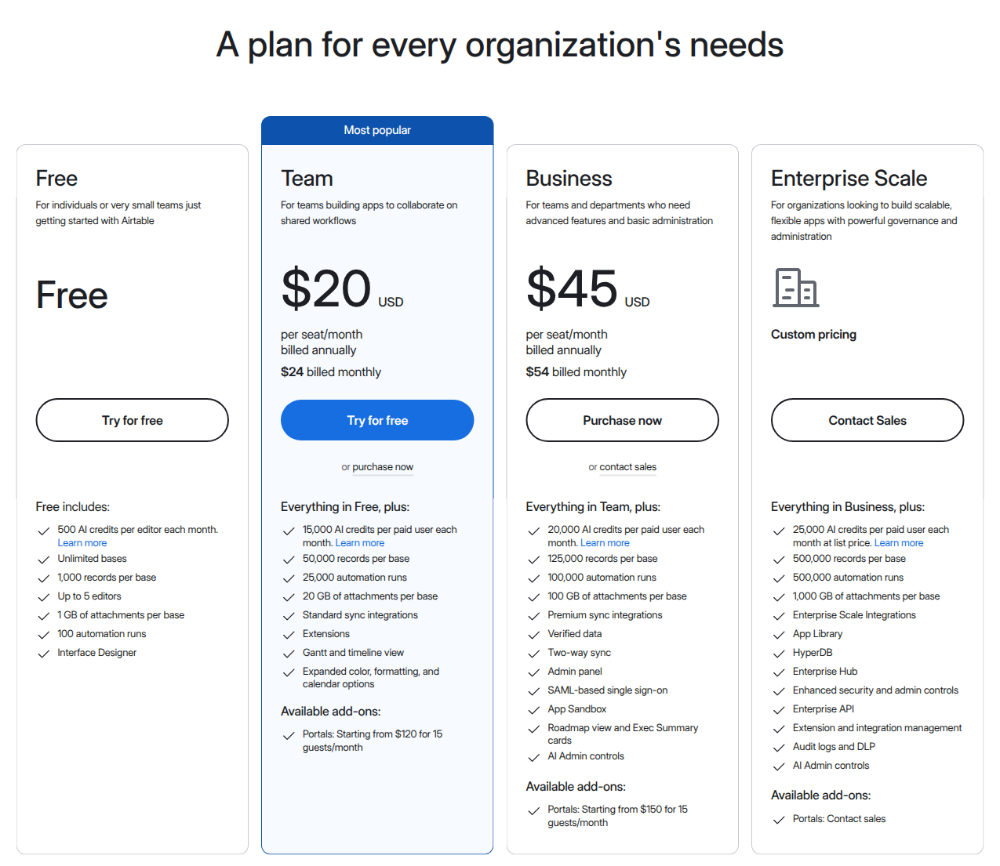

Airtable Business advertises $45 per seat per month when billed annually. The seat count comes from collaborator permissions inside a paid workspace, not from everyone who can open a base. In Flexprice, classify collaborators first, then set the quantity on a fixed annual price.

<Frame caption="Airtable pricing comparison from the official site, 2026-11-23.">
  
</Frame>

[View the official pricing page](https://airtable.com/pricing).

**Scope:** The public US annual self-serve Business base charge for one workspace.

**Not modeled:** Team and Enterprise Scale rules, mid-cycle collaborator changes, Portal add-ons, AI credits, discounts, and taxes.

## Pricing profile

| Dimension | Modeled offering |
| --- | --- |
| Pricing model | Per-seat |
| Industry | Collaborative application building |
| Buyer | Teams and departments |
| Sales motion | Self-serve |
| Billing mechanics | Annual fixed price; Permission-based seat count per workspace |

## What Airtable charges

| Item | Published terms | Flexprice implication |
| --- | --- | --- |
| Business annual rate | $45 USD per seat per month, billed annually | $540 USD per billable collaborator for a full year |
| Billing scope | Self-serve plans are billed per workspace | Keep a distinct subscription for each billed workspace |
| Business seat eligibility | Owners, Creators and Editors are billable. Commenters and read-only collaborators are not | Count eligible users before setting quantity |

## Design takeaways

1. **Classify by plan, not by a global role list.** A Commenter can be billable on Team but not on self-serve Business. Keep the role-to-seat rule tied to the plan so a change of plan can change the count even if nobody changes roles. [Published terms](https://support.airtable.com/docs/airtable-plans).
2. **Keep the workspace as the billing boundary.** Compute a distinct eligible-user count for each workspace. Counting once across all workspaces would turn separate workspace subscriptions into an account-wide seat pool. [Published terms](https://support.airtable.com/docs/airtable-plans).

## How Airtable's pricing maps to Flexprice

| Airtable concept | Flexprice configuration |
| --- | --- |
| Annual price per billable collaborator | Fixed price of $540.00 USD in advance |
| Billable quantity | Application or checkout calculation, passed as the fixed-line quantity |

## Configure the plan and subscription

These requests are illustrative. Use your test environment and replace example IDs with the IDs returned by your setup. Create a [plan](/docs/product-catalogue/plans/create) with `POST /plans`:

```json
{
  "name": "Airtable Business example",
  "lookup_key": "airtable_pricing_example",
  "description": "The public US annual self-serve Business base charge for one workspace"
}
```

Create the [fixed price](/docs/product-catalogue/plans/pricing) with `POST /prices`. Enter the full annual amount per seat in USD, not cents.

```json
{
  "entity_type": "PLAN",
  "entity_id": "plan_airtable_example",
  "currency": "usd",
  "price_unit_type": "FIAT",
  "billing_period": "ANNUAL",
  "billing_period_count": 1,
  "display_name": "Business",
  "type": "FIXED",
  "billing_model": "FLAT_FEE",
  "invoice_cadence": "ADVANCE",
  "amount": "540"
}
```

For each workspace, count each eligible user once. For this example, one Owner, two Creators and three Editors qualify. Four Commenters and two read-only collaborators do not. Reuse the same Flexprice customer if one payer pays for multiple workspaces, but keep each workspace's subscription quantity separate.

Create or select a customer to bill, then use `POST /subscriptions`. Set the quantity on the returned fixed price using a [line-item override](/docs/subscriptions/plan-price-overrides).

```json
{
  "customer_id": "cust_airtable_example",
  "plan_id": "plan_airtable_example",
  "currency": "usd",
  "billing_period": "ANNUAL",
  "billing_period_count": 1,
  "billing_cycle": "anniversary",
  "start_date": "2026-12-01T00:00:00Z",
  "override_line_items": [
    {
      "price_id": "price_airtable_example",
      "quantity": "6"
    }
  ]
}
```

## Worked bill

Six billable collaborators at $45 × 12 = $540.00 per collaborator produce **6 × $540.00 = $3,240.00 for the year** before taxes and discounts. The six non-billable collaborators do not change the charge.

Verify that the opening invoice shows the annual unit amount and the fixed-line quantity, with no metered line in this example.

## Pricing sources

- [Airtable pricing](https://airtable.com/pricing): Published US plan rates and purchase options.
- [Airtable billing documentation](https://support.airtable.com/docs/airtable-plans): Workspace billing and plan-specific collaborator permissions.

Pricing checked on 2026-11-23. This example does not reproduce a full provider invoice.

## Related guide

[Plan price overrides](/docs/subscriptions/plan-price-overrides)
