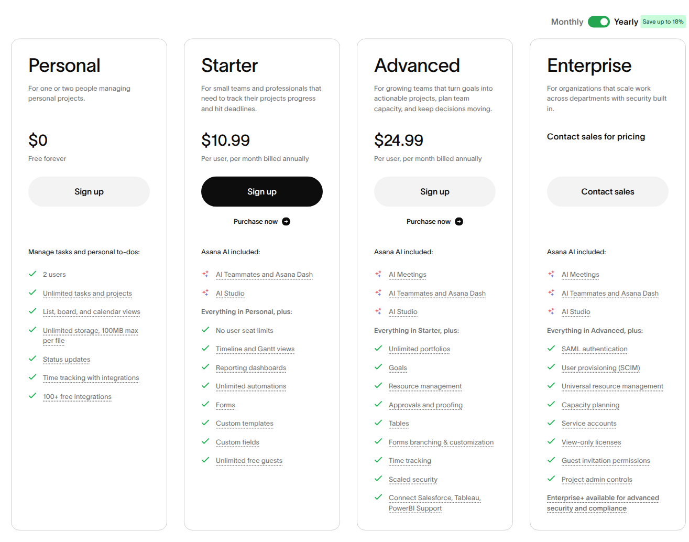

Asana Starter advertises $10.99 per user per month billed annually. Subscriptions start at two seats and are sold in set sizes, so the number of people who need access can differ from the quantity on the bill.

<Frame caption="Asana plan pricing from the official site, 2026-11-20.">
  
</Frame>

[View the official pricing page](https://asana.com/pricing).

**Scope:** The initial USD annual charge for Asana Starter when seven people need paid seats.

**Not modeled:** Other plans, free guests, in-term changes, consumption-based AI products, add-ons, discounts and tax.

## Pricing profile

| Dimension | Modeled offering |
| --- | --- |
| Pricing model | Subscription; Per-seat |
| Industry | Work management software |
| Buyer | Project teams |
| Sales motion | Self-serve |
| Billing mechanics | Annual billing; Purchased seat bundles |

## What Asana charges

| Item | Published terms | Flexprice implication |
| --- | --- | --- |
| Starter, yearly | $10.99 per user per month | $131.88 per purchased seat for a year |
| Seat bundles | Starts at 2; then 3, 4, 5, then steps of 5 through 30. Larger subscriptions use other steps. | Seven required seats map to the 10-seat bundle, not a quantity of seven |
| Consumption products | Consumption-based products have separate allowances or charges | Do not fold AI consumption into the seat price |

## Design takeaways

1. **Choose the bundle before pricing.** Translate demand to a valid purchased bundle at checkout. Keeping that rule outside the line price lets you reuse one annual seat rate across bundle sizes. [Published terms](https://help.asana.com/s/article/asana-subscriptions-and-pricing?language=en_US).
2. **Keep the bundle size on the subscription.** Logins can occupy or vacate seats without changing the package the customer bought. Store the purchased quantity separately from active-user counts. [Published terms](https://help.asana.com/s/article/asana-subscriptions-and-pricing?language=en_US).

## How Asana's pricing maps to Flexprice

| Asana concept | Flexprice configuration |
| --- | --- |
| USD base price per purchased seat | Fixed annual price of $131.88 in advance |
| Quantity | Set the fixed line's quantity on the subscription |

## Configure the plan and subscription

These requests are illustrative. Use your test environment and replace example IDs with the IDs returned by your setup. Create a [plan](/docs/product-catalogue/plans/create) with `POST /plans`:

```json
{
  "name": "Asana Starter annual seat bundles example",
  "lookup_key": "asana_pricing_example",
  "description": "The initial USD annual charge for Asana Starter when seven people need paid seats"
}
```

Create the [fixed price](/docs/product-catalogue/plans/pricing) with `POST /prices`. Enter the amount for the full billing period in USD, not cents.

```json
{
  "entity_type": "PLAN",
  "entity_id": "plan_asana_example",
  "currency": "usd",
  "price_unit_type": "FIAT",
  "billing_period": "ANNUAL",
  "billing_period_count": 1,
  "display_name": "Starter annual seat bundles",
  "type": "FIXED",
  "billing_model": "FLAT_FEE",
  "invoice_cadence": "ADVANCE",
  "amount": "131.88"
}
```

For this example, the eligible bundle sizes around seven users are five and ten. Choose the smallest bundle that covers the request before creating the subscription; Flexprice does not infer the bundle from the number of users. Enforce the published seat schedule in your purchase flow.

Create a customer for the payer and use its ID with `POST /subscriptions`. Use the returned price ID in `override_line_items` to set the fixed-line quantity.

```json
{
  "customer_id": "cust_asana_example",
  "plan_id": "plan_asana_example",
  "currency": "usd",
  "billing_period": "ANNUAL",
  "billing_period_count": 1,
  "billing_cycle": "anniversary",
  "start_date": "2026-12-01T00:00:00Z",
  "override_line_items": [
    {
      "price_id": "price_asana_example",
      "quantity": "10"
    }
  ]
}
```

## Worked bill

$10.99 × 12 = $131.88 per seat for one year. Seven required seats mean a purchase of ten seats: 10 × $131.88 = **$1,318.80**. If five are required instead, the five-seat bundle costs **$659.40**.

## Pricing sources

- [Asana pricing](https://asana.com/pricing): Annual Starter rate and self-serve plan comparison.
- [Asana billing documentation](https://help.asana.com/s/article/asana-subscriptions-and-pricing?language=en_US): Base plan seat bundles and the separation between subscription and consumption charges.

Pricing checked on 2026-11-20. This example does not reproduce a full provider invoice.

## Related guide

[Plan price overrides](/docs/subscriptions/plan-price-overrides)
