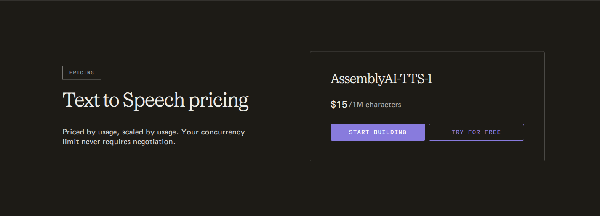
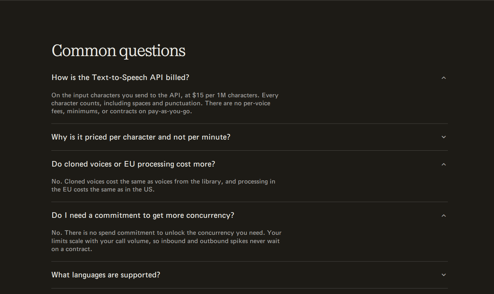

AssemblyAI prices **AssemblyAI-TTS-1** at **$15 per million input characters** on pay-as-you-go. Spaces and punctuation count, and the published rate does not change for cloned voices or EU processing. This guide models that text-to-speech offering with one metered feature and one usage charge in Flexprice.

<Frame caption="AssemblyAI-TTS-1 pricing card, captured from the official product page on November 5, 2026. This example models the $15 per million input-character rate, not a free trial or a negotiated contract.">
  
</Frame>

<Frame caption="AssemblyAI's text-to-speech billing FAQ, captured on November 5, 2026. Input characters include spaces and punctuation; pay-as-you-go has no per-voice fees, minimums or contracts. Cloned voices and EU processing use the same rate.">
  
</Frame>

Source: [AssemblyAI's official text-to-speech product and pricing page](https://www.assemblyai.com/products/text-to-speech).

<Note>
  This example covers gross pay-as-you-go usage charges for AssemblyAI-TTS-1 only, before credits, discounts and tax. It excludes speech-to-text, audio intelligence, other products and models, free trials, promotional balances and negotiated contracts. The event names and configuration labels below are integration-defined examples, not AssemblyAI API fields.
</Note>

## Pricing profile

These labels describe the self-serve text-to-speech API modeled here, not AssemblyAI's full product catalogue or enterprise sales process.

| Dimension | Offering profile |
| --- | --- |
| Pricing model | [Usage-based](https://www.assemblyai.com/products/text-to-speech) |
| Industry | [AI; Speech technology](https://www.assemblyai.com/products/text-to-speech) |
| Buyer | [Developers building voice agents and applications](https://www.assemblyai.com/products/text-to-speech) |
| Sales motion | [Self-serve](https://www.assemblyai.com/products/text-to-speech) |
| Billing mechanics | [Per-input-character metering; No pay-as-you-go minimum; Uniform voice and region rate](https://www.assemblyai.com/products/text-to-speech) |

## AssemblyAI-TTS-1 pricing

The [text-to-speech pricing section and FAQ](https://www.assemblyai.com/products/text-to-speech) publish the following terms:

| Pricing dimension | Published terms | Modeling decision |
| --- | --- | --- |
| **Usage rate** | $15 per 1,000,000 input characters | Store a price of **$0.000015 per raw character** |
| **What counts** | Every input character, including spaces and punctuation | Sum charged input characters, not words or output audio duration |
| **Voice pricing** | No per-voice fees; cloned and library voices cost the same | Do not add a voice surcharge or separate priced feature per voice |
| **Processing region** | EU processing costs the same as US processing | Keep one price for both regions |
| **Pay-as-you-go minimum** | No minimums or contracts | No recurring base fee or minimum-spend charge in this model |

The million-character denominator is a rate presentation, not a requirement to purchase whole million-character blocks. Keep the meter in raw characters and apply **15 ÷ 1,000,000 = 0.000015** once. Do not round each request up to a million characters, and do not substitute a per-minute speech estimate.

## Design takeaways

1. **A large display unit need not become a billing package.** The [published per-character billing rule](https://www.assemblyai.com/products/text-to-speech) lets the model preserve small requests exactly. A raw-character SUM meter and a decimal unit price avoid artificial million-character blocks.
2. **Price dimensions should follow real rate differences.** The [same rate for cloned voices and EU processing](https://www.assemblyai.com/products/text-to-speech) means neither needs a new charge. Keep voice or region attributes for operational analysis if useful, without multiplying the billable quantity across overlapping meters.
3. **Usage measurement and payment collection are separate decisions.** The [pay-as-you-go offer has no minimum or contract](https://www.assemblyai.com/products/text-to-speech). That supports a usage-only price, but does not by itself establish a monthly invoice or prepaid-wallet cadence. Configure collection separately rather than inventing a monthly allowance or credit grant.

## How AssemblyAI's pricing maps to Flexprice

| AssemblyAI's pricing uses | Flexprice setup |
| --- | --- |
| **Input characters sent for AssemblyAI-TTS-1** | A [metered feature](/docs/product-catalogue/features/create) with a SUM aggregation on normalized `billable_characters` and a model filter |
| **$15 per million characters** | A [flat-fee usage charge](/docs/product-catalogue/plans/billing-models/flat-fee) with decimal amount `"0.000015"` per character |
| **No pay-as-you-go minimum** | No package transform, recurring fee or minimum-spend commitment |
| **The same price across voice types and US/EU processing** | One meter and price; no duplicate charges for those attributes |
| **No recurring free allowance modeled here** | An unlimited metered entitlement for access; every recorded character is priced |

This guide uses **USD** and **monthly usage billing in arrears** in Flexprice to demonstrate a gross usage invoice. The invoice cadence is an implementation choice, not a claim about AssemblyAI's payment collection schedule. Reproducing trial credits, prepaid funding or negotiated terms requires separate, verified configuration; a monthly entitlement reset does not create free characters.

## Set up the character meter

In **Product Catalog → Features → Add Feature**, create a metered feature named **AssemblyAI TTS input characters**. Use the following feature configuration, or the equivalent dashboard settings:

```json
{
  "name": "AssemblyAI TTS input characters",
  "lookup_key": "assemblyai_tts_input_characters",
  "type": "metered",
  "unit_singular": "character",
  "unit_plural": "characters",
  "meter": {
    "name": "AssemblyAI TTS input characters",
    "event_name": "assemblyai_tts_usage",
    "reset_usage": "BILLING_PERIOD",
    "aggregation": {
      "type": "SUM",
      "field": "billable_characters"
    },
    "filters": [
      { "key": "model", "values": ["AssemblyAI-TTS-1"] }
    ]
  }
}
```

`AssemblyAI-TTS-1` is an integration label for the selected product, not a claim about an API request parameter. Populate it only after verifying which product produced the charged usage. Route other products and models to separate meters and verified prices.

Leave reporting conversion unset. Both the SUM field and the charge use raw characters, so the price must not be applied to an already divided million-character quantity. Use **SUM**, not **COUNT**: a 2,000-character request contributes 2,000 units, not one.

## Configure the usage-only plan

Create a [plan](/docs/product-catalogue/plans/create) named **AssemblyAI TTS PAYG Example** and add the feature as a usage-based flat-fee charge:

| Setting | Value |
| --- | --- |
| **Currency / price unit type** | `usd` / `FIAT` |
| **Charge type / billing model** | `USAGE` / `FLAT_FEE` |
| **Amount per character** | Decimal string `"0.000015"` |
| **Billing period / count** | `MONTHLY` / `1` |
| **Invoice cadence** | `ARREAR` |
| **Meter** | The meter returned for the feature above |
| **Package transform, tiers and minimum quantity** | Omit |
| **Recurring fee and minimum-spend commitment** | None |

When using the prices API, set `entity_type` to `PLAN`, `entity_id` to the created plan's ID and `meter_id` to the returned meter ID. Use `billing_period`, not `billing_cycle`, and keep `billing_period_count` at `1`. Pass the unit amount as a decimal string without rounding it to two decimal places.

Add an unlimited [metered entitlement](/docs/product-catalogue/features/linking-to-plans) for this feature. It permits access; it is not a free usage allowance. Create a customer and [subscription](/docs/subscriptions/customers-create-subscription) to the example plan with subscription quantity **1**. Do not add another recurring charge just to enable metering.

## Send charged usage

Have your server normalize charged input characters into [Flexprice usage events](/docs/core-concepts/usage-events/sending-events). Preserve spaces and punctuation. Reconcile the quantity with the provider's charged usage rather than inferring it from audio length, stripping whitespace or assuming that every attempted request or retry was charged.

This is an illustrative Flexprice event, not an AssemblyAI API response:

```json
{
  "event_name": "assemblyai_tts_usage",
  "event_id": "evt_tts_charge_0001",
  "external_customer_id": "customer_voice_app_001",
  "timestamp": "2026-11-05T04:00:00Z",
  "properties": {
    "model": "AssemblyAI-TTS-1",
    "billable_characters": 2000
  }
}
```

Use a stable event ID for each charged usage record and preserve its original usage timestamp on delivery retries. Flexprice deduplication requires both `event_id` and `timestamp` to match; a new retry timestamp can count the same usage twice. A separately charged generation is a separate record. Verify the provider's character-count convention for Unicode text; do not assume that bytes, JavaScript string length and billed characters are interchangeable. This example does not invent a Unicode counting rule or a failed-request billing policy.

## Verify a worked usage bill

Suppose the customer's normalized charged records total **750,250 characters** from library voices and **600,000 characters** from cloned voices in the example billing period. Both belong to the same meter and price, regardless of US or EU processing.

| Calculation | Exact result |
| --- | --- |
| **Unit price** | $15 ÷ 1,000,000 = $0.000015 per character |
| **Total metered usage** | 750,250 + 600,000 = 1,350,250 characters |
| **Gross usage charge before currency rounding** | 1,350,250 × $0.000015 = $20.25375 |
| **Illustrative USD total rounded to cents** | **$20.25**, before tax, credits or discounts |

Use decimal arithmetic and aggregate usage before rounding the monetary total. For comparison, 2,000 charged characters cost **$0.03**, and 1,000,000 cost **$15.00**. Rounding each small request to cents before summing can lose usage charges.

Before relying on an invoice, verify that:

- The SUM meter receives only the selected product's charged input characters.
- Spaces and punctuation remain included, while duplicate event delivery does not add usage.
- Cloned voices and EU processing do not produce additional surcharges or overlapping priced events.
- The unit amount remains `"0.000015"`, with no package rounding or second million-character conversion.
- No recurring fee, free monthly allowance or minimum commitment was added.

## Pricing sources

- [AssemblyAI Text to Speech product page, pricing section and billing FAQ](https://www.assemblyai.com/products/text-to-speech)
- [AssemblyAI pricing overview](https://www.assemblyai.com/pricing)

Pricing checked on 2026-11-05. Public rates and terms can change; recheck the selected product before implementing it. This guide describes a configuration and calculation, not an executed Flexprice setup.

For the general meter → plan → subscription flow, see the [usage-based pricing recipe](/cookbooks/billing-recipes/usage-based-pricing).
