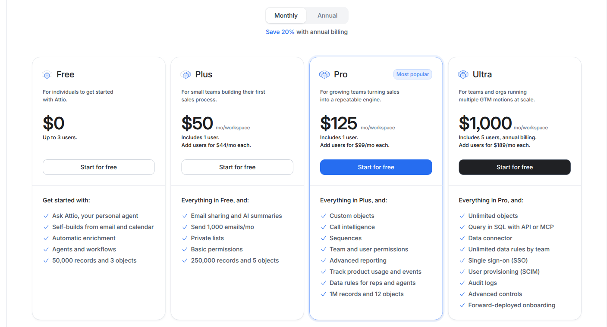

Attio Pro charges a workspace fee that includes one seat, then charges for each additional seat. Flexprice can represent those as two fixed monthly charges on one subscription.

<Frame caption="Attio monthly plan comparison from the official site, 2026-11-25. This guide models only Pro monthly.">
  
</Frame>

[View the official pricing page](https://attio.com/pricing).

**Scope:** The USD monthly Attio Pro workspace fee and additional-seat rate for one workspace.

**Not modeled:** Annual pricing, other plans, credits, trials, add-ons, taxes, and mid-cycle changes or proration.

## Pricing profile

| Dimension | Modeled offering |
| --- | --- |
| Pricing model | Subscription; Per-seat |
| Industry | Customer relationship management |
| Buyer | Sales and revenue operations teams |
| Sales motion | Self-serve |
| Billing mechanics | Monthly workspace fee; First seat included; Additional purchased seats; Advance billing |

## What Attio charges

| Item | Published terms | Flexprice implication |
| --- | --- | --- |
| Pro workspace | $125 USD per month on monthly billing, including one seat | One fixed base line per workspace |
| Additional seats | $99 USD per additional seat per month | Multiply only by seats beyond the first |
| Seat accounting | Purchased seats can hold an active member or pending invite, and can be vacant | Pass the purchased quantity, not a count of active CRM users |
| Invoice timing | Each workspace is billed separately at the start of its interval | One monthly subscription in advance per workspace |

## Design takeaways

1. **Charge for the workspace before counting extras.** Keep the first seat in the base price. A single flat price multiplied by all seats either double-charges the first seat or loses the workspace fee [Published terms](https://attio.com/pricing).
2. **Use a seat ledger per workspace.** Suspending a member frees their seat without changing what was bought. Track purchased capacity separately from assignments and calculate each workspace subscription independently [Published terms](https://attio.com/help/reference/workspace-settings-billing/billing-and-payments).

## How Attio's pricing maps to Flexprice

| Attio concept | Flexprice configuration |
| --- | --- |
| Workspace fee, first seat included | Fixed monthly price of $125.00 USD in advance |
| Additional Pro seat | Fixed monthly price of $99.00 USD in advance |

## Configure the plan and subscription

These requests are illustrative. Use your test environment and replace example IDs with the IDs returned by your setup. Create a [plan](/docs/product-catalogue/plans/create) with `POST /plans`:

```json
{
  "name": "Attio Pro monthly example",
  "lookup_key": "attio_pricing_example",
  "description": "The USD monthly Attio Pro workspace fee and additional-seat rate for one workspace"
}
```

Use `POST /prices` for each [fixed recurring price](/docs/product-catalogue/plans/pricing) below. Amounts are in USD for the full billing period, not cents.

```json
{
  "entity_type": "PLAN",
  "entity_id": "plan_attio_example",
  "currency": "usd",
  "price_unit_type": "FIAT",
  "billing_period": "MONTHLY",
  "billing_period_count": 1,
  "display_name": "Workspace fee, first seat included",
  "type": "FIXED",
  "billing_model": "FLAT_FEE",
  "invoice_cadence": "ADVANCE",
  "amount": "125.00"
}
```

```json
{
  "entity_type": "PLAN",
  "entity_id": "plan_attio_example",
  "currency": "usd",
  "price_unit_type": "FIAT",
  "billing_period": "MONTHLY",
  "billing_period_count": 1,
  "display_name": "Additional Pro seat",
  "type": "FIXED",
  "billing_model": "FLAT_FEE",
  "invoice_cadence": "ADVANCE",
  "amount": "99.00"
}
```

Calculate additional seats as purchased seats minus one. Pass that quantity on the extra-seat price, not on the workspace price. For a one-seat workspace, list only the returned workspace price ID in `include_price_ids` and omit the extra-seat override. Leaving the list out would attach both matching monthly prices.

Create or select the payer's customer record. When paid billing begins, use `POST /subscriptions` with that customer ID and the returned plan and price IDs. Where a quantity is needed, set it through a [line-item override](/docs/subscriptions/plan-price-overrides). To set up a subscription now without raising the advance invoice yet, [create a draft](/docs/core-concepts/subscriptions#choosing-a-subscription-start-date) and activate it when billing begins.

```json
{
  "customer_id": "cust_attio_example",
  "plan_id": "plan_attio_example",
  "currency": "usd",
  "billing_period": "MONTHLY",
  "billing_period_count": 1,
  "billing_cycle": "anniversary",
  "override_line_items": [
    {
      "price_id": "price_attio_2_example",
      "quantity": "3"
    }
  ],
  "include_price_ids": [
    "price_attio_1_example",
    "price_attio_2_example"
  ]
}
```

## Worked bill

A workspace has four purchased seats, three assigned and one vacant. Bill the $125.00 workspace fee once and three additional seats at $99.00 each: $125.00 + (3 × $99.00) = **$422.00** for the month. A single purchased seat costs **$125.00** because it is included.

Verify the fixed charge amounts and quantities on the opening invoice. No usage line should be present in this example.

## Pricing sources

- [Attio pricing](https://attio.com/pricing): Pro workspace and extra-seat rates.
- [Attio billing and payments](https://attio.com/help/reference/workspace-settings-billing/billing-and-payments): Billing at the start of the interval and purchased seat rules.

Pricing checked on 2026-11-25. This example does not reproduce a full provider invoice.

## Related guide

[Plan price overrides](/docs/subscriptions/plan-price-overrides)
