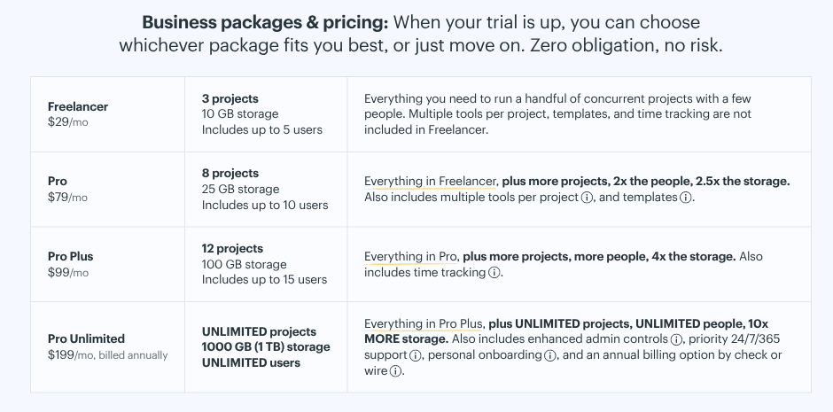

Basecamp Pro has a **$79 per month account fee** and includes up to 10 users, 8 active projects, and 25 GB of storage. The user cap does not make it a per-user plan. One fixed monthly price with quantity one models the account charge.

<Frame caption="Basecamp's complete desktop paid-package comparison. The guide models Pro, not Freelancer, Pro Plus or Pro Unlimited. Captured November 18, 2026. Source: Basecamp's official pricing page, linked below.">
  
</Frame>

[View the original pricing page](https://basecamp.com/pricing).

**Scope:** USD Basecamp Pro monthly account fee, with no package switching or additional storage.

**Not modeled:** Other packages, the trial, storage purchases, upgrades or downgrades during the month, refunds, discounts and taxes.

## Pricing profile

| Dimension | Modeled offering |
| --- | --- |
| Pricing model | Subscription |
| Industry | Project management |
| Buyer | Teams managing multiple projects |
| Sales motion | Self-serve |
| Billing mechanics | Fixed monthly account fee, User and active-project caps |

## What Basecamp charges

| Item | Published terms | Flexprice implication |
| --- | --- | --- |
| Pro account | $79 per month | One recurring price per account |
| Users | Up to 10 users, no per-user fee | Enforce the package limit outside the price |
| Active projects | Up to 8; archived or deleted projects do not count | Check active projects rather than all historical projects |
| Storage | 25 GB included | Separate product limit, no storage charge configured here |

## Design takeaways

1. **Do not multiply the fee by users.** The charge buys the package, not individual seats. Five users and ten users pay the same base fee if they meet the other limits. See [the published terms](https://basecamp.com/pricing).
2. **Count active projects for access, not invoicing.** Archiving a project can create room under the limit without changing the monthly price. Enforce the limit when projects are activated rather than summing project events for billing. See [the published terms](https://basecamp.com/pricing).
3. **Change packages instead of charging an invented overage.** The published Pro limits describe where the package stops fitting. A team that needs more room should choose a suitable package; the Pro price below does not sell extra users or projects. See [the published terms](https://basecamp.com/pricing).

## How Basecamp's pricing maps to Flexprice

| Basecamp concept | Flexprice configuration |
| --- | --- |
| Pro account | Fixed monthly price of $79 per billable unit |
| Billable quantity | Subscription line-item quantity; no usage meter |
| Billing schedule | One monthly period, invoiced in advance |

## Set up the fixed subscription

Use the Flexprice API only in your own test environment. Replace the illustrative IDs with the IDs returned by your setup. Create a [plan](/docs/product-catalogue/plans/create) with `POST /plans`:

```json
{
  "name": "Basecamp Pro Monthly example",
  "lookup_key": "basecamp_pricing_example",
  "description": "USD Basecamp Pro monthly account fee, with no package switching or additional storage"
}
```

Create the [fixed price](/docs/product-catalogue/plans/pricing) with `POST /prices`. The amount is in USD, not cents, and is the unit amount for the entire billing period:

```json
{
  "entity_type": "PLAN",
  "entity_id": "plan_basecamp_example",
  "type": "FIXED",
  "billing_model": "FLAT_FEE",
  "billing_period": "MONTHLY",
  "billing_period_count": 1,
  "invoice_cadence": "ADVANCE",
  "currency": "usd",
  "price_unit_type": "FIAT",
  "amount": "79",
  "display_name": "Pro Monthly Pro account"
}
```

Create one customer for the billing account, then call `POST /subscriptions` with that customer, the plan and its fixed price. The [quantity override](/docs/subscriptions/plan-price-overrides) applies to the fixed line item.

```json
{
  "customer_id": "cust_basecamp_example",
  "plan_id": "plan_basecamp_example",
  "currency": "usd",
  "billing_period": "MONTHLY",
  "billing_period_count": 1,
  "billing_cycle": "anniversary",
  "start_date": "2026-12-01T00:00:00Z",
  "override_line_items": [
    {
      "price_id": "price_basecamp_example",
      "quantity": "1"
    }
  ]
}
```

Keep the subscription line item at quantity one whether the account has one user or ten. Enforce the 10-user, 8-active-project and 25 GB limits separately.

## Worked bill

One Pro account × $79 per month = $79 for the full month. The invoice base is **$79** for quantity **1**, before excluded charges or adjustments.

## Pricing sources

- [Basecamp pricing](https://basecamp.com/pricing): Paid-package comparison, active project cap, storage and included users.

Pricing checked on 2026-11-18. Recheck the source before implementing. This is illustrative configuration, not a recreation of a full provider invoice.

## Related guide

[Plan price overrides](/docs/subscriptions/plan-price-overrides)
