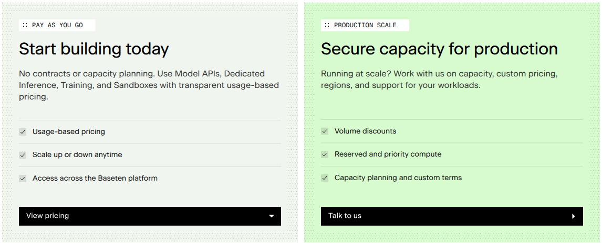
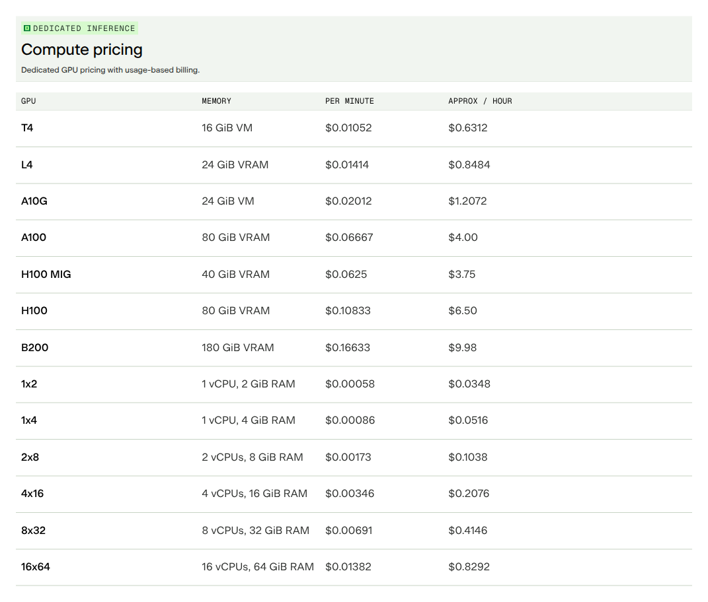

Baseten lists **T4 dedicated inference at $0.01052 per minute**, with an approximate hourly equivalent of **$0.6312**. The billable quantity is running replica time, not prediction requests or generated tokens. This guide maps finalized T4 replica-minute usage to one Flexprice meter and usage price.

<Frame caption="Baseten's complete purchasing-option cards, captured on November 12, 2026. The pay-as-you-go path is the context for this example; production-scale capacity, discounts and custom terms are not modeled.">
  
</Frame>

<Frame caption="Baseten's complete Dedicated Inference compute comparison, captured on November 12, 2026. All hardware rows and both per-minute and approximate hourly columns are visible. Only the T4 row is modeled; other GPU and CPU shapes are comparison context.">
  
</Frame>

Source: [Baseten's official pricing page](https://www.baseten.co/pricing/).

<Note>
  This example calculates gross USD list-price charges for dedicated inference replicas using the T4 configuration. It excludes Model API tokens, training, other hardware, Sandboxes, storage, network charges, credits, discounts, tax and custom regions or contracts. Monthly arrears is the illustrative Flexprice billing cycle, not a claim about Baseten's collection schedule. No live deployment or billing setup is executed.
</Note>

## Pricing profile

These labels describe the dedicated T4 inference offering, not every Baseten product or purchasing path.

| Dimension | Offering profile |
| --- | --- |
| Pricing model | [Usage-based](https://www.baseten.co/pricing/) |
| Industry | [AI inference infrastructure](https://www.baseten.co/pricing/) |
| Buyer | [Developers operating model deployments](https://docs.baseten.co/deployment/autoscaling/overview) |
| Sales motion | [Self-serve pay-as-you-go; Separate sales-assisted capacity option](https://www.baseten.co/pricing/) |
| Billing mechanics | [Per-minute running-replica metering; Startup is billable; Scale-to-zero](https://docs.baseten.co/deployment/autoscaling/overview) |

## Published pricing and billing measure

| Item | Published term | Source |
| --- | --- | --- |
| T4 dedicated inference | $0.01052 per minute | [Compute pricing](https://www.baseten.co/pricing/) |
| T4 hourly display | Approximately $0.6312 per hour | [Compute pricing](https://www.baseten.co/pricing/) |
| Meter boundary | Each running replica is billed by the minute | [Autoscaling](https://docs.baseten.co/deployment/autoscaling/overview) |
| Startup | Starting and loading a replica is billable, before responses are served | [Replica lifecycle](https://docs.baseten.co/deployment/autoscaling/overview) |
| Zero replicas | No running-replica GPU charge at zero replicas | [Scale-to-zero](https://docs.baseten.co/deployment/autoscaling/overview) |

Baseten defines a replica as an independent model instance on its own hardware. Two T4 replicas running for 60 billable minutes each contribute **120 replica minutes**, not 60. A warm replica waiting for requests remains running. Do not meter only request-serving latency or interpret zero requests as zero compute usage.

Use the published **per-minute** price directly. The hourly column is a comparison aid, not an instruction to round each replica into hourly packages. This example starts from finalized billable minute quantities. The cited sources do not establish a partial-minute rounding algorithm, so it does not invent a per-start ceiling, minimum or second-level proration rule.

## Design takeaways

1. **Capacity time and request activity are different measures.** Baseten [bills running replicas and their startup](https://docs.baseten.co/deployment/autoscaling/overview). A request counter would miss warm idle time and loading time. The collector must supply billable capacity time, including intervals with no predictions.
2. **Aggregate across replicas, not just the deployment clock.** The [replica definition](https://docs.baseten.co/deployment/autoscaling/overview) gives every instance its own hardware. Sum each replica's billable minutes before applying the rate. Otherwise a two-replica deployment could be charged like a single replica.
3. **Keep a hardware rate separate from the purchasing agreement.** The [pricing page](https://www.baseten.co/pricing/) separates public compute rates from volume discounts and secured capacity. A filtered list-price usage line can reproduce the T4 calculation without pretending to implement negotiated commitments or credits.

## How Baseten's pricing maps to Flexprice

| Baseten's pricing uses | Flexprice setup |
| --- | --- |
| Dedicated inference on T4 hardware | Filter a [metered feature](/docs/product-catalogue/features/create) by `product = dedicated_inference` and `hardware = T4` |
| Billable time summed across replicas | SUM over `billable_replica_minutes`, not COUNT of events |
| $0.01052 per replica minute | One [flat-fee usage charge](/docs/product-catalogue/plans/billing-models/flat-fee) with decimal amount `0.01052` |
| A deployment can scale to zero | Send no positive time for a zero-replica interval; do not remove earlier usage from the period |
| Gross usage before commercial adjustments | No fixed fee, credit grant, discount or commitment in this scoped example |

The event fields below are integration-defined, not Baseten API response fields. Use one Flexprice customer for the account being billed. Collect nonoverlapping, finalized usage intervals from an authoritative billing measurement. Preserve the provider's treatment of startup, idle running time and partial minutes before ingestion.

## Configure the T4 meter

Create one metered feature. Both filters must match:

```json
{
  "name": "Baseten dedicated T4 replica minutes",
  "lookup_key": "baseten_dedicated_t4_replica_minutes",
  "type": "metered",
  "unit_singular": "replica minute",
  "unit_plural": "replica minutes",
  "meter": {
    "name": "Baseten dedicated T4 replica minutes",
    "event_name": "baseten_compute_usage",
    "reset_usage": "BILLING_PERIOD",
    "aggregation": { "type": "SUM", "field": "billable_replica_minutes" },
    "filters": [
      { "key": "product", "values": ["dedicated_inference"] },
      { "key": "hardware", "values": ["T4"] }
    ]
  }
}
```

Keep training and other hardware out of this meter even when they use the same account or share a displayed rate. If a deployment changes hardware, separate its usage by hardware before emitting events. Save the meter ID returned with the feature; the price references that meter ID, not the feature ID.

## Create the example plan and usage price

Create a USD plan:

```json
{
  "name": "Baseten Dedicated T4 Example",
  "lookup_key": "baseten_dedicated_t4_example",
  "description": "Gross list-price dedicated T4 inference replica-minute charges"
}
```

Replace the illustrative IDs with the returned plan and meter IDs:

```json
{
  "entity_type": "PLAN",
  "entity_id": "plan_baseten_t4_example",
  "meter_id": "meter_baseten_t4_minutes_example",
  "type": "USAGE",
  "price_unit_type": "FIAT",
  "billing_model": "FLAT_FEE",
  "amount": "0.01052",
  "currency": "usd",
  "billing_period": "MONTHLY",
  "billing_period_count": 1,
  "invoice_cadence": "ARREAR",
  "display_name": "Dedicated T4 replica minutes"
}
```

Subscribe the example customer to this plan with a monthly period. The usage price multiplies finalized minute quantities directly. Do not configure hourly packages, an additional GPU-count multiplier or another T4 compute price for the same usage.

## Ingest finalized replica-minute usage

Suppose two T4 replicas each contribute 60 billable minutes in a finalized interval. Send one aggregate event for their combined 120 replica minutes:

```json
{
  "event_name": "baseten_compute_usage",
  "event_id": "evt_baseten_t4_interval_0001",
  "external_customer_id": "customer_inference_001",
  "timestamp": "2026-11-12T04:00:00Z",
  "properties": {
    "product": "dedicated_inference",
    "hardware": "T4",
    "deployment_id": "deployment_t4_example",
    "billable_replica_minutes": "120"
  }
}
```

This event contributes `120 × 0.01052 = 1.2624` USD before invoice-level currency rounding. Alternatively, send each replica's 60-minute increment separately with distinct stable event IDs. Do not send both the aggregate and its component events. Do not repeatedly emit a month-to-date total into a SUM meter.

Split usage at the billing-period boundary before ingestion. Retry the same interval with the same event ID instead of creating duplicate usage. Hold missing or uncertain billing measurements for reconciliation rather than deriving them from request latency. This example does not prescribe a Baseten usage-export endpoint.

## Work through a compute bill

Assume the account's finalized T4 inference usage for one example monthly period is:

| Usage source | Billable replica minutes | Rate per minute | Gross charge |
| --- | --- | --- | --- |
| Replica A, including startup and idle running time | 6,000 | $0.01052 | $63.12 |
| Replica B, including startup and idle running time | 4,000 | $0.01052 | $42.08 |
| **Total** | **10,000** | | **$105.20** |

The exact calculation is `10,000 × 0.01052 = 105.20` USD. Stopping both replicas at the end of the period stops additional running-replica usage; it does not erase the 10,000 minutes already consumed. Credits, discounts and tax could change the amount collected, but are not part of this gross-charge example.

Before extending the setup, verify these cases:

- **Zero billable minutes:** compute charge is zero, without claiming other account charges are zero.
- **One replica for 60 billable minutes:** `60 × 0.01052 = 0.6312` USD, matching the published hourly comparison.
- **Two replicas for 60 billable minutes each:** `120 × 0.01052 = 1.2624` USD.
- **Training or non-T4 usage:** it fails the meter filters and contributes nothing to this line.

## Pricing sources

Pricing checked on 2026-11-12.

- [Baseten pricing](https://www.baseten.co/pricing/): current purchasing paths, Dedicated Inference compute prices and separate product rate tables.
- [Baseten autoscaling](https://docs.baseten.co/deployment/autoscaling/overview): per-replica minute billing, billable startup, idle capacity and scale-to-zero behavior.

This is a reproducible configuration example for a usage calculation, not a full recreation of Baseten's invoice or deployment lifecycle. Validate partial-minute treatment, rate changes, credits and collection timing separately before applying it to a production account.

<Card icon="gauge" horizontal={true} href="/cookbooks/billing-recipes/usage-based-pricing" title="Usage-based pricing recipe">
  Configure meters and usage prices for a consumption-based product.
</Card>
