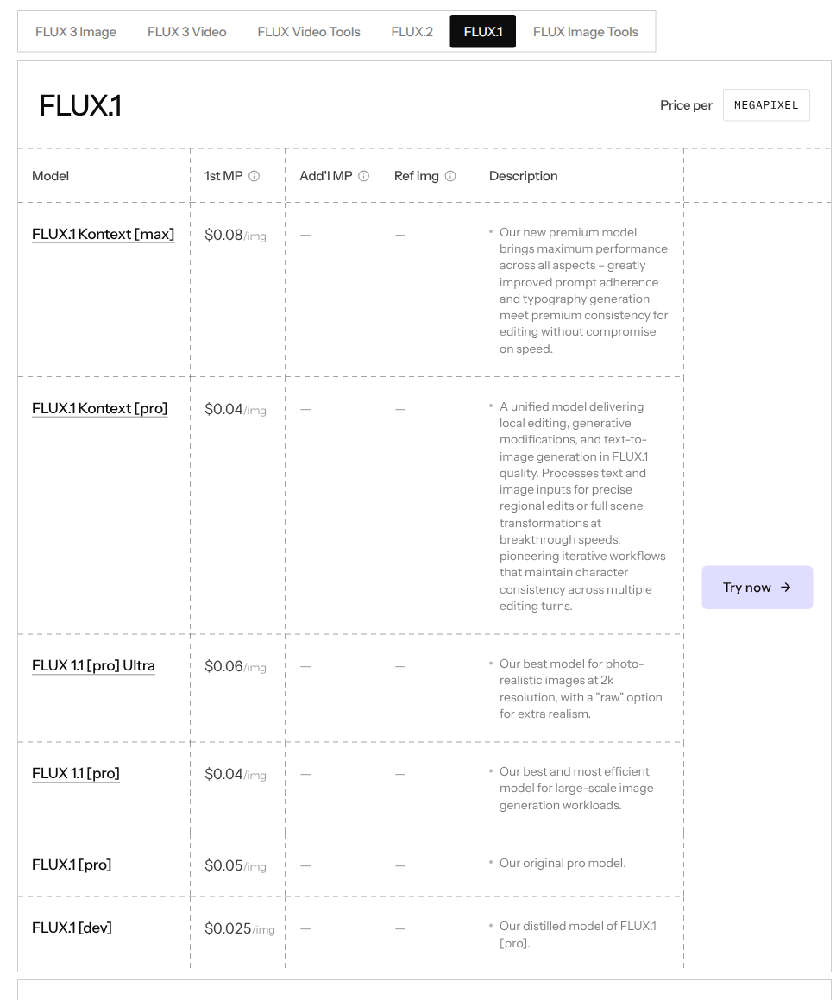

Black Forest Labs lists **FLUX1.1 [pro] at $0.04 per image**, equivalent to **4 credits** at **$0.01 per credit**. This guide models that direct API image-generation charge with a model-filtered SUM meter and one constant usage rate. It calculates gross consumption, not the purchase or movement of prepaid credits.

<Frame caption="Black Forest Labs' complete FLUX.1 model-price comparison, captured on November 16, 2026. The selected model-family tab, all six model rows, prices, units, descriptions and table bottom are visible. Only standard FLUX1.1 [pro] is modeled; Kontext, Ultra and the other models are comparison context.">
  
</Frame>

Sources: [official pricing comparison](https://bfl.ai/pricing) and [model prices and credit conversion](https://docs.bfl.ai/quick_start/pricing).

<Note>
  This example uses USD and covers standard FLUX1.1 [pro] through the direct API, not FLUX1.1 Ultra or Raw, Kontext, FLUX.2, FLUX 3, editing tools, third-party hosting, open-weights licensing or enterprise contracts. It excludes credit purchases, auto top-up, transfers, refunds, expiry, promotional balances, discounts and taxes. Monthly arrears is an illustrative Flexprice aggregation and invoice choice, not Black Forest Labs' prepaid collection workflow. No live setup was executed.
</Note>

## Pricing profile

These labels describe the selected self-serve API charge, not every purchasing path or product.

| Dimension | Offering profile |
| --- | --- |
| Pricing model | [Usage-based](https://bfl.ai/pricing) |
| Industry | [AI image generation](https://docs.bfl.ai/flux_models/flux_1_1_pro) |
| Buyer | [Developers integrating image generation](https://docs.bfl.ai/flux_models/flux_1_1_pro) |
| Sales motion | [Self-serve](https://docs.bfl.ai/quick_start/get_started) |
| Billing mechanics | [Per-image rate; Model-specific metering](https://docs.bfl.ai/quick_start/pricing); [Prepaid organization credit pool, not configured here](https://docs.bfl.ai/account_management/credits_billing) |

## FLUX1.1 [pro] pricing

| Item | Published rule | Treatment in this example |
| --- | --- | --- |
| Standard FLUX1.1 [pro] | $0.04 per image, or 4 credits | One raw image unit costs $0.04 |
| Credit conversion | 1 credit = $0.01 USD | Reconciliation check only; no second charge for credits |
| API endpoint | `/flux-pro-1.1` | Explicit meter filter distinguishes this model from other endpoints |
| Generation flow | Submit a request, receive a polling URL, then poll for the result | Count finalized billable images, not polling requests |
| Credit scope | Organization credits are shared across projects; project usage is tracked separately | One example customer represents one organization; project ID is attribution, not an allowance |
| Collection | Purchase credits; optional threshold-triggered auto top-up | Not implemented by the monthly usage price |

The [pricing documentation](https://docs.bfl.ai/quick_start/pricing) explicitly labels the amount **per image**. Use that model-specific unit, not the pricing site's generic megapixel column headings, and do not apply the resolution pricing of other model families to this example. There is no fixed subscription fee, included-image allowance or volume tier configured here.

The [generation guide](https://docs.bfl.ai/flux_models/flux_1_1_pro) describes asynchronous submission and polling. A `Ready` result makes the image available, but the [status reference](https://docs.bfl.ai/api_integration/errors) also includes pending, moderation and error states. It does not establish a complete charging or refund policy for every state. Reconcile billability upstream rather than treating every HTTP request, retry or status poll as a new image charge.

## Design takeaways

1. **Price the output, not the transport.** One generation can require several status polls. The published unit is an image, so a SUM of finalized image counts preserves the rate while counting API calls would inflate it. The premise comes from the [per-image table](https://docs.bfl.ai/quick_start/pricing) and [asynchronous generation flow](https://docs.bfl.ai/flux_models/flux_1_1_pro).
2. **Keep the model identity in the billing key.** Standard and Ultra have separate rows and rates in the [model comparison](https://bfl.ai/pricing). An endpoint filter prevents a broader image-event stream from silently applying the standard rate to another model. Price resolution-sensitive families separately rather than introducing an unsupported multiplier here.
3. **Separate consumption value from funding.** Credits are shared at the organization level, while project usage remains attributable. A $50 consumption total is not necessarily a $50 credit purchase in that month. The [credit-management workflow](https://docs.bfl.ai/account_management/credits_billing) requires a separate balance and funding layer if the goal is to reproduce prepaid collection.

## How Black Forest Labs' pricing maps to Flexprice

| Black Forest Labs concept | Flexprice configuration |
| --- | --- |
| Standard FLUX1.1 [pro] | One metered feature, filtered to `endpoint: "flux-pro-1.1"` |
| Billable generated images | `SUM` of `billable_images`, retaining raw image units |
| $0.04 per image | `USAGE` price with `billing_model: "FLAT_FEE"` and `amount: "0.04"` |
| Organization-level attribution | One external customer per organization in this example |
| Projects within that organization | Event `project_id`; not a filter that excludes other projects in the same customer |
| Four credits per image | Informational equivalent of the USD charge, not a second priced meter |
| Prepaid credits and auto top-up | Separate funding workflow, excluded |

`FLAT_FEE` means a constant rate for each image when paired with `type: "USAGE"`. It does not add a monthly subscription fee. There is no package rounding, reporting-unit conversion or included tier.

## Create the image feature

The following request bodies are illustrative. Use your Flexprice environment's API base URL and authentication, and replace example IDs with returned IDs. Create the feature with `POST /features`:

```json
{
  "name": "FLUX1.1 pro billable images",
  "lookup_key": "bfl_flux_1_1_pro_images",
  "type": "metered",
  "unit_singular": "image",
  "unit_plural": "images",
  "meter": {
    "name": "FLUX1.1 pro billable images",
    "event_name": "bfl_image_generation",
    "reset_usage": "BILLING_PERIOD",
    "aggregation": { "type": "SUM", "field": "billable_images" },
    "filters": [
      { "key": "endpoint", "values": ["flux-pro-1.1"] },
      { "key": "billing_scope", "values": ["direct_api_example"] }
    ]
  }
}
```

Both filters must match. Capture the returned **meter ID** for the price; a feature ID is not interchangeable with a meter ID. `billing_scope` is an application-defined routing label, not a provider response field.

## Configure the usage-only plan

Create a plan with `POST /plans`:

```json
{
  "name": "FLUX1.1 pro image usage example",
  "lookup_key": "bfl_flux_1_1_pro_usage_example",
  "description": "Gross image-generation value only; no prepaid credit collection"
}
```

Create one price with `POST /prices`, substituting the returned plan and meter IDs:

```json
{
  "entity_type": "PLAN",
  "entity_id": "plan_bfl_flux_1_1_pro_example",
  "meter_id": "meter_bfl_flux_1_1_pro_images_example",
  "type": "USAGE",
  "price_unit_type": "FIAT",
  "billing_model": "FLAT_FEE",
  "amount": "0.04",
  "currency": "usd",
  "billing_period": "MONTHLY",
  "billing_period_count": 1,
  "invoice_cadence": "ARREAR",
  "display_name": "FLUX1.1 pro generated images"
}
```

Add an unlimited [metered entitlement](/docs/product-catalogue/features/linking-to-plans) for the feature, then create a customer and a [subscription](/docs/subscriptions/customers-create-subscription) to the plan with quantity **1**. Unlimited access is not free usage. The monthly usage price calculates consumption value; it does not reject requests when a prepaid balance is exhausted or replenish that balance.

## Send normalized image usage

Your server must normalize provider activity into finalized billable image quantities. The `billable_images` property below is your integration's field, not a field promised by the provider API.

| Source or decision | Normalized property |
| --- | --- |
| Exact generation endpoint used | `endpoint` |
| Finalized billable output count | `billable_images` |
| Stable generation identity | `generation_id` and a stable `event_id` |
| Owning organization | `external_customer_id` |
| Project used for generation | `project_id` |

Send one incremental event per finalized generation with `POST /events`:

```json
{
  "event_name": "bfl_image_generation",
  "event_id": "evt_bfl_generation_0001",
  "external_customer_id": "customer_visual_org_001",
  "timestamp": "2026-11-16T04:00:00Z",
  "properties": {
    "endpoint": "flux-pro-1.1",
    "billing_scope": "direct_api_example",
    "project_id": "project_visual_app_example",
    "generation_id": "generation_0001",
    "billable_images": "1"
  }
}
```

Reuse the same event identity when retrying delivery of the same usage. Do not emit another image event for each poll, redownload, replayed callback or cumulative dashboard snapshot. Hold unresolved billability for reconciliation; failure adjustments and refunds need a separate verified workflow and are outside this example.

## Worked monthly charge

Assume one organization has **1,250 finalized billable images** from standard FLUX1.1 [pro] in the illustrative monthly period, across any number of its projects:

| Component | Calculation | Charge |
| --- | --- | --- |
| Generated images | 1,250 × $0.04 | $50.00 |
| Fixed fee | Not configured | $0.00 |
| Gross consumption total | $50.00 + $0.00 | **$50.00** |

Credit cross-check: `1,250 × 4 = 5,000 credits`, and `5,000 × $0.01 = $50.00`. These are two representations of the same consumption, not additive charges. The organization's credit purchases and remaining balance are separate from this total.

Boundary checks:

- **0 images:** $0.00. No minimum or fixed charge is introduced.
- **1 image:** $0.04, not a minimum pack or a megapixel charge.
- **25 images:** $1.00, equivalent to 100 credits.
- **1,251 images:** $50.04. Each additional image adds $0.04.
- **750 + 500 images from two projects:** still $50.00 for the same organization.
- An event for `flux-pro-1.1-ultra` does not match this meter; price it separately if added later.

## Pricing sources

Pricing checked on 2026-11-16.

- [Black Forest Labs pricing](https://bfl.ai/pricing): selected FLUX.1 comparison, standard rate and other model context.
- [Pricing overview](https://docs.bfl.ai/quick_start/pricing): 4 credits and $0.04 per standard FLUX1.1 [pro] image; $0.01 per credit.
- [FLUX1.1 [pro] generation](https://docs.bfl.ai/flux_models/flux_1_1_pro): endpoint, submission and polling flow.
- [Quick start](https://docs.bfl.ai/quick_start/get_started): self-serve account creation, credits and API keys.
- [Credits and billing](https://docs.bfl.ai/account_management/credits_billing): shared organization pool, project attribution and optional auto top-up.
- [Error and result statuses](https://docs.bfl.ai/api_integration/errors): pending, ready, moderation and error states; not a full billability policy.

For a complete funding model, see [credit-based pricing](/cookbooks/billing-recipes/credit-based-pricing). For the usage primitives used here, see [usage-based pricing](/cookbooks/billing-recipes/usage-based-pricing).
