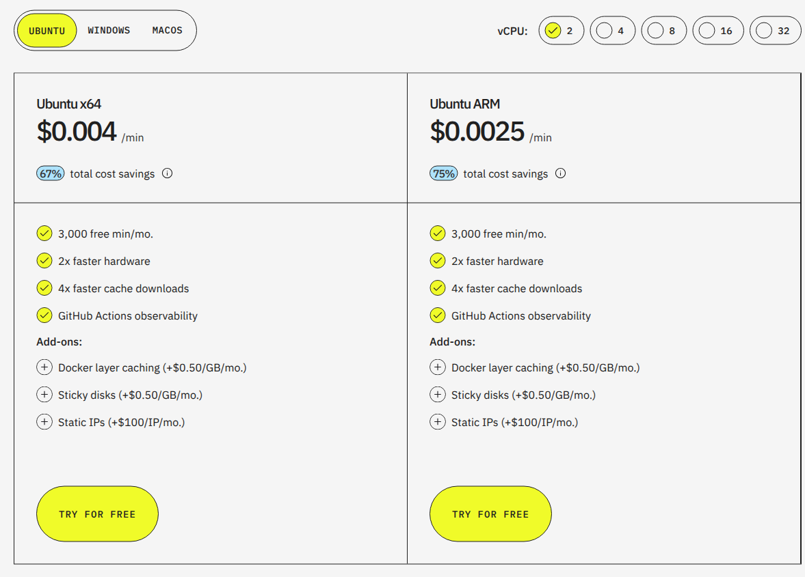

Blacksmith lists **$0.004 per minute** for its 2-vCPU Ubuntu x64 runner and includes **3,000 x64 2-vCPU minutes per organization per month**. For an organization using only that runner, a zero-priced tier followed by a paid tier models the compute charge without a separate subscription fee.

<Frame caption="Blacksmith's complete Ubuntu runner comparison with 2 vCPU selected. Only Ubuntu x64 at standard rates is modeled. Captured November 18, 2026. Source: Blacksmith's official pricing page, linked below.">
  
</Frame>

[View the original pricing page](https://www.blacksmith.sh/pricing).

**Scope:** Pay-as-you-go compute for one organization using only standard 2-vCPU Ubuntu x64 runners.

**Not modeled:** Mixed runner families or sizes, flex scheduling, enterprise terms, storage, caching and static IP add-ons, any promotional discounts and taxes.

## Pricing profile

| Dimension | Modeled offering |
| --- | --- |
| Pricing model | Usage-based, Tiered pricing |
| Industry | Continuous integration infrastructure |
| Buyer | Teams running GitHub Actions |
| Sales motion | Self-serve |
| Billing mechanics | Organization-wide monthly allowance, Per-minute overage |

## What Blacksmith charges

| Item | Published terms | Flexprice implication |
| --- | --- | --- |
| Standard runner rate | $0.004 per minute for Ubuntu x64 at 2 vCPU | Apply only above the free tier |
| Monthly allowance | 3,000 x64 2-vCPU minute equivalents per organization | Use one monthly meter pool across the organization's repositories |
| Other runners | Different sizes and architectures consume different quantities of the shared allowance | Do not grant separate free tiers per runner in a mixed fleet |
| Usage contract | Reporting distinguishes billable minutes from runtime | Supply finalized rated minutes before applying the allowance, not raw build duration or minutes already net of the allowance |

## Design takeaways

1. **Give the allowance to the organization.** A per-repository subscription would multiply the published 3,000-minute allowance. Keep repository as event context, with one billing customer and one subscription for the organization. See [the published terms](https://docs.blacksmith.sh/blacksmith-runners/overview).
2. **Separate runtime from rating.** Use the provider-equivalent billed quantity, not the number of jobs or raw elapsed time. Do not infer how partial minutes are rounded from a per-minute sticker price. See [the published terms](https://docs.blacksmith.sh/blacksmith-cli/usage).
3. **Model a single denomination before mixing runners.** The x64-only subset avoids conversion. A multi-runner model needs a shared normalized pool rather than a fresh allowance on every meter. See [the published terms](https://docs.blacksmith.sh/blacksmith-runners/overview).

## How Blacksmith's pricing maps to Flexprice

| Blacksmith concept | Flexprice configuration |
| --- | --- |
| billable runner minutes | SUM of `runner_minutes` on eligible usage events |
| Eligible usage | Filter by `runner_sku`, `rate_class`, `billing_scope` |
| Usage price | Graduated tier: first 3,000 units free, then $0.004 per unit |
| Account | One metered subscription with no fixed fee |

## Configure the metered subscription

These examples are illustrative. Replace example IDs with IDs returned by your Flexprice environment. Create a [metered feature](/docs/product-catalogue/features/linking-to-plans) with `POST /features`:

```json
{
  "name": "Blacksmith billable runner minutes",
  "lookup_key": "blacksmith_rated_usage",
  "type": "metered",
  "meter": {
    "name": "Blacksmith billable runner minutes",
    "event_name": "blacksmith_rated_usage",
    "reset_usage": "BILLING_PERIOD",
    "aggregation": {
      "type": "SUM",
      "field": "runner_minutes"
    },
    "filters": [
      {
        "key": "runner_sku",
        "values": [
          "ubuntu_x64_2vcpu"
        ]
      },
      {
        "key": "rate_class",
        "values": [
          "standard"
        ]
      },
      {
        "key": "billing_scope",
        "values": [
          "blacksmith_example"
        ]
      }
    ]
  }
}
```

Create the [plan](/docs/product-catalogue/plans/create) with `POST /plans`:

```json
{
  "name": "Blacksmith 2-vCPU Ubuntu x64 example",
  "lookup_key": "blacksmith_pricing_example",
  "description": "Pay-as-you-go compute for one organization using only standard 2-vCPU Ubuntu x64 runners"
}
```

Create the usage price with `POST /prices`. Use the returned meter ID, not the feature ID. The USD price bills at the end of each period:

```json
{
  "entity_type": "PLAN",
  "entity_id": "plan_blacksmith_example",
  "type": "USAGE",
  "billing_model": "TIERED",
  "billing_period": "MONTHLY",
  "billing_period_count": 1,
  "invoice_cadence": "ARREAR",
  "currency": "usd",
  "price_unit_type": "FIAT",
  "display_name": "2-vCPU Ubuntu x64 billable runner minutes",
  "meter_id": "meter_blacksmith_example",
  "tier_mode": "SLAB",
  "tiers": [
    {
      "up_to": 3000,
      "unit_amount": "0"
    },
    {
      "up_to": null,
      "unit_amount": "0.004"
    }
  ]
}
```

Send all eligible rated minutes before the monthly allowance. The graduated tier prices the first 3,000 at zero and applies the paid rate only above that. Do not subtract free minutes upstream or grant a second allowance.

Create one customer for the account. If you configure a metered entitlement, make it unlimited so it does not cap the priced usage. Start the [subscription](/docs/subscriptions/customers-create-subscription) with `POST /subscriptions`:

```json
{
  "customer_id": "cust_blacksmith_example",
  "plan_id": "plan_blacksmith_example",
  "currency": "usd",
  "billing_period": "MONTHLY",
  "billing_period_count": 1,
  "billing_cycle": "anniversary",
  "start_date": "2026-12-01T00:00:00Z"
}
```

### Send finalized usage

Set `external_customer_id` to the external ID of the same customer used on the subscription. The [event](/docs/core-concepts/usage-events/sending-events) uses integration-defined properties, not a provider response:

```json
{
  "event_name": "blacksmith_rated_usage",
  "event_id": "evt_blacksmith_0001",
  "external_customer_id": "account_blacksmith_example",
  "timestamp": "2026-12-02T12:00:00Z",
  "properties": {
    "runner_sku": "ubuntu_x64_2vcpu",
    "rate_class": "standard",
    "billing_scope": "blacksmith_example",
    "repository_id": "repo_example",
    "runner_minutes": "23"
  }
}
```

Use finalized gross runner minutes for eligible standard jobs before deducting free minutes. Use the provider's billing quantity or a reconciled equivalent. The cited rate does not establish a partial-minute rounding algorithm. Align the subscription period to the applicable monthly allowance period; examples assume complete months.

Keep the same event ID and original timestamp when retrying. Do not emit both individual records and an interval total covering the same usage. Aggregate before rounding currency.

## Worked bill

Of 4,250 rated minutes in one organization-month, 3,000 are included. The remaining 1,250 × $0.004 = $5.00. At 3,001 minutes only one minute is paid ($0.004 before currency rounding).

## Pricing sources

- [Blacksmith pricing](https://www.blacksmith.sh/pricing): Ubuntu 2-vCPU card rate and included minutes.
- [Blacksmith billing documentation](https://docs.blacksmith.sh/blacksmith-runners/overview): Monthly organization allowance in 2-vCPU x64 equivalents.
- [Blacksmith usage reporting](https://docs.blacksmith.sh/blacksmith-cli/usage): Reporting distinguishes billable minutes and raw runtime.

Pricing checked on 2026-11-18. Recheck the source before implementing. This is illustrative configuration, not a recreation of a full provider invoice.

## Related guide

[Usage-based pricing recipe](/cookbooks/billing-recipes/usage-based-pricing)
