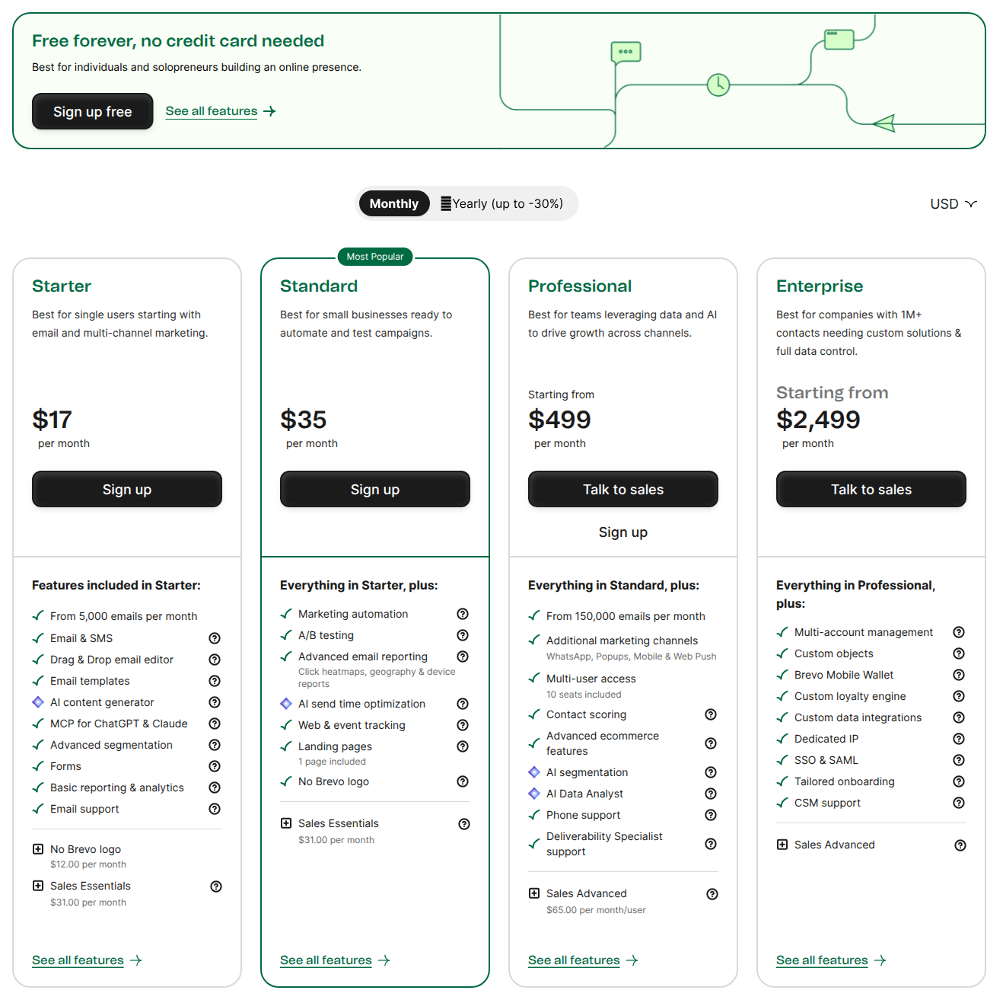
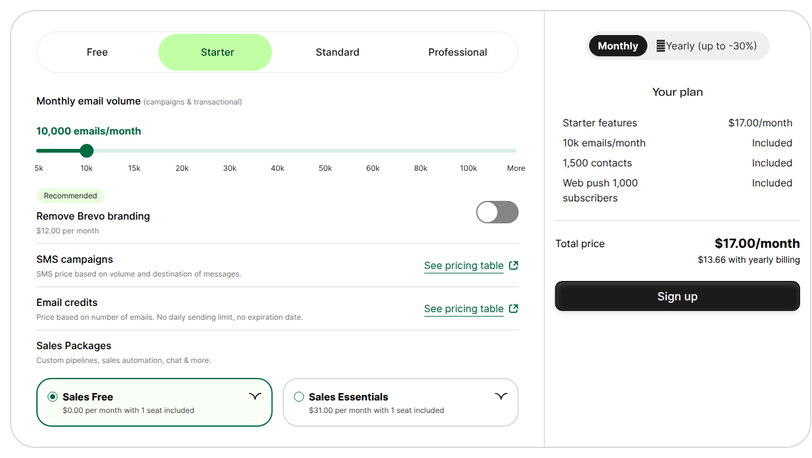

Brevo Starter lets the customer buy a monthly email volume. Flexprice can bill the selected package as one recurring price while the application tracks consumption of its allowance.

<Frame caption="Brevo monthly plan comparison from the official site, 2026-11-26. This guide models only Starter monthly at 10,000 sends.">
  
</Frame>

<Frame caption="Brevo Starter package calculator from the official site, 2026-11-26. This guide models only Starter monthly at 10,000 sends.">
  
</Frame>

[View the official pricing page](https://www.brevo.com/pricing/).

**Scope:** The USD Starter monthly calculator selection with 10,000 emails and 1,500 contacts.

**Not modeled:** Yearly pricing, discounts, the free offer, other packages, SMS, pay-as-you-go credits, add-ons, mid-cycle changes, and taxes.

## Pricing profile

| Dimension | Modeled offering |
| --- | --- |
| Pricing model | Subscription; Tiered pricing |
| Industry | Email and multichannel marketing |
| Buyer | Small businesses and individual marketers |
| Sales motion | Self-serve |
| Billing mechanics | Monthly prepaid package; Email volume and contact capacity |

## What Brevo charges

| Item | Published terms | Flexprice implication |
| --- | --- | --- |
| Starter package | $17 USD on monthly billing for the selected 10,000-email volume | Bill one recurring price for the selected package |
| Capacity | The calculator selection includes 10,000 campaign and transactional sends per month and 1,500 contacts | Track the monthly send balance and the contact ceiling independently |
| Pay as you go | Email credits are offered separately and do not expire | Keep any purchased credit balance outside this recurring package |

## Design takeaways

1. **Bill the purchased volume.** A customer selects the monthly package before sending. Keep the package fee constant for in-band usage and use send events to decrement its allowance [Published terms](https://www.brevo.com/pricing/).
2. **Separate recurring capacity from email credits.** The recurring volume is monthly while separately bought credits do not expire. A single counter with a monthly reset would erase any unused purchased credits [Published terms](https://www.brevo.com/pricing/).

## How Brevo's pricing maps to Flexprice

| Brevo concept | Flexprice configuration |
| --- | --- |
| Starter 10,000-send package | Fixed monthly price of $17.00 USD in advance |

## Configure the plan and subscription

These requests are illustrative. Use your test environment and replace example IDs with the IDs returned by your setup. Create a [plan](/docs/product-catalogue/plans/create) with `POST /plans`:

```json
{
  "name": "Brevo Starter monthly at 10,000 sends example",
  "lookup_key": "brevo_pricing_example",
  "description": "The USD Starter monthly calculator selection with 10,000 emails and 1,500 contacts"
}
```

Use `POST /prices` for each [fixed recurring price](/docs/product-catalogue/plans/pricing) below. Set the amount in USD for the full billing period.

```json
{
  "entity_type": "PLAN",
  "entity_id": "plan_brevo_example",
  "currency": "usd",
  "price_unit_type": "FIAT",
  "billing_period": "MONTHLY",
  "billing_period_count": 1,
  "display_name": "Starter 10,000-send package",
  "type": "FIXED",
  "billing_model": "FLAT_FEE",
  "invoice_cadence": "ADVANCE",
  "amount": "17.00"
}
```

Use the fixed price for the exact calculator selection. Track campaign and transactional sends against the same monthly allowance in your application. Track stored contacts separately.

Create or select the payer's customer record. When paid billing begins, use `POST /subscriptions` with that customer ID and the returned plan and price IDs. To set up a subscription now without raising the advance invoice yet, [create a draft](/docs/core-concepts/subscriptions#choosing-a-subscription-start-date) and activate it when billing begins.

```json
{
  "customer_id": "cust_brevo_example",
  "plan_id": "plan_brevo_example",
  "currency": "usd",
  "billing_period": "MONTHLY",
  "billing_period_count": 1,
  "billing_cycle": "anniversary"
}
```

## Worked bill

A Starter account pays **$17.00** for its monthly package before taxes. If it has 1,300 contacts and sends 8,000 campaign plus 1,500 transactional emails, it uses 9,500 of its 10,000 monthly sends. The fixed invoice is still $17.00.

Verify the fixed charge amounts and quantities on the opening invoice. No usage line should be present in this example.

## Pricing sources

- [Brevo pricing and calculator](https://www.brevo.com/pricing/): Monthly plan comparison and the Starter calculator selection.
- [Brevo terms of service](https://www.brevo.com/legal/termsofuse/): Recurring fees, subscription commencement and automatic renewal.
- [Brevo cancellation and renewal](https://help.brevo.com/hc/en-us/articles/208593449): Renewal charge timing and access through the paid period.

Pricing checked on 2026-11-26.

## Related guide

[Plan price overrides](/docs/subscriptions/plan-price-overrides)
