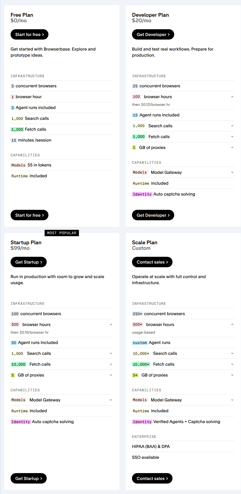

Browserbase's **Developer plan costs $20 per month**, includes **100 browser hours**, and charges **$0.12 per additional browser hour**. Browser time is billed in minutes, with a one-minute minimum per session. This guide models the base subscription and browser-time component using one fixed charge and a SUM meter with a zero-priced first tier.

<Frame caption="Browserbase's complete Free, Developer, Startup and Scale pricing cards, captured on November 13, 2026, with browser-hour details expanded. All four plans, monthly prices, included quantities, overage rates, capabilities and card bottoms are visible. Only Developer's base fee and browser time are modeled.">
  
</Frame>

Sources: [official pricing cards](https://www.browserbase.com/pricing) and [plans, allocations and billing minimums](https://docs.browserbase.com/account/billing/plans).

<Note>
  This example covers one full Developer monthly period in USD, without a plan change. It includes only the $20 base fee and browser-time overage. Proxy bandwidth, Agent runs, Search, Fetch, Extract, Model Gateway tokens, other plans, promotions, credits, discounts, proration, taxes and custom terms are excluded. The screenshot shows a broader bundle than this configuration implements.
</Note>

## Pricing profile

These labels describe the Developer base subscription and browser-time component, not Browserbase's complete product catalog.

| Dimension | Offering profile |
| --- | --- |
| Pricing model | [Hybrid; Subscription; Usage-based](https://www.browserbase.com/pricing) |
| Industry | [Browser and agent infrastructure](https://www.browserbase.com/pricing) |
| Buyer | [Developers building browser workflows](https://www.browserbase.com/pricing) |
| Sales motion | [Self-serve](https://docs.browserbase.com/account/billing/plan-management) |
| Billing mechanics | [Monthly included hours; Per-minute metering; Per-session minimum; Graduated overage](https://docs.browserbase.com/account/billing/plans) |

## Published terms and billing boundary

| Item | Developer term | Modeling consequence |
| --- | --- | --- |
| **Base subscription** | $20 per month | One recurring fixed charge, quantity 1 |
| **Included browser time** | 100 hours per month | First 6,000 billable minutes have a zero usage price |
| **Browser overage** | $0.12 per hour | $0.12 ÷ 60 = $0.002 per billable minute beyond the allowance |
| **Measurement** | Browser time is rounded and billed by the minute, with a one-minute minimum per session | Finalize billable minutes for each session before monthly aggregation |
| **Concurrent browsers** | 25 | Capacity control, not 25 copies of the time allowance or base fee |

The [plan documentation](https://docs.browserbase.com/account/billing/plans) distinguishes usage allocations from capacity limits. Exceeding the browser-hour allocation incurs overage; it does not automatically stop sessions. Concurrency and session-duration controls are separate from the monthly time charge.

Browserbase documents [two invoices for Developer](https://docs.browserbase.com/account/billing/plan-management): one for the subscription and another for tokens and overages. The worked total below combines the two **modeled charge components for comparison**, not a claim that Browserbase puts them on one invoice. In Flexprice, advance billing for the fixed fee and arrears for usage are explicit example choices. Exact invoice timing, collection and document grouping are outside scope.

## Design takeaways

1. **Apply session measurement before the pricing threshold.** The [one-minute per-session minimum](https://docs.browserbase.com/account/billing/plans) belongs in usage normalization. The 100-hour allowance belongs in monthly pricing. Combining raw durations before applying session minimums can undercount time; subtracting an allowance separately for each session can erase overage.
2. **Keep capacity enforcement outside the usage price.** Developer's [25-browser concurrency limit and 100-hour allocation](https://docs.browserbase.com/account/billing/plans) constrain different things. A graduated price can charge excess time, but it does not enforce concurrent-session admission or session duration.
3. **Validate amounts separately from invoice layout.** Browserbase's [separate subscription and usage invoices](https://docs.browserbase.com/account/billing/plan-management) show why reproducing a charge formula is not the same as reproducing invoicing. Check the fixed and usage amounts first, then design collection and document grouping independently.

## How Browserbase's pricing maps to Flexprice

| Browserbase's pricing uses | Flexprice setup |
| --- | --- |
| **$20 monthly subscription** | A `FIXED` price with `FLAT_FEE` billing and quantity 1 |
| **Finalized billable browser minutes** | A [metered feature](/docs/product-catalogue/features/create) with SUM aggregation on `billable_browser_minutes` |
| **100 included hours per monthly period** | A [graduated tiered price](/docs/product-catalogue/plans/billing-models/tiered) with a zero-priced first 6,000 minutes |
| **$0.12/hour excess time** | A second, unbounded tier at `0.002` per minute, using `tier_mode: "SLAB"` |
| **One Developer subscription's allowance** | Route that billing scope to one customer and subscription, not one allowance per session or project |
| **25 concurrent browsers** | Separate application-side capacity enforcement, not the meter's usage limit |

Use **SLAB**, not **VOLUME**. SLAB charges only the minutes within each tier. VOLUME would choose a rate from the total quantity and apply it to all minutes, charging the included time once usage crosses 6,000 minutes.

## Create the browser-minute feature

Use `POST /features` with a SUM meter. Each event carries finalized billable minutes for a completed session or a non-overlapping usage interval, not a count of API calls:

```json
{
  "name": "Browserbase Developer browser minutes",
  "lookup_key": "browserbase_developer_browser_minutes",
  "type": "metered",
  "unit_singular": "browser minute",
  "unit_plural": "browser minutes",
  "meter": {
    "name": "Browserbase Developer browser minutes",
    "event_name": "browserbase_browser_usage",
    "reset_usage": "BILLING_PERIOD",
    "aggregation": { "type": "SUM", "field": "billable_browser_minutes" },
    "filters": [
      { "key": "offering", "values": ["developer"] },
      { "key": "billing_scope", "values": ["developer_subscription_example"] }
    ]
  }
}
```

`offering`, `billing_scope` and the event field are integration-defined labels, not Browserbase API fields. Replace the example billing scope with a stable identifier for the selected Developer subscription and use the same value on its events. Route all its relevant project usage to the same pool. Other subscriptions or plans must not consume this allowance.

Keep quantities and rates in minutes. Do not add a quantity transform that divides by 60 and then keep the per-minute price, or round the entire month's usage up to purchased-hour packages.

## Configure the plan and two prices

Create the [plan](/docs/product-catalogue/plans/create) with `POST /plans`:

```json
{
  "name": "Browserbase Developer Browser Time Example",
  "lookup_key": "browserbase_developer_browser_time_example",
  "description": "Monthly base fee and browser-time allowance/overage only"
}
```

Create the fixed price with `POST /prices`. Replace `plan_browserbase_developer_example` with the returned plan ID:

```json
{
  "entity_type": "PLAN",
  "entity_id": "plan_browserbase_developer_example",
  "type": "FIXED",
  "price_unit_type": "FIAT",
  "billing_model": "FLAT_FEE",
  "amount": "20",
  "currency": "usd",
  "billing_period": "MONTHLY",
  "billing_period_count": 1,
  "invoice_cadence": "ADVANCE",
  "display_name": "Developer monthly base fee"
}
```

Create the graduated usage price on the same plan. Replace `meter_browserbase_minutes_example` with the **meter ID** returned by feature creation, not the feature ID:

```json
{
  "entity_type": "PLAN",
  "entity_id": "plan_browserbase_developer_example",
  "meter_id": "meter_browserbase_minutes_example",
  "type": "USAGE",
  "price_unit_type": "FIAT",
  "billing_model": "TIERED",
  "tier_mode": "SLAB",
  "tiers": [
    { "up_to": 6000, "unit_amount": "0" },
    { "up_to": null, "unit_amount": "0.002" }
  ],
  "currency": "usd",
  "billing_period": "MONTHLY",
  "billing_period_count": 1,
  "invoice_cadence": "ARREAR",
  "display_name": "Developer browser time with 100 included hours"
}
```

The first boundary is inclusive: exactly 6,000 billable minutes produce zero browser-time overage. The next minute enters the paid tier. Do not add the $20 fee again as a tier `flat_amount`.

Attach an unlimited [metered entitlement](/docs/product-catalogue/features/linking-to-plans) for the feature, then create a customer and [subscription](/docs/subscriptions/customers-create-subscription) with quantity **1**. The unlimited entitlement permits time beyond the allowance; it does not make that usage free. The zero-priced tier grants the included minutes. Do not also add a credit grant or subtract 6,000 minutes upstream. Each full monthly period starts a new usage pool; this model does not carry unused minutes forward.

## Send normalized browser time

Browserbase's [billing minimums](https://docs.browserbase.com/account/billing/plans) apply **per session**. Two separate 30-second sessions each incur at least one billable minute, contributing two minutes, even though their raw durations add to one minute. Two simultaneous sessions with 60 finalized billable minutes each contribute 120 minutes, not 60 minutes of shared wall-clock time.

Supply finalized provider-equivalent billable minutes upstream. The cited documentation says time is rounded with a one-minute minimum, but does not establish a precise rounding algorithm for longer partial minutes. This guide does not invent one. Reconcile the normalizer to the provider's billed usage before using it for billing; raw elapsed seconds alone are not the input contract.

This illustrative [Flexprice event](/docs/core-concepts/usage-events/sending-events) represents one session contributing 120 finalized billable minutes. It is not a Browserbase response:

```json
{
  "event_name": "browserbase_browser_usage",
  "event_id": "evt_browserbase_session_0001",
  "external_customer_id": "customer_browser_workflows_001",
  "timestamp": "2026-11-13T04:00:00Z",
  "properties": {
    "offering": "developer",
    "billing_scope": "developer_subscription_example",
    "project_id": "project_workflows_example",
    "session_id": "session_0001",
    "billable_browser_minutes": "120"
  }
}
```

Send the **full billable quantity**, including minutes within the allowance. Flexprice applies the zero-priced tier once to the monthly total. Do not send only excess minutes to this tiered meter, or it will grant the allowance twice.

Keep the same event ID **and timestamp** when retrying a usage record. Do not emit both session-level records and an interval total containing those same sessions. Browserbase's [Project Usage API](https://docs.browserbase.com/reference/api/get-project-usage) exposes `browserMinutes`, but its schema alone does not establish an incremental billing export or rounding contract. Reconcile it as appropriate; do not repeatedly send a cumulative snapshot to a SUM meter as new usage.

## Verify a worked monthly charge

Suppose one full Developer period has **7,500 finalized billable browser minutes** across its projects. Assume no excluded charges or adjustments.

| Calculation | Exact result |
| --- | --- |
| **Convert included hours** | 100 × 60 = 6,000 minutes |
| **Convert overage rate** | $0.12 ÷ 60 = $0.002 per minute |
| **Total time** | 7,500 ÷ 60 = 125 hours |
| **Included tier** | 6,000 × $0 = $0 |
| **Paid tier** | (7,500 − 6,000) × $0.002 = $3.00 |
| **Base subscription** | 1 × $20 = $20.00 |
| **Combined modeled charge components** | **$23.00**, before excluded usage, credits, discounts and taxes |

Boundary checks: **0 minutes costs $20** in base subscription, **6,000 minutes still costs $20**, and **6,060 minutes costs $20.12**. At 6,001 minutes, the exact usage charge is **$0.002 before currency rounding**, not 6,001 × $0.002. Aggregate the charge before rounding currency; do not round each session's usage charge to cents.

Before relying on the result, verify that:

- Per-session minimums and verified provider rounding are applied before SUM aggregation.
- Events from other plans or billing scopes do not match this meter.
- All relevant projects share the selected subscription's single 6,000-minute allowance.
- The $20 fixed price has quantity 1, not the number of sessions, projects or concurrent browsers.
- Crossing 6,000 minutes charges only the excess; capacity limits remain separately enforced.
- Subscription and usage amounts are reconciled independently of invoice grouping and payment timing.

## Pricing sources

- [Browserbase pricing cards and product description](https://www.browserbase.com/pricing)
- [Plans, monthly allocations, browser capacity and billing minimums](https://docs.browserbase.com/account/billing/plans)
- [Plan management and separate subscription/usage invoices](https://docs.browserbase.com/account/billing/plan-management)
- [Browserbase usage tracking](https://docs.browserbase.com/optimizations/cost/measuring-usage)
- [Project Usage API schema](https://docs.browserbase.com/reference/api/get-project-usage)

Pricing checked on 2026-11-13. Recheck public prices and metering terms before implementation. This guide describes illustrative configuration and calculation, not an executed Flexprice setup or a complete Browserbase invoice recreation.

<Card title="Hybrid pricing recipe" icon="layer-group" horizontal={true} href="/cookbooks/billing-recipes/hybrid-pricing">
  Combine a recurring fee with included usage and overage.
</Card>
