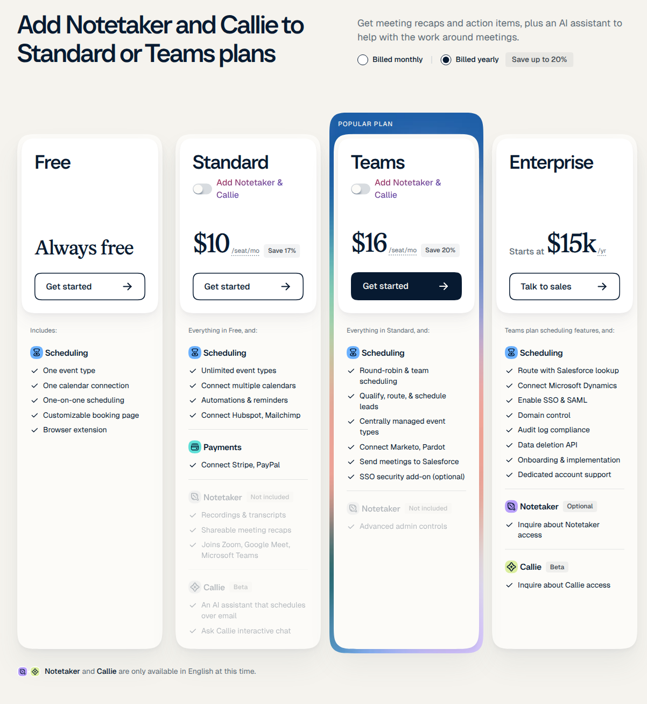

Calendly Teams sells scheduling by the host seat. The yearly option shows $16 per seat per month without the optional Notetaker and Callie bundle. Invitees do not need a paid seat.

<Frame caption="Calendly pricing as shown on the official pricing page, 2026-11-19.">
  
</Frame>

[View the official pricing page](https://calendly.com/pricing).

**Scope:** The initial annual base charge for Calendly Teams scheduling in USD, with eight paid host seats.

**Not modeled:** Free, Standard and Enterprise; monthly billing; midterm seat changes; add-ons, discounts and tax.

## Pricing profile

| Dimension | Modeled offering |
| --- | --- |
| Pricing model | Subscription; Per-seat |
| Industry | Scheduling software |
| Buyer | Teams coordinating appointments |
| Sales motion | Self-serve |
| Billing mechanics | Annual billing; Host-seat quantity |

## What Calendly charges

| Item | Published terms | Flexprice implication |
| --- | --- | --- |
| Teams, yearly | $16 per host seat per month | One annual price of $192 per seat |
| Seat definition | Hosts need seats; invitees do not | Set quantity from paid hosts, not meeting attendance |
| Teams features | Includes round-robin and team scheduling | Treat routing as a feature, not a billable event |

## Design takeaways

1. **Count hosts, not bookings.** Round-robin routing may produce many meetings from one team, but the base bill follows paid hosts. Use a subscription quantity rather than a meeting meter. [Published terms](https://calendly.com/pricing).
2. **Keep add-ons out of the seat price.** The pricing page can show an optional bundle on top of scheduling. Give any independently sold bundle its own line instead of obscuring the base Teams rate. [Published terms](https://calendly.com/pricing).

## How Calendly's pricing maps to Flexprice

| Calendly concept | Flexprice configuration |
| --- | --- |
| Base price per host seat | Fixed annual price of $192.00 USD in advance |
| Billable quantity | Fixed line-item quantity override |

## Configure the plan and subscription

These requests are illustrative. Use your own test environment and replace all example IDs with the IDs returned by your setup. Create a [plan](/docs/product-catalogue/plans/create) with `POST /plans`:

```json
{
  "name": "Calendly Teams scheduling example",
  "lookup_key": "calendly_pricing_example",
  "description": "The initial annual base charge for Calendly Teams scheduling in USD, with eight paid host seats"
}
```

Create the [fixed price](/docs/product-catalogue/plans/pricing) with `POST /prices`. The amount covers the entire year and is in USD, not cents.

```json
{
  "entity_type": "PLAN",
  "entity_id": "plan_calendly_example",
  "currency": "usd",
  "price_unit_type": "FIAT",
  "billing_period": "ANNUAL",
  "billing_period_count": 1,
  "display_name": "Teams scheduling",
  "type": "FIXED",
  "billing_model": "FLAT_FEE",
  "invoice_cadence": "ADVANCE",
  "amount": "192.00"
}
```

Create a customer for the payer, then create the subscription with `POST /subscriptions`. The [quantity override](/docs/subscriptions/plan-price-overrides) applies to the fixed line.

```json
{
  "customer_id": "cust_calendly_example",
  "plan_id": "plan_calendly_example",
  "currency": "usd",
  "billing_period": "ANNUAL",
  "billing_period_count": 1,
  "billing_cycle": "anniversary",
  "start_date": "2026-12-01T00:00:00Z",
  "override_line_items": [
    {
      "price_id": "price_calendly_example",
      "quantity": "8"
    }
  ]
}
```

Count every purchased host seat, including any paid seat not currently assigned. Do not use invitee counts or booking volume.

## Worked bill

$16 × 12 = $192 per host seat per year. Eight paid host seats cost **$1,536.00** for the initial year.

## Pricing sources

- [Calendly pricing](https://calendly.com/pricing): Yearly scheduling plan comparison, host-seat rules, and Teams features.

Pricing checked on 2026-11-19. This example does not reproduce a full provider invoice.

## Related guide

[Plan price overrides](/docs/subscriptions/plan-price-overrides)
