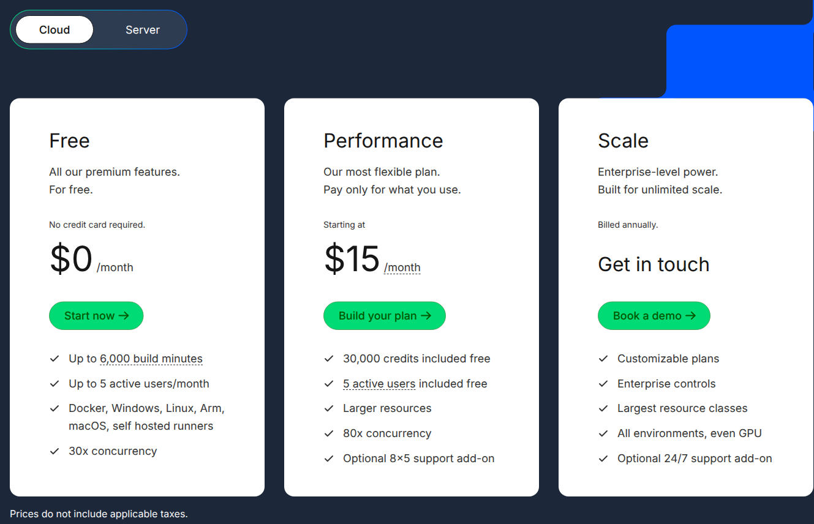
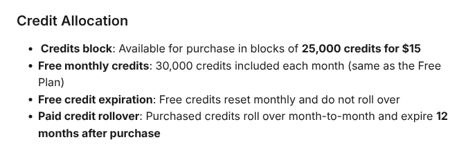

CircleCI Performance sells monthly credit blocks in advance. The purchase is a fixed charge; subtracting credits for compute and other usage is separate from billing for that purchase.

<Frame caption="CircleCI Cloud plan comparison from the official site, 2026-11-25. This guide models only Performance monthly credit packs.">
  
</Frame>

<Frame caption="CircleCI credit allocation rates from the official site, 2026-11-25. This guide models only Performance monthly credit packs.">
  
</Frame>

[View the official pricing page](https://circleci.com/pricing/).

**Scope:** A USD monthly CircleCI Performance credit allocation bought in fixed-size blocks, with free and paid balances tracked separately.

**Not modeled:** Resource-specific burn rates, active-user deductions, real-time refills, bulk prepaid discounts, support, taxes, and other offers.

## Pricing profile

| Dimension | Modeled offering |
| --- | --- |
| Pricing model | Credits; Subscription |
| Industry | Continuous integration and delivery |
| Buyer | Software and platform engineering teams |
| Sales motion | Self-serve |
| Billing mechanics | Monthly prepaid credit blocks; Separate included credits; Paid balances can roll over |

## What CircleCI charges

| Item | Published terms | Flexprice implication |
| --- | --- | --- |
| Paid monthly credits | $15 USD for each 25,000-credit block | Fixed in-advance price, charged per purchased block |
| Included allowance | 30,000 free credits per month; they reset without carryover | Track the included grant separately with a monthly expiry |
| Paid credits | Paid credits roll over and expire 12 months after purchase | Keep each purchase as its own expiring balance |
| Refills | Mid-cycle refills are paid when purchased, separately from the monthly allocation | Omitted; do not report their cost as part of the monthly fixed charge |

## Design takeaways

1. **Invoice the quantity bought, not the credits burned.** The monthly allocation is billed at the beginning of the cycle. Tracking debits in a product ledger avoids charging the same utilization again on a usage invoice [Published terms](https://circleci.com/docs/guides/plans-pricing/credits/).
2. **Track paid and included credits in different buckets.** The free grant resets while paid lots retain their own expiry date. A single monthly balance would either discard paid credits too early or carry free credits forward [Published terms](https://support.circleci.com/en/articles/15091190-performance-plan-overview).

## How CircleCI's pricing maps to Flexprice

| CircleCI concept | Flexprice configuration |
| --- | --- |
| 25,000-credit monthly pack | Fixed monthly price of $15.00 USD in advance |

## Configure the plan and subscription

These requests are illustrative. Use your test environment and replace example IDs with the IDs returned by your setup. Create a [plan](/docs/product-catalogue/plans/create) with `POST /plans`:

```json
{
  "name": "CircleCI Performance monthly credit packs example",
  "lookup_key": "circleci_pricing_example",
  "description": "A USD monthly CircleCI Performance credit allocation bought in fixed-size blocks, with free and paid balances tracked separately"
}
```

Use `POST /prices` for each [fixed recurring price](/docs/product-catalogue/plans/pricing) below. Amounts are in USD for the full billing period, not cents.

```json
{
  "entity_type": "PLAN",
  "entity_id": "plan_circleci_example",
  "currency": "usd",
  "price_unit_type": "FIAT",
  "billing_period": "MONTHLY",
  "billing_period_count": 1,
  "display_name": "25,000-credit monthly pack",
  "type": "FIXED",
  "billing_model": "FLAT_FEE",
  "invoice_cadence": "ADVANCE",
  "amount": "15.00"
}
```

Use the line quantity for purchased blocks, not the number of credits. Keep an application ledger for non-cash product credits. Grant the included monthly balance separately, and provision each purchased lot once after successful payment using the invoice line as the idempotency key. Give each paid lot its own expiration. Record deductions against the relevant balances. The invoice alone does not provision credits or enforce a usage cap.

Create or select the payer's customer record. When paid billing begins, use `POST /subscriptions` with that customer ID and the returned plan and price IDs. Where a quantity is needed, set it through a [line-item override](/docs/subscriptions/plan-price-overrides). To set up a subscription now without raising the advance invoice yet, [create a draft](/docs/core-concepts/subscriptions#choosing-a-subscription-start-date) and activate it when billing begins.

```json
{
  "customer_id": "cust_circleci_example",
  "plan_id": "plan_circleci_example",
  "currency": "usd",
  "billing_period": "MONTHLY",
  "billing_period_count": 1,
  "billing_cycle": "anniversary",
  "override_line_items": [
    {
      "price_id": "price_circleci_1_example",
      "quantity": "2"
    }
  ]
}
```

## Worked bill

Two blocks cost 2 × $15.00 = **$30.00** before taxes and provision 2 × 25,000 = **50,000 paid credits**. A fresh month with no carryover starts with those paid credits and **30,000 separate included credits**. If a month closes with 7,000 free and 9,000 unexpired paid credits unused, only the 9,000 paid credits carry forward. Deducting credits from an existing balance does not add a charge to this example invoice.

Verify the fixed charge amounts and quantities on the opening invoice. No usage line should be present in this example.

## Pricing sources

- [CircleCI pricing](https://circleci.com/pricing/): Cloud plan cards and included Performance credits.
- [CircleCI Performance Plan overview](https://support.circleci.com/en/articles/15091190-performance-plan-overview): Credit block price, monthly allowance, paid carryover and expiry.
- [CircleCI credit billing](https://circleci.com/docs/guides/plans-pricing/credits/): Monthly allocation invoice timing and separately billed refills.

Pricing checked on 2026-11-25. This example does not reproduce a full provider invoice.

## Related guide

[Plan price overrides](/docs/subscriptions/plan-price-overrides)
