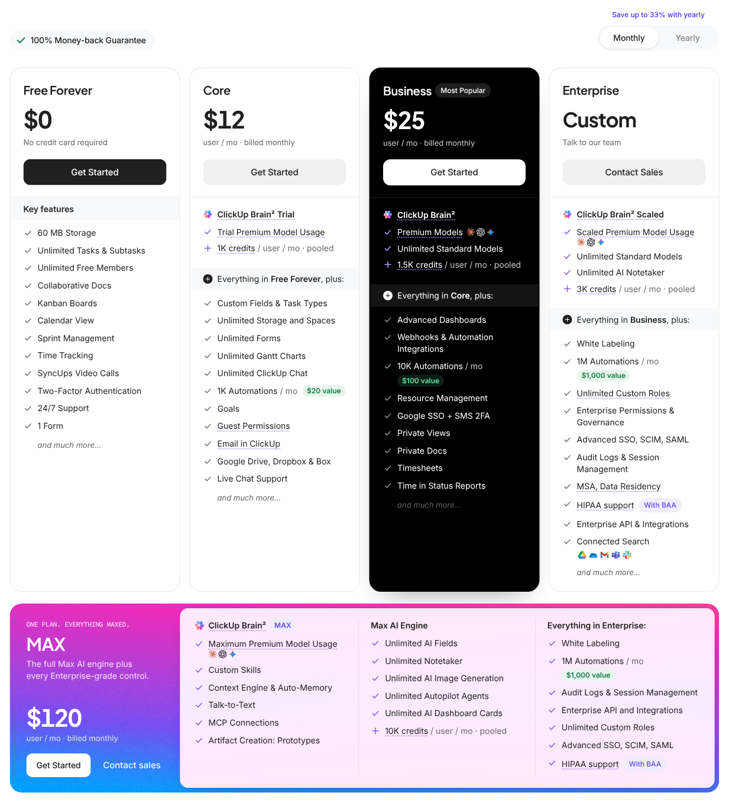

ClickUp Core lists $12 per user per month with monthly billing selected. The paid subscription belongs to a Workspace, so a user's presence in another Workspace does not create a shared seat pool. Model the base subscription in Flexprice with one fixed monthly price and a paid-user quantity per Workspace.

<Frame caption="ClickUp pricing comparison from the official site, 2026-11-24. This guide models only Core monthly.">
  
</Frame>

[View the official pricing page](https://clickup.com/pricing).

**Scope:** The current USD Core monthly base subscription for one Workspace with a stable paid-user count.

**Not modeled:** Legacy plans, yearly billing, guest-seat rules, limited-member rules, AI credit tracking or top-ups, add-ons, mid-cycle changes, refunds, discounts and taxes.

## Pricing profile

| Dimension | Modeled offering |
| --- | --- |
| Pricing model | Per-seat; Subscription |
| Industry | Work management software |
| Buyer | Teams managing shared work |
| Sales motion | Self-serve |
| Billing mechanics | Monthly fixed price; Paid users per Workspace; Charge on purchase and renewal |

## What ClickUp charges

| Item | Published terms | Flexprice implication |
| --- | --- | --- |
| Core monthly | $12 USD per user per month, billed monthly | Fixed $12.00 monthly unit amount |
| Workspace boundary | Each Workspace requires its own upgrade | Keep the subscription and billable quantity scoped to that Workspace |
| Role qualification | Owners, admins and members are paid roles; some other roles have separate rules | This example counts only these three paid role types |
| Included AI | Core shows 1,000 credits per user per month, pooled | Included access is separate from the USD seat charge; no credit ledger configured here |
| Billing lifecycle | Purchase grants immediate access; subscriptions renew automatically | Advance base fee for the upcoming cycle; mid-cycle adjustments are excluded |

## Design takeaways

1. **Keep the Workspace boundary in the subscription.** One person can belong to two separately upgraded Workspaces. Deduplicate within each Workspace, not across the payer's entire organization, or the second Workspace can be underbilled. [Published terms](https://clickup.com/pricing).
2. **A pooled allowance is not a currency balance.** The Core card describes AI credits pooled across paid users. Keep that product allowance separate from money used to settle the seat invoice; the base price does not implement credit consumption. [Published terms](https://clickup.com/pricing).

## How ClickUp's pricing maps to Flexprice

| ClickUp concept | Flexprice configuration |
| --- | --- |
| Monthly price per paid Workspace user | Fixed price of $12.00 USD in advance |
| Billable quantity | Application or checkout calculation, passed as the fixed-line quantity |

## Configure the plan and subscription

These requests are illustrative. Use your test environment and replace example IDs with the IDs returned by your setup. Create a [plan](/docs/product-catalogue/plans/create) with `POST /plans`:

```json
{
  "name": "ClickUp Core monthly example",
  "lookup_key": "clickup_pricing_example",
  "description": "The current USD Core monthly base subscription for one Workspace with a stable paid-user count"
}
```

Create the [fixed price](/docs/product-catalogue/plans/pricing) with `POST /prices`. Enter the full amount per seat for one month in USD, not cents.

```json
{
  "entity_type": "PLAN",
  "entity_id": "plan_clickup_example",
  "currency": "usd",
  "price_unit_type": "FIAT",
  "billing_period": "MONTHLY",
  "billing_period_count": 1,
  "display_name": "Core monthly",
  "type": "FIXED",
  "billing_model": "FLAT_FEE",
  "invoice_cadence": "ADVANCE",
  "amount": "12.00"
}
```

Use one subscription per Workspace and count unique paid users inside it. For this example, one owner, one admin and six members give eight paid users. The same eight people appearing in several Lists still count eight, not one seat per List membership. Do not include guests or limited members in this example; their plan-specific qualification rules are outside its scope.

Create or select a customer to bill, then use `POST /subscriptions`. Set the quantity on the returned fixed price using a [line-item override](/docs/subscriptions/plan-price-overrides).

```json
{
  "customer_id": "cust_clickup_example",
  "plan_id": "plan_clickup_example",
  "currency": "usd",
  "billing_period": "MONTHLY",
  "billing_period_count": 1,
  "billing_cycle": "anniversary",
  "start_date": "2026-12-01T00:00:00Z",
  "override_line_items": [
    {
      "price_id": "price_clickup_example",
      "quantity": "8"
    }
  ]
}
```

## Worked bill

Eight paid users produce **8 × $12.00 = $96.00 for one full month** before taxes. Duplicating a member's task or List assignments does not change that quantity. A ninth paid user present from the start of a full month would make the base fee $108.00. Mid-cycle invitations require separate proration, not the full-month arithmetic shown here.

Verify that the opening invoice shows the monthly unit amount and the fixed-line quantity, with no metered line in this example.

## Pricing sources

- [ClickUp pricing](https://clickup.com/pricing): Current Core monthly card, Workspace billing FAQ and new-plan AI inclusions.
- [ClickUp role pricing](https://help.clickup.com/hc/en-us/articles/6303244318999-Pricing-per-user-role-and-plan): Workspace user roles and the distinction between allocated seats and paid subscriptions.
- [ClickUp terms](https://clickup.com/terms): Subscription payment and automatic renewal terms.
- [ClickUp upgrade guide](https://help.clickup.com/hc/en-us/articles/6303314345623-Upgrade-your-plan): Payment on upgrade, immediate access and prorated paid-plan upgrades.

Pricing checked on 2026-11-24. This example does not reproduce a full provider invoice.

## Related guide

[Plan price overrides](/docs/subscriptions/plan-price-overrides)
