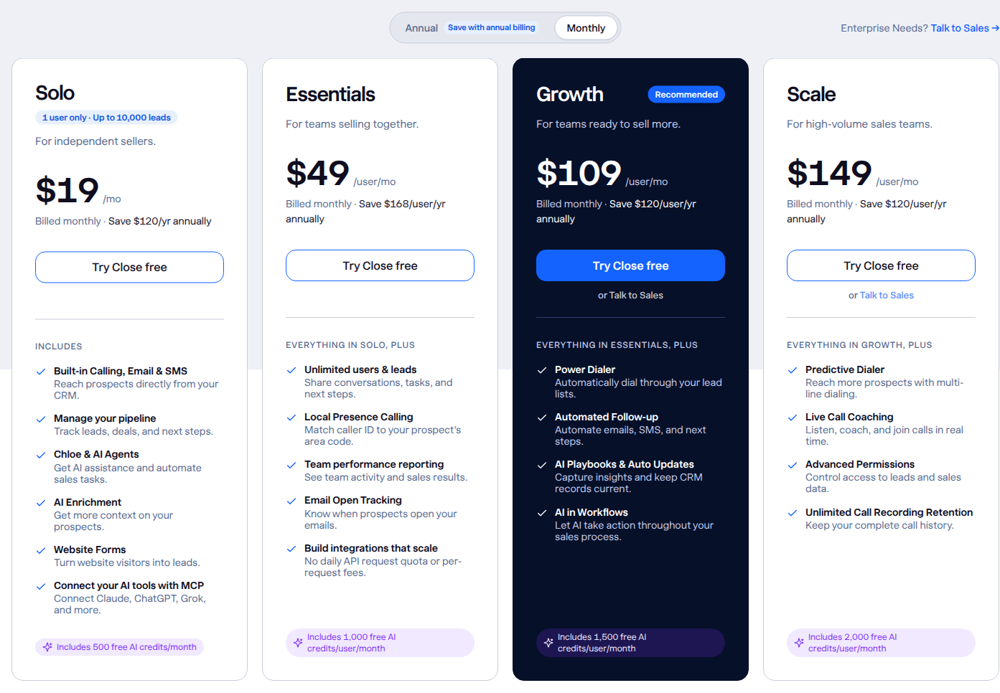

Close prices its Essentials CRM subscription per user and bills telephony and AI usage separately. This Flexprice example models a stable monthly CRM seat count, not the variable charges on a Close account.

<Frame caption="Close monthly plan comparison from the official site, 2026-11-25. This guide models only Essentials monthly.">
  
</Frame>

[View the official pricing page](https://close.com/pricing).

**Scope:** The USD monthly Close Essentials CRM subscription for one organization at a stable seat count.

**Not modeled:** Annual pricing, linked billing organizations, trials, mid-cycle changes, telephony, AI credits, add-ons, and taxes.

## Pricing profile

| Dimension | Modeled offering |
| --- | --- |
| Pricing model | Per-seat; Subscription |
| Industry | Customer relationship management |
| Buyer | Sales teams |
| Sales motion | Self-serve |
| Billing mechanics | Monthly CRM seat charge; Organization-level plan |

## What Close charges

| Item | Published terms | Flexprice implication |
| --- | --- | --- |
| Essentials monthly | $49 USD per user per month on monthly billing | Use one monthly price with a seat quantity |
| Plan scope | All users in the organization are on the same paid plan | Use one subscription for the modeled organization |
| Replace a user | A seat vacated mid-cycle remains available until the next cycle | Replacing the user in that seat is not a second monthly seat charge |
| Variable usage | Telephony usage is charged separately from the CRM plan | Do not include it in this example's fixed line |

## Design takeaways

1. **Model the plan at the organization level.** Keep one Essentials price with a quantity rather than issuing subscriptions for each user. The organization chooses the plan and bills its user seats together [Published terms](https://help.close.com/account-management/plans-and-billing).
2. **Do not count unique identities across the month.** A replacement can occupy the seat of a removed user before renewal. Using every identity seen during the month as the multiplier would overcount that seat [Published terms](https://help.close.com/account-management/plans-and-billing/adding-and-removing-users).

## How Close's pricing maps to Flexprice

| Close concept | Flexprice configuration |
| --- | --- |
| Essentials user seat | Fixed monthly price of $49.00 USD in advance |

## Configure the plan and subscription

These requests are illustrative. Use your test environment and replace example IDs with the IDs returned by your setup. Create a [plan](/docs/product-catalogue/plans/create) with `POST /plans`:

```json
{
  "name": "Close Essentials monthly example",
  "lookup_key": "close_pricing_example",
  "description": "The USD monthly Close Essentials CRM subscription for one organization at a stable seat count"
}
```

Use `POST /prices` for each [fixed recurring price](/docs/product-catalogue/plans/pricing) below. Amounts are in USD for the full billing period, not cents.

```json
{
  "entity_type": "PLAN",
  "entity_id": "plan_close_example",
  "currency": "usd",
  "price_unit_type": "FIAT",
  "billing_period": "MONTHLY",
  "billing_period_count": 1,
  "display_name": "Essentials user seat",
  "type": "FIXED",
  "billing_model": "FLAT_FEE",
  "invoice_cadence": "ADVANCE",
  "amount": "49.00"
}
```

Set the fixed-line quantity to the organization's billed seat count. In this example, bill it at the start of the paid month. Keep a slot available for a replacement through the current cycle rather than counting the replacement as a fourth seat.

Create or select the payer's customer record. When paid billing begins, use `POST /subscriptions` with that customer ID and the returned plan and price IDs. Where a quantity is needed, set it through a [line-item override](/docs/subscriptions/plan-price-overrides). To set up a subscription now without raising the advance invoice yet, [create a draft](/docs/core-concepts/subscriptions#choosing-a-subscription-start-date) and activate it when billing begins.

```json
{
  "customer_id": "cust_close_example",
  "plan_id": "plan_close_example",
  "currency": "usd",
  "billing_period": "MONTHLY",
  "billing_period_count": 1,
  "billing_cycle": "anniversary",
  "override_line_items": [
    {
      "price_id": "price_close_1_example",
      "quantity": "3"
    }
  ]
}
```

## Worked bill

Three billed seats cost 3 × $49.00 = **$147.00** for the month before taxes and variable charges. A replacement using one of those seats does not turn it into a four-seat bill.

Verify the fixed charge amounts and quantities on the opening invoice. No usage line should be present in this example.

## Pricing sources

- [Close pricing](https://close.com/pricing): Essentials rate with the monthly toggle selected.
- [Close plans and billing](https://help.close.com/account-management/plans-and-billing): Organization-level plans and separate telephony usage.
- [Close managing users](https://help.close.com/account-management/plans-and-billing/adding-and-removing-users): Replacement seats remain available until the next billing cycle.

Pricing checked on 2026-11-25. This example does not reproduce a full provider invoice.

## Related guide

[Plan price overrides](/docs/subscriptions/plan-price-overrides)
