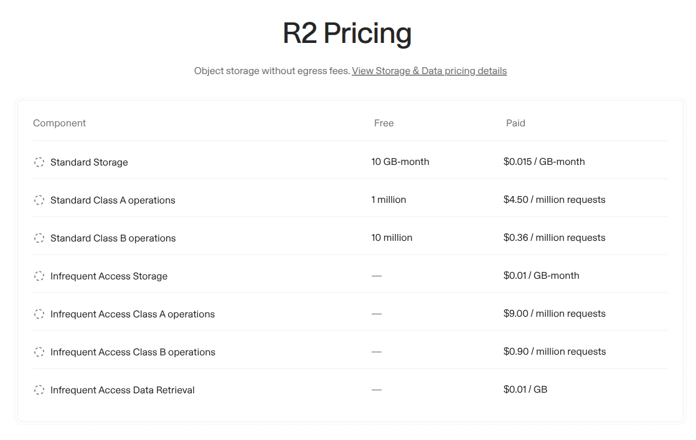

Cloudflare R2 Standard charges separately for storage, Class A operations and Class B operations. Each has a monthly free allowance. The bill uses rounded billing units rather than charging a fractional rate on every request.

<Frame caption="Cloudflare pricing as shown on the official pricing page, 2026-11-19.">
  
</Frame>

[View the official pricing page](https://www.cloudflare.com/products/r2/).

**Scope:** One billing account's R2 Standard storage, Class A requests and Class B requests for a monthly period.

**Not modeled:** Infrequent Access, data retrieval, other services, negotiated rates and tax. R2 does not charge for direct egress.

## Pricing profile

| Dimension | Modeled offering |
| --- | --- |
| Pricing model | Usage-based; Tiered pricing |
| Industry | Cloud object storage |
| Buyer | Developers and infrastructure teams |
| Sales motion | Self-serve |
| Billing mechanics | Monthly free allowances; Rounded billing units; Separate operation classes |

## What Cloudflare charges

| Item | Published terms | Flexprice implication |
| --- | --- | --- |
| Standard storage | 10 GB-month free; $0.015 per additional GB-month | Round the monthly storage metric up to whole GB-months |
| Standard Class A | 1 million requests free; $4.50 per additional million | Round the monthly Class A total up in millions |
| Standard Class B | 10 million requests free; $0.36 per additional million | Round the monthly Class B total up in millions |

## Design takeaways

1. **Round after aggregation.** The billable unit is a unit of monthly usage. Rounding each event would make the invoice depend on how the same activity was batched. [Published terms](https://developers.cloudflare.com/r2/pricing/).
2. **Model each allowance independently.** Storage, Class A and Class B have separate thresholds. Keep one meter per dimension and preserve the account scope so the free unit is not repeated for every bucket. [Published terms](https://developers.cloudflare.com/r2/pricing/).

## How Cloudflare's pricing maps to Flexprice

| Cloudflare concept | Flexprice configuration |
| --- | --- |
| Monthly account totals | Calculate rounded billable units upstream; send one rated event for the period |
| Three Standard billing dimensions | Three SUM meters, filtered to Standard, each reading its own numeric property |
| Independent free allowances | Graduated tiers with separate zero-cost thresholds |
| Monthly invoice | Three usage prices in arrears, no fixed subscription charge |

## Configure the plan and subscription

These requests are illustrative. Use your own test environment and replace all example IDs with the IDs returned by your setup. Create a [plan](/docs/product-catalogue/plans/create) with `POST /plans`:

```json
{
  "name": "Cloudflare R2 Standard example",
  "lookup_key": "cloudflare_pricing_example",
  "description": "One billing account's R2 Standard storage, Class A requests and Class B requests for a monthly period"
}
```

For each billing account, collect the Standard totals across its buckets. Use the [Cloudflare pricing rules](https://developers.cloudflare.com/r2/pricing/) to classify billable requests. Exclude authentication and authorization failures, but don't filter to successful responses only: a conditional `PutObject` that returns HTTP 412 is still a Class A operation. Divide each class total by 1,000,000 and round up.

For storage, use the account's unrounded GB-month total from the upstream rating process, then round up to a whole unit. The example below uses Cloudflare's documented 30-day case: add the 30 daily peaks of aggregate Standard storage in GB and divide by 30. For other windows, supply the verified GB-month total rather than assuming the same divisor. Do not round operations or storage per bucket, or subtract the free amounts upstream.

Create these [metered features](/docs/product-catalogue/features/linking-to-plans) and [usage prices](/docs/product-catalogue/plans/pricing). Replace each example meter ID with the meter ID from the corresponding feature. In Flexprice's API, the graduated tier mode is `SLAB`. These prices allow the first quantity band at zero and rate only the excess.

### Standard storage

`POST /features`:

```json
{
  "name": "Standard storage",
  "lookup_key": "r2_standard_month_closed_standard_storage_gb_month_units",
  "type": "metered",
  "meter": {
    "name": "Standard storage",
    "event_name": "r2_standard_month_closed",
    "reset_usage": "BILLING_PERIOD",
    "aggregation": {
      "type": "SUM",
      "field": "standard_storage_gb_month_units"
    },
    "filters": [
      {
        "key": "storage_class",
        "values": [
          "standard"
        ]
      }
    ]
  }
}
```

`POST /prices`:

```json
{
  "entity_type": "PLAN",
  "entity_id": "plan_cloudflare_example",
  "currency": "usd",
  "price_unit_type": "FIAT",
  "billing_period": "MONTHLY",
  "billing_period_count": 1,
  "display_name": "Standard storage",
  "type": "USAGE",
  "billing_model": "TIERED",
  "invoice_cadence": "ARREAR",
  "tier_mode": "SLAB",
  "meter_id": "meter_r2_standard_1",
  "tiers": [
    {
      "up_to": 10,
      "unit_amount": "0"
    },
    {
      "unit_amount": "0.015"
    }
  ]
}
```

### Standard Class A

`POST /features`:

```json
{
  "name": "Standard Class A",
  "lookup_key": "r2_standard_month_closed_standard_class_a_million_units",
  "type": "metered",
  "meter": {
    "name": "Standard Class A",
    "event_name": "r2_standard_month_closed",
    "reset_usage": "BILLING_PERIOD",
    "aggregation": {
      "type": "SUM",
      "field": "standard_class_a_million_units"
    },
    "filters": [
      {
        "key": "storage_class",
        "values": [
          "standard"
        ]
      }
    ]
  }
}
```

`POST /prices`:

```json
{
  "entity_type": "PLAN",
  "entity_id": "plan_cloudflare_example",
  "currency": "usd",
  "price_unit_type": "FIAT",
  "billing_period": "MONTHLY",
  "billing_period_count": 1,
  "display_name": "Standard Class A",
  "type": "USAGE",
  "billing_model": "TIERED",
  "invoice_cadence": "ARREAR",
  "tier_mode": "SLAB",
  "meter_id": "meter_r2_standard_2",
  "tiers": [
    {
      "up_to": 1,
      "unit_amount": "0"
    },
    {
      "unit_amount": "4.50"
    }
  ]
}
```

### Standard Class B

`POST /features`:

```json
{
  "name": "Standard Class B",
  "lookup_key": "r2_standard_month_closed_standard_class_b_million_units",
  "type": "metered",
  "meter": {
    "name": "Standard Class B",
    "event_name": "r2_standard_month_closed",
    "reset_usage": "BILLING_PERIOD",
    "aggregation": {
      "type": "SUM",
      "field": "standard_class_b_million_units"
    },
    "filters": [
      {
        "key": "storage_class",
        "values": [
          "standard"
        ]
      }
    ]
  }
}
```

`POST /prices`:

```json
{
  "entity_type": "PLAN",
  "entity_id": "plan_cloudflare_example",
  "currency": "usd",
  "price_unit_type": "FIAT",
  "billing_period": "MONTHLY",
  "billing_period_count": 1,
  "display_name": "Standard Class B",
  "type": "USAGE",
  "billing_model": "TIERED",
  "invoice_cadence": "ARREAR",
  "tier_mode": "SLAB",
  "meter_id": "meter_r2_standard_3",
  "tiers": [
    {
      "up_to": 10,
      "unit_amount": "0"
    },
    {
      "unit_amount": "0.36"
    }
  ]
}
```

Create one subscription per billing account with `POST /subscriptions`, with a period boundary aligned to how you measure usage:

```json
{
  "customer_id": "cust_cloudflare_example",
  "plan_id": "plan_cloudflare_example",
  "currency": "usd",
  "billing_period": "MONTHLY",
  "billing_period_count": 1,
  "billing_cycle": "anniversary",
  "start_date": "2027-04-01T00:00:00Z"
}
```

At period close, send the totals with `POST /events` early enough for all three meters to reflect them before [the first invoice computation](/docs/core-concepts/invoices#billing-usage-that-arrives-after-the-invoice-is-computed), which can happen one hour after period end. Use the customer's external ID and a timestamp inside the period being billed. Keep the event ID and timestamp stable for retries. Do not bill both the summary and the individual events.

```json
{
  "event_name": "r2_standard_month_closed",
  "event_id": "evt_r2_account_2027_04",
  "external_customer_id": "account_r2_example",
  "timestamp": "2027-04-30T23:59:59Z",
  "properties": {
    "storage_class": "standard",
    "standard_storage_gb_month_units": "110",
    "standard_class_a_million_units": "2",
    "standard_class_b_million_units": "11"
  }
}
```

If the first computation missed the summary, wait until all three meters reflect it. Use [Query invoices](/api-reference/invoices/query-invoices) with the subscription ID, `"billing_reason": "SUBSCRIPTION_CYCLE"`, and `"invoice_status": ["DRAFT", "SKIPPED", "FINALIZED"]`. Match the billing period's start and end dates. The billing reason distinguishes the period-end invoice from the opening invoice, which can be skipped for the same dates. Confirm the period-end invoice still lacks the usage before choosing a recovery step:

- **`DRAFT`:** Call [Recalculate draft invoice](/api-reference/invoices/recalculate-draft-invoice-v2) directly with `POST /v1/invoices/{id}/recalculate-v2?finalize=false`. Portal’s **Recalculate** action finalizes the invoice immediately. Check the line items in the API response. When they’re correct and the invoice is still a draft, call `POST /v1/invoices/{id}/finalize`.
- **`SKIPPED` or `FINALIZED`:** To replace the invoice, call [Recalculate invoice](/api-reference/invoices/recalculate-invoice-voided-invoice) directly with `POST /v1/invoices/{id}/recalculate`. Portal disables **Recalculate** for skipped invoices. The replacement runs in the background. Fetch the original invoice and use its `recalculated_invoice_id` to verify the replacement. If the original invoice was paid and you want to keep it, create a one-off invoice for only the missing amount.

## Worked bill

Over 30 days, 27 daily peaks of 109 GB and three of 110 GB produce `(27 × 109 + 3 × 110) / 30 = 109.1 GB-month`.

| Standard usage in the period | Rounded units | Free units | Paid calculation |
| --- | ---: | ---: | ---: |
| 109.1 GB-month | 110 | 10 | 100 × $0.015 = $1.50 |
| 1,000,001 Class A requests | 2 million | 1 million | 1 × $4.50 = $4.50 |
| 10,000,001 Class B requests | 11 million | 10 million | 1 × $0.36 = $0.36 |

The base usage total is **$6.36** before exclusions. Exactly 1 million Class A requests costs $0; one more request moves that month's Class A charge to $4.50.

## Pricing sources

- [Cloudflare pricing](https://www.cloudflare.com/products/r2/): R2 Standard and Infrequent Access pricing comparison.
- [Cloudflare product documentation](https://developers.cloudflare.com/r2/pricing/): Monthly allowances, daily storage peaks and round-up rules for billable units.

Pricing checked on 2026-11-19. This example does not reproduce a full provider invoice.

## Related guide

[Usage-based pricing](/cookbooks/billing-recipes/usage-based-pricing)
