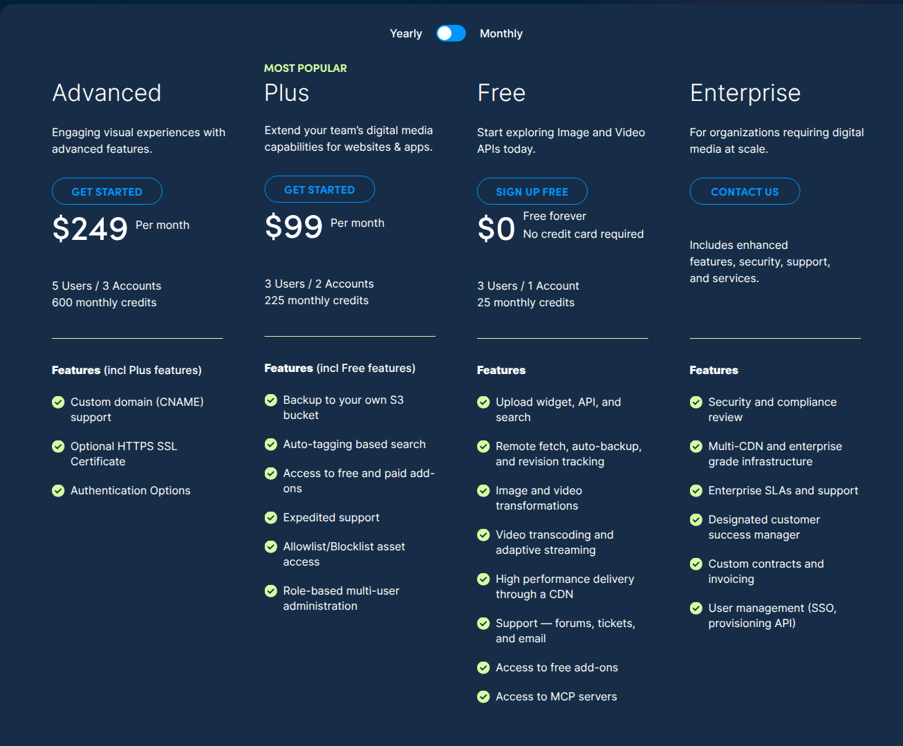
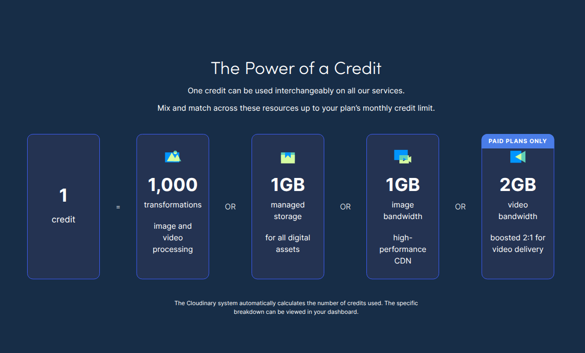

Cloudinary Image and Video API Plus pairs a $99 monthly fee with a shared 225-credit allowance. This guide models the subscription fee in Flexprice and calculates a separate usage snapshot from the resources that draw on the allowance.

<Frame caption="Cloudinary plan comparison showing Plus at $99 per month from the official site, 2026-11-27. This guide models only Image and Video API Plus monthly fee.">
  
</Frame>

<Frame caption="Cloudinary credit conversion rates from the official site, 2026-11-27. This guide models only Image and Video API Plus monthly fee.">
  
</Frame>

[View the official pricing page](https://cloudinary.com/pricing).

**Scope:** USD Plus fee with monthly billing and one example of usage within the included credit allowance.

**Not modeled:** Yearly prices, video processing usage, add-ons, Digital Asset Management, paid overages, and enforcement above the allowance.

## Pricing profile

| Dimension | Modeled offering |
| --- | --- |
| Pricing model | Subscription; Credits |
| Industry | Media processing and delivery |
| Buyer | Application development teams |
| Sales motion | Self-serve |
| Billing mechanics | Fixed monthly fee; Shared credit allowance |

## What Cloudinary charges

| Item | Published terms | Flexprice implication |
| --- | --- | --- |
| Plus base | $99 per month on monthly billing, including 225 credits | Fixed monthly price and a separately tracked allowance |
| Credit conversions used here | 1 credit per 1,000 image transformations, 1 GB stored, 1 GB of standard image bandwidth, or 2 GB of video bandwidth on Plus | Convert each resource to the same credit unit upstream |
| Managed storage | Original assets, cached copies of delivered derivatives, and revisions backed up to Cloudinary storage | Include all three in the storage snapshot |
| Usage window | Transformations and bandwidth accrue over a trailing 30 days. Storage uses a current snapshot | Evaluate the allowance from an application snapshot outside the billing-period meters |

## Design takeaways

1. **Share the allowance across resources.** Add the converted amounts before comparing with 225. Four separate 225-credit limits would let the account consume more than the published shared pool [Published terms](https://cloudinary.com/documentation/billing_and_plans).
2. **Keep the billing date separate from the usage window.** A monthly invoice does not reset a trailing 30-day total or today's stored bytes. Calculate quota consumption from the resource records independently of invoice generation [Published terms](https://cloudinary.com/documentation/billing_and_plans).

## How Cloudinary's pricing maps to Flexprice

| Cloudinary concept | Flexprice configuration |
| --- | --- |
| Base charge | Fixed monthly price of $99.00 USD in advance |
| Charge quantity | One charge per subscription |
| Billing boundaries | Anniversary subscription billing |
| Shared allowance | Application-calculated credit snapshot with an included limit of 225 |

## Configure the plan and subscription

These requests are illustrative. Use your test environment and replace example IDs with the IDs returned by your setup. Create a [plan](/docs/product-catalogue/plans/create) with `POST /plans`:

```json
{
  "name": "Cloudinary Image and Video API Plus monthly fee example",
  "lookup_key": "cloudinary_pricing_example",
  "description": "USD Plus fee with monthly billing and one example of usage within the included credit allowance"
}
```

Use `POST /prices` to create the [fixed recurring price](/docs/product-catalogue/plans/pricing). The amount is USD for the entire billing period.

```json
{
  "entity_type": "PLAN",
  "entity_id": "plan_cloudinary_example",
  "currency": "usd",
  "price_unit_type": "FIAT",
  "billing_period": "MONTHLY",
  "billing_period_count": 1,
  "display_name": "Image and Video API Plus monthly fee",
  "type": "FIXED",
  "billing_model": "FLAT_FEE",
  "invoice_cadence": "ADVANCE",
  "amount": "99.00"
}
```

Use the account owner as the Flexprice customer. Start one monthly subscription when paid service begins. Track resource consumption separately from this subscription's invoice calculation.

Use `POST /subscriptions` with the returned customer, plan, and price IDs. Set `include_price_ids` to the modeled price ID. If you need to prepare the subscription ahead of the paid start, [save it as a draft](/docs/core-concepts/subscriptions#choosing-a-subscription-start-date) and activate it when billing begins. Creating an active advance-billed subscription can raise its opening invoice at creation.

```json
{
  "customer_id": "cust_cloudinary_example",
  "plan_id": "plan_cloudinary_example",
  "currency": "usd",
  "billing_period": "MONTHLY",
  "billing_period_count": 1,
  "billing_cycle": "anniversary",
  "include_price_ids": [
    "price_cloudinary_example"
  ]
}
```

## Worked bill

A Plus account has 100,000 billable image transformations, 30 GB of standard image bandwidth, and 60 GB of video bandwidth over the last 30 days. Its current storage totals 20 GB across originals, cached derivatives, and revisions backed up to Cloudinary.

| Resource | Conversion | Credits |
| --- | --- | --- |
| Image transformations | 100,000 ÷ 1,000 | 100 |
| Image bandwidth | 30 GB ÷ 1 GB | 30 |
| Video bandwidth | 60 GB ÷ 2 GB | 30 |
| Storage | 20 GB ÷ 1 GB | 20 |

Total usage is **180 of 225 credits**, leaving 45 credits at this snapshot. The invoice has one **$99.00** monthly fee before taxes. When refreshing the calculation, use current storage and recalculate transformations and delivery over the trailing 30 days. If your account has a different image CDN conversion, use the conversion in your account terms.

## Pricing sources

- [Cloudinary pricing](https://cloudinary.com/pricing): Monthly Plus price and included credits.
- [Cloudinary billing and plans](https://cloudinary.com/documentation/billing_and_plans): Credit conversions, managed storage, and Plus usage windows.
- [Cloudinary terms of use](https://cloudinary.com/tou): Access to paid services after confirmation of payment.

Pricing checked on 2026-11-27.

## Related guide

[Credit-based pricing](/cookbooks/billing-recipes/credit-based-pricing)
