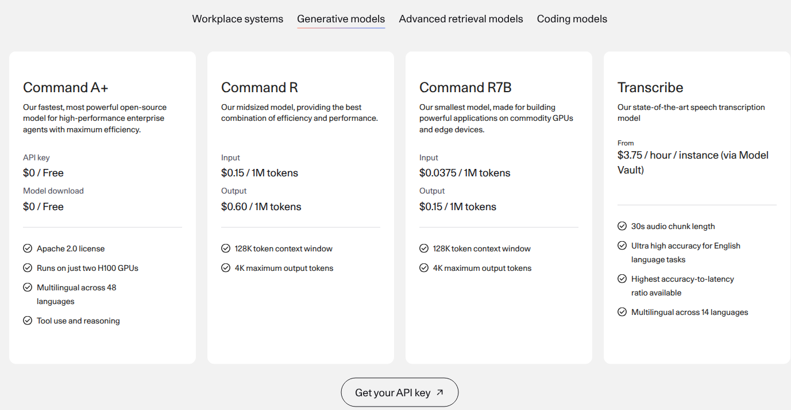

Cohere prices Command R production API usage at **$0.15 per million input tokens** and **$0.60 per million output tokens**. Its response distinguishes billable tokens from total processed tokens. This guide maps the billed quantities to two Flexprice meters and a usage-only plan for `command-r-08-2024`.

<Frame caption="Cohere's complete Generative models comparison, captured on November 11, 2026, with all four cards, token rates, inclusions and the API-key entry point visible. Only Command R production API token charges are modeled; Command A+, Command R7B and Transcribe are shown for context.">
  
</Frame>

Source: [Cohere pricing](https://cohere.com/pricing), with **Generative models** selected.

<Note>
  This example covers USD token charges on Cohere's direct API using a production key. It excludes trial-key usage, other models and endpoints, private or dedicated deployments, partner-hosted pricing, discounts and tax. The illustrative Flexprice plan bills monthly in arrears. It does not reproduce Cohere's additional invoice trigger at $250 of outstanding balance.
</Note>

## Pricing profile

These labels describe the Command R production API offering, not every Cohere product or sales channel.

| Dimension | Offering profile |
| --- | --- |
| Pricing model | [Usage-based](https://docs.cohere.com/docs/how-does-cohere-pricing-work) |
| Industry | [AI language models](https://docs.cohere.com/docs/command-r) |
| Buyer | [Developers](https://docs.cohere.com/v2/reference/chat) |
| Sales motion | [Self-serve signup; Production activation required](https://cohere.com/pricing) |
| Billing mechanics | [Separate input/output rates; Billed-token metering; Monthly and balance-threshold invoicing](https://cohere.com/pricing) |

The pricing page offers API-key signup. Its FAQ says an organization owner requests a production key through the billing workflow. Trial access is not permission to use the free key for production or commercial workloads.

## Command R token prices

The [Generative models rate cards](https://cohere.com/pricing) publish the following prices. The [Command R documentation](https://docs.cohere.com/docs/command-r) identifies the August 2024 API model as `command-r-08-2024`. Do not apply these rates to the older March 2024 model listed separately in the pricing FAQ.

| Billable quantity | USD per million tokens | Equivalent USD per token |
| --- | --- | --- |
| **Input tokens** | $0.15 | $0.00000015 |
| **Output tokens** | $0.60 | $0.0000006 |

One million tokens is the rate's denominator, not a minimum package. Track raw integer counts of **billed** tokens and retain the decimal per-token prices.

Cohere's [billing guide](https://docs.cohere.com/docs/how-does-cohere-pricing-work) distinguishes `billed_units` from `tokens`. Cohere can add tokens internally that are not charged to the customer. For the [v2 Chat response](https://docs.cohere.com/v2/reference/chat), use `usage.billed_units.input_tokens` and `usage.billed_units.output_tokens`, not the corresponding totals under `usage.tokens`.

## Design takeaways

1. **Meter the billing measure, not the closest telemetry measure.** Cohere's [billed-versus-total distinction](https://docs.cohere.com/docs/how-does-cohere-pricing-work) means a generic token counter can overstate charges. Normalize the provider's billed fields before sending usage to Flexprice.
2. **Keep input and output independently priced.** The [output rate is four times the input rate](https://cohere.com/pricing). Two SUM meters preserve the mix instead of hiding it inside a blended rate or one total-token count.
3. **Separate rate calculation from invoice timing.** Cohere's [month-end or $250 balance trigger](https://cohere.com/pricing) changes when collection occurs, not the token unit prices. A monthly plan can model the usage charges without claiming to recreate the extra invoice trigger.

## How Cohere's pricing maps to Flexprice

| Cohere's pricing uses | Flexprice setup |
| --- | --- |
| **A named model with its own rate card** | A `model` property and a `command-r-08-2024` filter on both [metered features](/docs/product-catalogue/features/create) |
| **Production-key usage, not free trial calls** | A normalized `key_type = production` filter on both meters |
| **Billed input and output tokens** | Separate SUM meters over `billed_input_tokens` and `billed_output_tokens` |
| **Two constant per-token rates** | Two [flat-fee usage charges](/docs/product-catalogue/plans/billing-models/flat-fee), each linked to its own meter |
| **Monthly invoice plus a balance trigger** | Monthly arrears for this example; balance-triggered invoicing remains outside scope |

The event and plan names below are integration-defined examples, not Cohere API resources. Do not add a fixed subscription fee, token allowance or credit grant to this usage-only example. Do not invent a separate cache rate from another provider's pricing model.

## Set up the metered features

Create an input-token feature. Both filters must match for an event to contribute usage:

```json
{
  "name": "Cohere Command R billed input tokens",
  "lookup_key": "cohere_command_r_billed_input_tokens",
  "type": "metered",
  "unit_singular": "token",
  "unit_plural": "tokens",
  "meter": {
    "name": "Cohere Command R billed input tokens",
    "event_name": "cohere_chat_usage",
    "reset_usage": "BILLING_PERIOD",
    "aggregation": { "type": "SUM", "field": "billed_input_tokens" },
    "filters": [
      { "key": "model", "values": ["command-r-08-2024"] },
      { "key": "key_type", "values": ["production"] }
    ]
  }
}
```

Create the output-token feature using the same event name and filters, but a different aggregation field:

```json
{
  "name": "Cohere Command R billed output tokens",
  "lookup_key": "cohere_command_r_billed_output_tokens",
  "type": "metered",
  "unit_singular": "token",
  "unit_plural": "tokens",
  "meter": {
    "name": "Cohere Command R billed output tokens",
    "event_name": "cohere_chat_usage",
    "reset_usage": "BILLING_PERIOD",
    "aggregation": { "type": "SUM", "field": "billed_output_tokens" },
    "filters": [
      { "key": "model", "values": ["command-r-08-2024"] },
      { "key": "key_type", "values": ["production"] }
    ]
  }
}
```

Capture each returned **meter ID** separately. Prices reference meter IDs, not feature IDs. Leave reporting-unit conversion unset so the meters retain raw token counts.

## Configure the usage-only plan

Create a plan without a recurring fixed charge:

```json
{
  "name": "Cohere Command R usage example",
  "lookup_key": "cohere_command_r_usage_example",
  "description": "Billed input and output token charges only; monthly arrears"
}
```

Add the input price, replacing the example plan and meter IDs with the returned values:

```json
{
  "entity_type": "PLAN",
  "entity_id": "plan_cohere_command_r_example",
  "meter_id": "meter_cohere_command_r_input_example",
  "type": "USAGE",
  "price_unit_type": "FIAT",
  "billing_model": "FLAT_FEE",
  "amount": "0.00000015",
  "currency": "usd",
  "billing_period": "MONTHLY",
  "billing_period_count": 1,
  "invoice_cadence": "ARREAR",
  "display_name": "Command R billed input tokens"
}
```

Add the output price to the same plan with its own meter:

```json
{
  "entity_type": "PLAN",
  "entity_id": "plan_cohere_command_r_example",
  "meter_id": "meter_cohere_command_r_output_example",
  "type": "USAGE",
  "price_unit_type": "FIAT",
  "billing_model": "FLAT_FEE",
  "amount": "0.0000006",
  "currency": "usd",
  "billing_period": "MONTHLY",
  "billing_period_count": 1,
  "invoice_cadence": "ARREAR",
  "display_name": "Command R billed output tokens"
}
```

`FLAT_FEE` here means a constant usage rate, not a fixed monthly subscription charge. Do not use a package that rounds usage up to a million tokens. Add an unlimited [metered entitlement](/docs/product-catalogue/features/linking-to-plans) for **each** feature, then create a customer and a [subscription](/docs/subscriptions/customers-create-subscription) to this plan with quantity **1**. Unlimited access does not make usage free.

## Normalize and send usage

Read the completed provider response on your server. Map the fields as follows:

| Source | Normalized Flexprice property |
| --- | --- |
| Model ID used in the request | `model` |
| Whether the credential is a production key | `key_type` |
| `usage.billed_units.input_tokens` | `billed_input_tokens` |
| `usage.billed_units.output_tokens` | `billed_output_tokens` |

Do not send the API key itself. Your integration supplies the non-sensitive `key_type` label; it is not a Cohere response field. Do not substitute `usage.tokens` if billed quantities are missing. Hold those records for reconciliation instead of silently guessing the charge.

For a completed production call with 6,772 billed input tokens and 248 billed output tokens, the normalized [usage event](/docs/core-concepts/usage-events/sending-events) is:

```json
{
  "event_name": "cohere_chat_usage",
  "event_id": "evt_cohere_command_r_0001",
  "external_customer_id": "customer_ai_app_001",
  "timestamp": "2026-11-11T04:00:00Z",
  "properties": {
    "model": "command-r-08-2024",
    "key_type": "production",
    "billed_input_tokens": "6772",
    "billed_output_tokens": "248"
  }
}
```

The event uses string-valued dynamic properties. The two quantities contribute **$0.0011646** before currency rounding: `6772 × 0.00000015 + 248 × 0.0000006`. They illustrate normalization, not a live request executed by this guide.

Send the final billed counts once, not both streaming deltas and the final total. Use a stable event ID and preserve the original timestamp when retrying delivery of the **same usage record**. Flexprice deduplication requires both to match. A new separately charged provider call is a different record. Do not send a batch together with the individual records it contains.

## Worked usage calculation

Suppose one customer's billing period contains **40 million billed input tokens** and **10 million billed output tokens**, all for `command-r-08-2024` using production keys:

| Component | Calculation | Charge |
| --- | --- | --- |
| **Billed input** | 40,000,000 × $0.00000015 | $6.00 |
| **Billed output** | 10,000,000 × $0.0000006 | $6.00 |
| **Usage total** | $6.00 + $6.00 | **$12.00** |

The same 50 million total billed tokens would cost a different amount with a different input/output mix. If all 50 million were input, the charge would be $7.50; if all were output, it would be $30.00. Keep both quantities separate through aggregation.

Retain decimal precision until invoice currency rounding. Do not round every request to cents or round token quantities up to a million. The $12.00 excludes discounts and tax. It demonstrates the usage-rate calculation, not Cohere's full payment workflow or a guarantee about production-key approval. This guide does not execute setup or API calls.

## Pricing sources

- [Cohere pricing](https://cohere.com/pricing): current Generative models rates, trial/production distinction, production activation and invoice timing.
- [How Cohere pricing works](https://docs.cohere.com/docs/how-does-cohere-pricing-work): separate input/output prices and billed-versus-total tokens.
- [Cohere v2 Chat API](https://docs.cohere.com/v2/reference/chat): model selection and response usage structure.
- [Command R](https://docs.cohere.com/docs/command-r): the `command-r-08-2024` model identifier and offering scope.

Pricing checked on 2026-11-11.

For the underlying setup workflow, see the [usage-based pricing recipe](/cookbooks/billing-recipes/usage-based-pricing). For a separate prepaid settlement model, see the [credit-based pricing recipe](/cookbooks/billing-recipes/credit-based-pricing).
