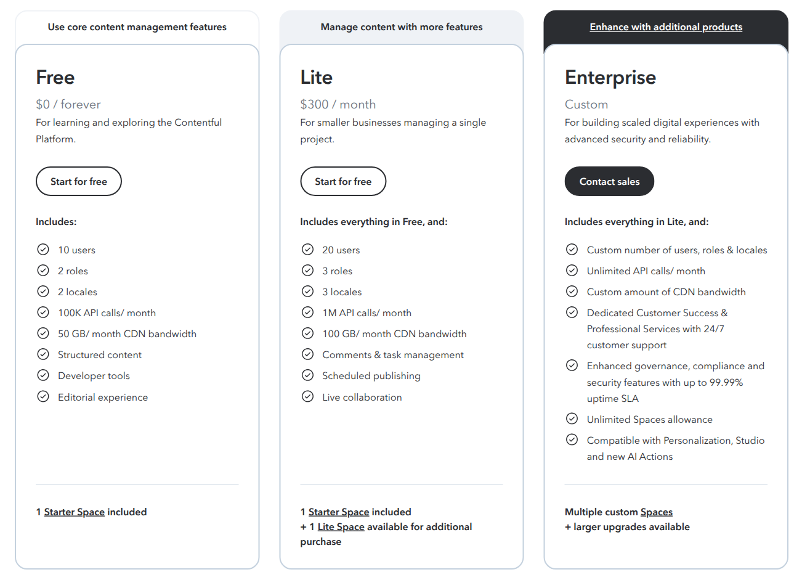
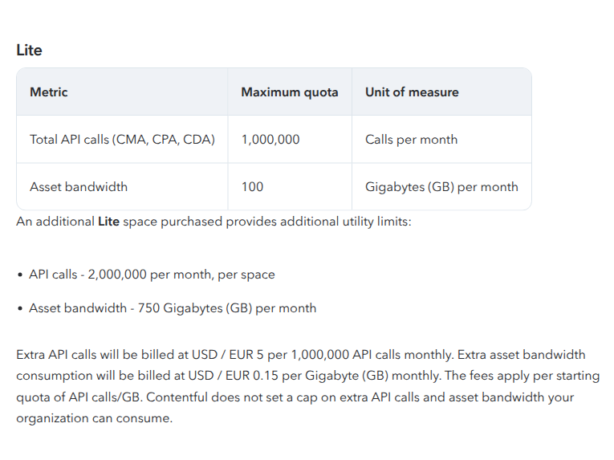

Contentful Lite includes a monthly allowance for API calls and CDN bandwidth. Once the allowances are used up, overages are billed in started blocks. This guide shows how to calculate those blocks and bill them in arrears with two Flexprice meters.

<Frame caption="Contentful platform plan comparison from the official site, 2026-11-27. This guide models only Lite usage overages.">
  
</Frame>

<Frame caption="Contentful Lite overage rates from the official site, 2026-11-27. This guide models only Lite usage overages.">
  
</Frame>

[View the official pricing page](https://www.contentful.com/pricing/).

**Scope:** USD overage charges for one Lite organization with its included Starter Space.

**Not modeled:** The recurring Lite fee and its payment timing, the optional Lite Space, taxes, and Enterprise terms.

## Pricing profile

| Dimension | Modeled offering |
| --- | --- |
| Pricing model | Usage-based |
| Industry | Headless CMS |
| Buyer | Small content teams |
| Sales motion | Self-serve |
| Billing mechanics | Monthly allowances; Started-block overages |

## What Contentful charges

| Item | Published terms | Flexprice implication |
| --- | --- | --- |
| Lite plan context | $300 per month with a Starter Space included | The example sets up only the incremental usage charges |
| API calls | 1,000,000 included monthly. $5.00 per started 1,000,000 extra calls | Count all billable API call types for the organization and round excess up in whole blocks |
| Asset bandwidth | 100 GB included monthly. $0.15 per started extra GB | Sum bandwidth before rounding excess to whole GB |

## Design takeaways

1. **Round at the organization boundary.** Apply the allowance to the monthly organization total before rounding. Rounding per request or per project can turn several fractions of a block into several billable blocks [Published terms](https://www.contentful.com/help/admin/usage/usage-limit/).
2. **Treat the Free cap and Lite allowance differently.** Free disallows paid overages. Keep the product-side limit for Free separate from the paid overage meters attached to Lite [Published terms](https://www.contentful.com/pricing/).

## How Contentful's pricing maps to Flexprice

| Contentful concept | Flexprice configuration |
| --- | --- |
| Organization usage and included amounts | Count monthly consumption and subtract each allowance in the application |
| Started blocks | Round each positive overage up and send the two quantities to SUM meters |
| Overage fees | Apply one USD rate per measured block and invoice in arrears |

## Configure the plan and subscription

These requests are illustrative. Use your test environment and replace example IDs with the IDs returned by your setup. Create a [plan](/docs/product-catalogue/plans/create) with `POST /plans`:

```json
{
  "name": "Contentful Lite usage overages example",
  "lookup_key": "contentful_pricing_example",
  "description": "USD overage charges for one Lite organization with its included Starter Space"
}
```

Create two [metered features](/docs/product-catalogue/features/linking-to-plans). Each feature receives the number of billable units for a resource. Use the corresponding returned meter ID in each `POST /prices` request.

### Additional API call blocks

`POST /features`

```json
{
  "name": "Additional API call blocks",
  "lookup_key": "contentful_lite_overages_api_blocks",
  "type": "metered",
  "meter": {
    "name": "Additional API call blocks",
    "event_name": "contentful_lite_overages",
    "reset_usage": "BILLING_PERIOD",
    "aggregation": {
      "type": "SUM",
      "field": "api_blocks"
    }
  }
}
```

`POST /prices`

```json
{
  "entity_type": "PLAN",
  "entity_id": "plan_contentful_example",
  "currency": "usd",
  "price_unit_type": "FIAT",
  "billing_period": "MONTHLY",
  "billing_period_count": 1,
  "display_name": "Additional API call blocks",
  "type": "USAGE",
  "invoice_cadence": "ARREAR",
  "billing_model": "FLAT_FEE",
  "meter_id": "meter_contentful_1_example",
  "amount": "5.00"
}
```

### Additional bandwidth GB

`POST /features`

```json
{
  "name": "Additional bandwidth GB",
  "lookup_key": "contentful_lite_overages_bandwidth_gb",
  "type": "metered",
  "meter": {
    "name": "Additional bandwidth GB",
    "event_name": "contentful_lite_overages",
    "reset_usage": "BILLING_PERIOD",
    "aggregation": {
      "type": "SUM",
      "field": "bandwidth_gb"
    }
  }
}
```

`POST /prices`

```json
{
  "entity_type": "PLAN",
  "entity_id": "plan_contentful_example",
  "currency": "usd",
  "price_unit_type": "FIAT",
  "billing_period": "MONTHLY",
  "billing_period_count": 1,
  "display_name": "Additional bandwidth GB",
  "type": "USAGE",
  "invoice_cadence": "ARREAR",
  "billing_model": "FLAT_FEE",
  "meter_id": "meter_contentful_2_example",
  "amount": "0.15"
}
```

### Subscription and usage

Create a subscription for the organization with `POST /subscriptions`. Attach the two overage prices using their returned IDs. This example uses a customer with [UTC billing](/docs/customers/timezone-aware-billing) and a December 1 start. If the start date or timezone differs, derive the event window from the subscription's actual period boundaries.

```json
{
  "customer_id": "cust_contentful_example",
  "plan_id": "plan_contentful_example",
  "currency": "usd",
  "billing_period": "MONTHLY",
  "billing_period_count": 1,
  "billing_cycle": "anniversary",
  "include_price_ids": [
    "price_contentful_1_example",
    "price_contentful_2_example"
  ],
  "start_date": "2026-12-01T00:00:00Z"
}
```

At period close, take each organization's finalized total for billable API calls and asset bandwidth. Subtract the included allotment, floor the result at zero, divide by the published block size, and round up once. Send the two whole quantities from this calculation. The meters sum those quantities and the prices charge per unit, so the event must contain overage blocks, already net of the allowances.

Send one period summary with `POST /events` using the customer's external ID. Keep its ID and timestamp stable across retries. Ensure both meters reflect the summary before invoice computation. If the summary arrives after computation, use the [late-usage recovery flow](/docs/core-concepts/invoices#billing-usage-that-arrives-after-the-invoice-is-computed) for the invoice's status.

```json
{
  "event_name": "contentful_lite_overages",
  "event_id": "contentful_usage_2026_12",
  "external_customer_id": "contentful_org_example",
  "timestamp": "2026-12-31T23:59:59Z",
  "properties": {
    "api_blocks": "2",
    "bandwidth_gb": "2"
  }
}
```

## Worked bill

In December the organization uses 2,000,001 API calls and 101.2 GB of asset bandwidth.

| Overage | Usage above allowance | Billable blocks | Charge |
| --- | --- | --- | --- |
| API calls | 1,000,001 calls | 2 started blocks of 1,000,000 calls | 2 × $5.00 = $10.00 |
| Asset bandwidth | 1.2 GB | 2 started 1 GB blocks | 2 × $0.15 = $0.30 |

The usage-only invoice totals **$10.30** before taxes. Check both quantities and charges on the invoice for the completed month.

### Verify the charges before month-end

To test the arithmetic now, use a dedicated test customer with UTC billing. Set the subscription's `start_date` to midnight UTC on the first day of the current month. Send the synthetic summary above with a fresh event ID and a current UTC timestamp within the active period. After the meters reflect the event, call [Get invoice preview](/api-reference/invoices/get-invoice-preview) with the test subscription ID. It previews the current period without creating an invoice.

`POST /invoices/preview`

```json
{
  "subscription_id": "sub_contentful_example"
}
```

Check for two units on each line, with charges of $10.00 and $0.30 before taxes.

## Pricing sources

- [Contentful pricing](https://www.contentful.com/pricing/): Plan price, allowances, and included space.
- [Contentful usage limit policy](https://www.contentful.com/help/admin/usage/usage-limit/): Started-block rates and usage scope.
- [Contentful invoice documentation](https://www.contentful.com/help/admin/billing-subscription/invoices/): Monthly invoice generation.

Pricing checked on 2026-11-27.

## Related guide

[Usage-based pricing](/cookbooks/billing-recipes/usage-based-pricing)
