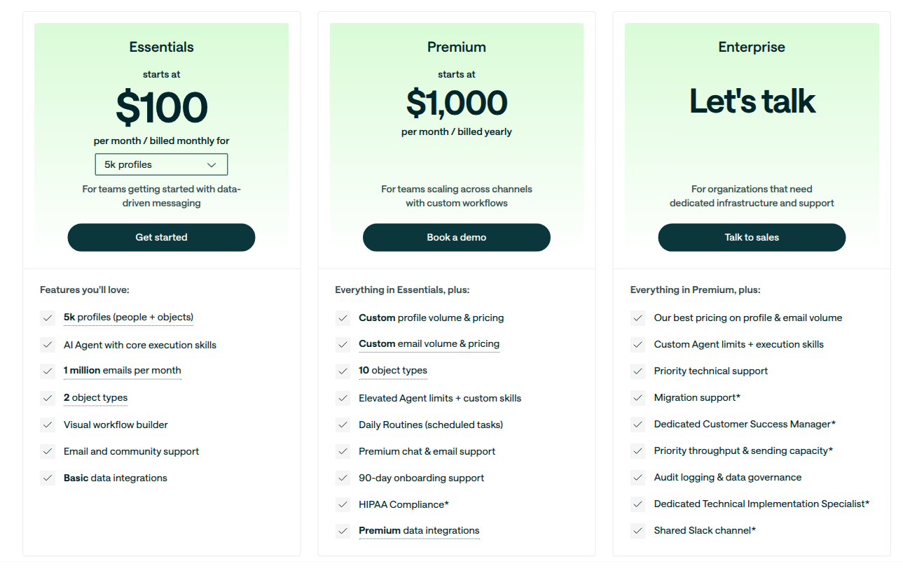
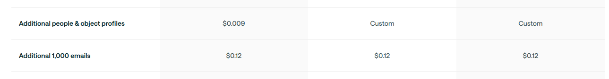

Customer.io Essentials combines a monthly subscription with separate allowances for profiles and email sends. The renewal bill pairs the upcoming month's base fee with overages from the month that just ended.

<Frame caption="Customer.io plan comparison from the official site, 2026-11-26. This guide models only Essentials at 5,000 profiles.">
  
</Frame>

<Frame caption="Customer.io profile and email overage rates from the official site, 2026-11-26. This guide models only Essentials at 5,000 profiles.">
  
</Frame>

[View the official pricing page](https://customer.io/pricing).

**Scope:** The USD Essentials 5,000-profile band with its monthly base fee and profile and email overages.

**Not modeled:** Other profile bands and plans, partial 1,000-email blocks, SMS, other add-ons, taxes, and mid-cycle plan changes.

## Pricing profile

| Dimension | Modeled offering |
| --- | --- |
| Pricing model | Hybrid; Tiered pricing |
| Industry | Customer engagement software |
| Buyer | Lifecycle marketing teams |
| Sales motion | Self-serve |
| Billing mechanics | Monthly base in advance; Separate profile and email allowances; Overages in arrears |

## What Customer.io charges

| Item | Published terms | Flexprice implication |
| --- | --- | --- |
| Base | $100 USD each month, including 5,000 people and object profiles and 1,000,000 emails | One fixed price in advance plus two separate metered prices |
| Profile overage | $0.009 per profile beyond 5,000. Count profiles that existed at any point in the cycle, across workspaces | Build the cycle total from opening profiles and subsequent additions. Deletions stay in the billed cycle |
| Email overage | $0.12 per 1,000 emails above 1,000,000. Sends count once they reach the email service provider | Measure billable sends separately from profiles or delivered mail. The example uses exact blocks |
| Renewal | Next month's base and previous month's overages are billed together | Set the fixed line to advance and the usage lines to arrears |

## Design takeaways

1. **Bill the period's profile population.** A month-end snapshot drops deleted records that still count. Calculate the billable population across workspaces and track each delete-and-recreate as a separate profile occurrence [Published terms](https://docs.customer.io/accounts-and-workspaces/billing/).
2. **Keep each renewal line tied to its service period.** On the same renewal, the new base opens a fresh allowance while the two usage lines settle the prior allowance. Derive both usage quantities from the same closed window so neither uses the new cycle's counters [Published terms](https://docs.customer.io/accounts-and-workspaces/billing/).

## How Customer.io's pricing maps to Flexprice

| Customer.io concept | Flexprice configuration |
| --- | --- |
| Monthly Essentials fee | One fixed price in advance |
| Profiles and email blocks | Two SUM meters based on a period summary |
| Included usage and overage | Separate graduated tiers with zero-priced included quantities |
| Renewal | Current-period usage in arrears and next-period base in advance |

## Configure the plan and subscription

These requests are illustrative. Use your test environment and replace example IDs with the IDs returned by your setup. Create a [plan](/docs/product-catalogue/plans/create) with `POST /plans`:

```json
{
  "name": "Customer.io Essentials at 5,000 profiles example",
  "lookup_key": "customerio_pricing_example",
  "description": "The USD Essentials 5,000-profile band with its monthly base fee and profile and email overages"
}
```

Use `POST /prices` to add the fixed subscription fee.

```json
{
  "entity_type": "PLAN",
  "entity_id": "plan_customerio_example",
  "currency": "usd",
  "price_unit_type": "FIAT",
  "billing_period": "MONTHLY",
  "billing_period_count": 1,
  "display_name": "Essentials monthly base",
  "type": "FIXED",
  "billing_model": "FLAT_FEE",
  "invoice_cadence": "ADVANCE",
  "amount": "100.00"
}
```

Create these [metered features](/docs/product-catalogue/features/linking-to-plans) with `POST /features`. Use each returned meter ID in its corresponding `POST /prices` request. Graduated tiers (`SLAB`) charge only for units above each allowance.

### Billable profiles

`POST /features`

```json
{
  "name": "Billable profiles",
  "lookup_key": "customerio_monthly_usage_profiles",
  "type": "metered",
  "meter": {
    "name": "Billable profiles",
    "event_name": "customerio_monthly_usage",
    "reset_usage": "BILLING_PERIOD",
    "aggregation": {
      "type": "SUM",
      "field": "profiles"
    }
  }
}
```

`POST /prices`

```json
{
  "entity_type": "PLAN",
  "entity_id": "plan_customerio_example",
  "currency": "usd",
  "price_unit_type": "FIAT",
  "billing_period": "MONTHLY",
  "billing_period_count": 1,
  "display_name": "Billable profiles",
  "type": "USAGE",
  "invoice_cadence": "ARREAR",
  "billing_model": "TIERED",
  "tier_mode": "SLAB",
  "meter_id": "meter_customerio_1_example",
  "tiers": [
    {
      "up_to": 5000,
      "unit_amount": "0"
    },
    {
      "unit_amount": "0.009"
    }
  ]
}
```

### Billable email blocks

`POST /features`

```json
{
  "name": "Billable email blocks",
  "lookup_key": "customerio_monthly_usage_email_blocks",
  "type": "metered",
  "meter": {
    "name": "Billable email blocks",
    "event_name": "customerio_monthly_usage",
    "reset_usage": "BILLING_PERIOD",
    "aggregation": {
      "type": "SUM",
      "field": "email_blocks"
    }
  }
}
```

`POST /prices`

```json
{
  "entity_type": "PLAN",
  "entity_id": "plan_customerio_example",
  "currency": "usd",
  "price_unit_type": "FIAT",
  "billing_period": "MONTHLY",
  "billing_period_count": 1,
  "display_name": "Billable email blocks",
  "type": "USAGE",
  "invoice_cadence": "ARREAR",
  "billing_model": "TIERED",
  "tier_mode": "SLAB",
  "meter_id": "meter_customerio_2_example",
  "tiers": [
    {
      "up_to": 1000,
      "unit_amount": "0"
    },
    {
      "unit_amount": "0.12"
    }
  ]
}
```

### Subscription and usage

Use `POST /subscriptions` when paid billing begins. The worked example sets `start_date` to the beginning of December in UTC so the anniversary period matches the usage window. For a different start, update the start date and the summary event's ID and timestamp to match the actual period. An active subscription with a future start date raises its opening advance invoice at creation. To prepare it earlier and defer the invoice, [create a draft](/docs/core-concepts/subscriptions#choosing-a-subscription-start-date) and activate it when billing begins.

```json
{
  "customer_id": "cust_customerio_example",
  "plan_id": "plan_customerio_example",
  "currency": "usd",
  "billing_period": "MONTHLY",
  "billing_period_count": 1,
  "billing_cycle": "anniversary",
  "start_date": "2026-12-01T00:00:00Z"
}
```

From your application's records, count opening profiles plus all new profiles in the billing month, across workspaces. Count a recreated profile again and retain deleted profiles for the current month's total. Count billable email sends that reach the email service provider. Report the profile total and the email total in 1,000-email units without subtracting allowances. This example covers complete blocks. Verify how partial blocks are charged before using this model for them.

Send one summary using `POST /events` and the customer's external ID. Use a timestamp inside the period you are settling and ensure the meters reflect the summary before the first invoice computation. Keep the event ID and timestamp stable on retries. If usage arrives late, follow the [invoice recovery flow](/docs/core-concepts/invoices#billing-usage-that-arrives-after-the-invoice-is-computed).

```json
{
  "event_name": "customerio_monthly_usage",
  "event_id": "customerio_usage_2026_12",
  "external_customer_id": "customerio_account_example",
  "timestamp": "2026-12-31T23:59:59Z",
  "properties": {
    "profiles": "5200",
    "email_blocks": "1010"
  }
}
```

## Worked bill

The opening invoice includes only the **$100.00** base for the first month. Start the period with 4,970 profiles, add 230, and delete 60. The ending count is 5,140, but 5,200 profiles existed during the period. Email volume is 1,010,000 sends, or 1,010 whole blocks.

| Renewal line | Service period | Calculation | Charge |
| --- | --- | --- | --- |
| Essentials base | Upcoming month | Fixed charge | $100.00 |
| Profile overage | Prior month | (5,200 − 5,000) × $0.009 | $1.80 |
| Email overage | Prior month | (1,010 − 1,000) × $0.12 | $1.20 |

The renewal invoice totals **$103.00** before taxes. Usage at or below either allowance adds $0 for that dimension.

## Pricing sources

- [Customer.io pricing](https://customer.io/pricing): Essentials base price, allowances and overage rates.
- [Customer.io billing guide](https://docs.customer.io/accounts-and-workspaces/billing/): Billable profile and send definitions and monthly invoice timing.

Pricing checked on 2026-11-26.

## Related guide

[Plan price overrides](/docs/subscriptions/plan-price-overrides)
