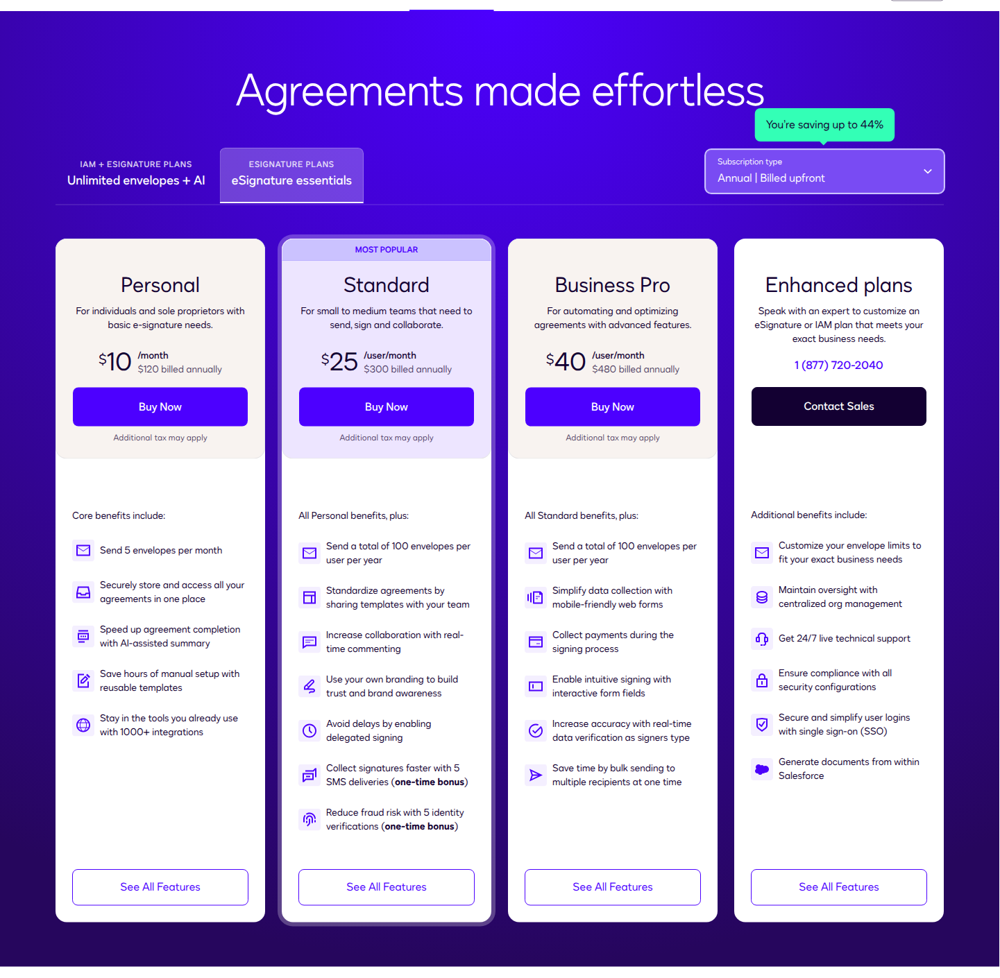

DocuSign eSignature Standard shows $25 per user per month with Annual | Billed upfront selected, and explicitly lists $300 billed annually. Configure the full yearly amount in Flexprice rather than charging $25 each month. Envelope allowances are a separate product limit, not another seat quantity.

<Frame caption="DocuSign pricing comparison from the official site, 2026-11-24. This guide models only eSignature Standard annual upfront.">
  
</Frame>

[View the official pricing page](https://ecom.docusign.com/plans-and-pricing/esignature).

**Scope:** The published US eSignature Standard base subscription with annual upfront billing and an unchanged purchased-user count.

**Not modeled:** Annual commitments paid in monthly installments, month-to-month purchases, other eSignature tiers, IAM, envelope tracking or overage, SMS, identity checks, mid-term changes, refunds, discounts and taxes.

## Pricing profile

| Dimension | Modeled offering |
| --- | --- |
| Pricing model | Per-seat; Subscription |
| Industry | Electronic signature software |
| Buyer | Small and medium teams sending agreements |
| Sales motion | Self-serve |
| Billing mechanics | Annual upfront payment; Purchased-user quantity; Monthly-equivalent price display |

## What DocuSign charges

| Item | Published terms | Flexprice implication |
| --- | --- | --- |
| Standard displayed rate | $25 USD per user per month on the Annual &#124; Billed upfront view | Convert the display to $300.00 per user per year |
| Actual payment period | $300 billed annually | Annual billing period and advance invoice |
| Included sends | 100 envelopes per user per year | Separate access allowance; not a metered charge or additional seat |
| Other billing selection | Annual &#124; Billed monthly is a one-year commitment paid in monthly installments | Different contract and price; excluded rather than treated as the upfront option |

## Design takeaways

1. **Read the payment selector as well as the price.** An annual commitment can be paid upfront or in installments. The $25 display belongs to the upfront choice; preserve both the $300 amount and annual invoice period when translating it. [Published terms](https://ecom.docusign.com/plans-and-pricing/esignature).
2. **Do not use sends as the seat quantity.** The plan pairs a purchased-user charge with an annual envelope allowance. Keep sending access separate from the fixed-price quantity; otherwise higher send volume would incorrectly increase the seat fee. [Published terms](https://ecom.docusign.com/plans-and-pricing/esignature).

## How DocuSign's pricing maps to Flexprice

| DocuSign concept | Flexprice configuration |
| --- | --- |
| Annual price per purchased Standard user | Fixed price of $300.00 USD in advance |
| Billable quantity | Application or checkout calculation, passed as the fixed-line quantity |

## Configure the plan and subscription

These requests are illustrative. Use your test environment and replace example IDs with the IDs returned by your setup. Create a [plan](/docs/product-catalogue/plans/create) with `POST /plans`:

```json
{
  "name": "DocuSign eSignature Standard annual upfront example",
  "lookup_key": "docusign_pricing_example",
  "description": "The published US eSignature Standard base subscription with annual upfront billing and an unchanged purchased-user count"
}
```

Create the [fixed price](/docs/product-catalogue/plans/pricing) with `POST /prices`. Enter the full amount per seat for one year in USD, not cents.

```json
{
  "entity_type": "PLAN",
  "entity_id": "plan_docusign_example",
  "currency": "usd",
  "price_unit_type": "FIAT",
  "billing_period": "ANNUAL",
  "billing_period_count": 1,
  "display_name": "eSignature Standard annual upfront",
  "type": "FIXED",
  "billing_model": "FLAT_FEE",
  "invoice_cadence": "ADVANCE",
  "amount": "300.00"
}
```

Use the number of purchased Standard user subscriptions as the fixed line quantity. Four purchased users require quantity four. Do not substitute the number of recipients signing agreements, envelopes sent or fields in a document. This guide does not configure the included envelope allowance or charge for extra envelopes. The annual-upfront selection is essential: the monthly-installment option is not represented by changing only the invoice period.

Create or select a customer to bill, then use `POST /subscriptions`. Set the quantity on the returned fixed price using a [line-item override](/docs/subscriptions/plan-price-overrides).

```json
{
  "customer_id": "cust_docusign_example",
  "plan_id": "plan_docusign_example",
  "currency": "usd",
  "billing_period": "ANNUAL",
  "billing_period_count": 1,
  "billing_cycle": "anniversary",
  "start_date": "2026-12-01T00:00:00Z",
  "override_line_items": [
    {
      "price_id": "price_docusign_example",
      "quantity": "4"
    }
  ]
}
```

## Worked bill

Four purchased users cost **4 × ($25 × 12) = 4 × $300.00 = $1,200.00 billed upfront for one year** before tax. This is not a $100 monthly invoice. A fifth purchased user present for the whole year would make the base $1,500.00. Sending more envelopes does not change this fixed line; any separate envelope charge is outside the example.

Verify that the opening invoice shows the annual unit amount and the fixed-line quantity, with no metered line in this example.

## Pricing sources

- [DocuSign eSignature pricing and FAQ](https://ecom.docusign.com/plans-and-pricing/esignature): US eSignature annual-upfront selector, Standard annual charge, included envelope allowance and separate annual-installment option.

Pricing checked on 2026-11-24. This example does not reproduce a full provider invoice.

## Related guide

[Plan price overrides](/docs/subscriptions/plan-price-overrides)
