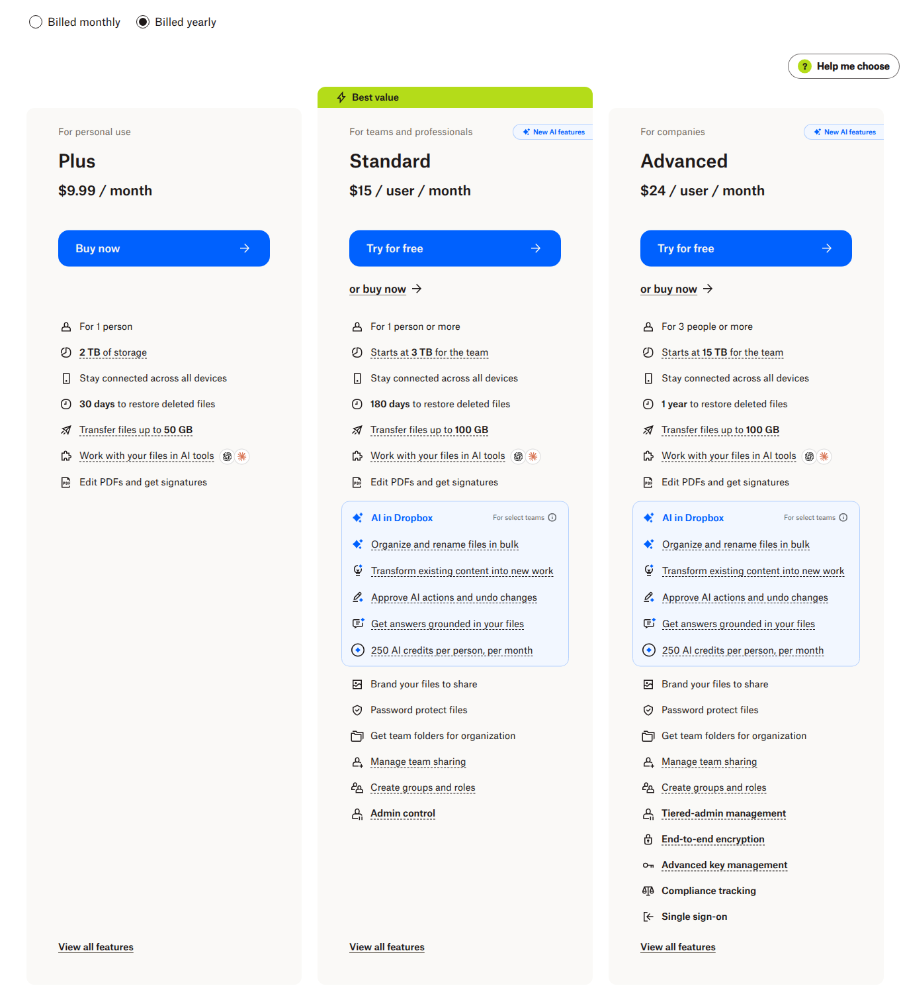

Dropbox Advanced lists $24 per user per month with yearly billing selected and starts at three people. Model it in Flexprice as an annual seat price. Enforce the minimum when choosing the subscription quantity rather than metering actual sign-ins.

<Frame caption="Dropbox pricing comparison from the official site, 2026-11-23.">
  
</Frame>

[View the official pricing page](https://www.dropbox.com/plans).

**Scope:** The US yearly Advanced base charge for one team, including the starting seat minimum.

**Not modeled:** Monthly rates, trials, seat changes mid-term, additional storage, AI credits, and taxes.

## Pricing profile

| Dimension | Modeled offering |
| --- | --- |
| Pricing model | Per-seat |
| Industry | Cloud file storage and sharing |
| Buyer | Company teams |
| Sales motion | Self-serve |
| Billing mechanics | Annual fixed price; Minimum three seats |

## What Dropbox charges

| Item | Published terms | Flexprice implication |
| --- | --- | --- |
| Advanced yearly rate | $24 USD per user per month on the Billed yearly view | $288 USD fixed per seat per year |
| Starting size | For three people or more | Require at least three purchased seats |
| Storage | Starts at 15 TB for the team | The shared allowance is not multiplied per seat in this example |

## Design takeaways

1. **Enforce the seat floor when selecting quantity.** A per-seat price alone would allow one or two seats. Validate the ordered quantity before creating the subscription so it cannot fall below the plan minimum. [Published terms](https://www.dropbox.com/plans).
2. **Do not price team storage as a seat.** The card puts its starting storage allowance at team level. Keep account-level capacity separate from the quantity on the seat charge. [Published terms](https://www.dropbox.com/plans).

## How Dropbox's pricing maps to Flexprice

| Dropbox concept | Flexprice configuration |
| --- | --- |
| Annual price per seat | Fixed price of $288.00 USD in advance |
| Billable quantity | Application or checkout calculation, passed as the fixed-line quantity |

## Configure the plan and subscription

These requests are illustrative. Use your test environment and replace example IDs with the IDs returned by your setup. Create a [plan](/docs/product-catalogue/plans/create) with `POST /plans`:

```json
{
  "name": "Dropbox Advanced example",
  "lookup_key": "dropbox_pricing_example",
  "description": "The US yearly Advanced base charge for one team, including the starting seat minimum"
}
```

Create the [fixed price](/docs/product-catalogue/plans/pricing) with `POST /prices`. Enter the full annual amount per seat in USD, not cents.

```json
{
  "entity_type": "PLAN",
  "entity_id": "plan_dropbox_example",
  "currency": "usd",
  "price_unit_type": "FIAT",
  "billing_period": "ANNUAL",
  "billing_period_count": 1,
  "display_name": "Advanced",
  "type": "FIXED",
  "billing_model": "FLAT_FEE",
  "invoice_cadence": "ADVANCE",
  "amount": "288"
}
```

Require at least three purchased seats at checkout. If a buyer only requests two, show the three-seat minimum and collect approval for that quantity before creating the subscription. The price below does not enforce the minimum on its own.

Create or select a customer to bill, then use `POST /subscriptions`. Set the quantity on the returned fixed price using a [line-item override](/docs/subscriptions/plan-price-overrides).

```json
{
  "customer_id": "cust_dropbox_example",
  "plan_id": "plan_dropbox_example",
  "currency": "usd",
  "billing_period": "ANNUAL",
  "billing_period_count": 1,
  "billing_cycle": "anniversary",
  "start_date": "2026-12-01T00:00:00Z",
  "override_line_items": [
    {
      "price_id": "price_dropbox_example",
      "quantity": "3"
    }
  ]
}
```

## Worked bill

The minimum three-seat order is **3 × ($24 × 12) = $864.00 per year** before taxes. Four purchased seats at the same list rate would be $1,152.00 per year.

Verify that the opening invoice shows the annual unit amount and the fixed-line quantity, with no metered line in this example.

## Pricing sources

- [Dropbox pricing](https://www.dropbox.com/plans): Yearly selector, Advanced list rate, and three-person starting size.

Pricing checked on 2026-11-23. This example does not reproduce a full provider invoice.

## Related guide

[Plan price overrides](/docs/subscriptions/plan-price-overrides)
