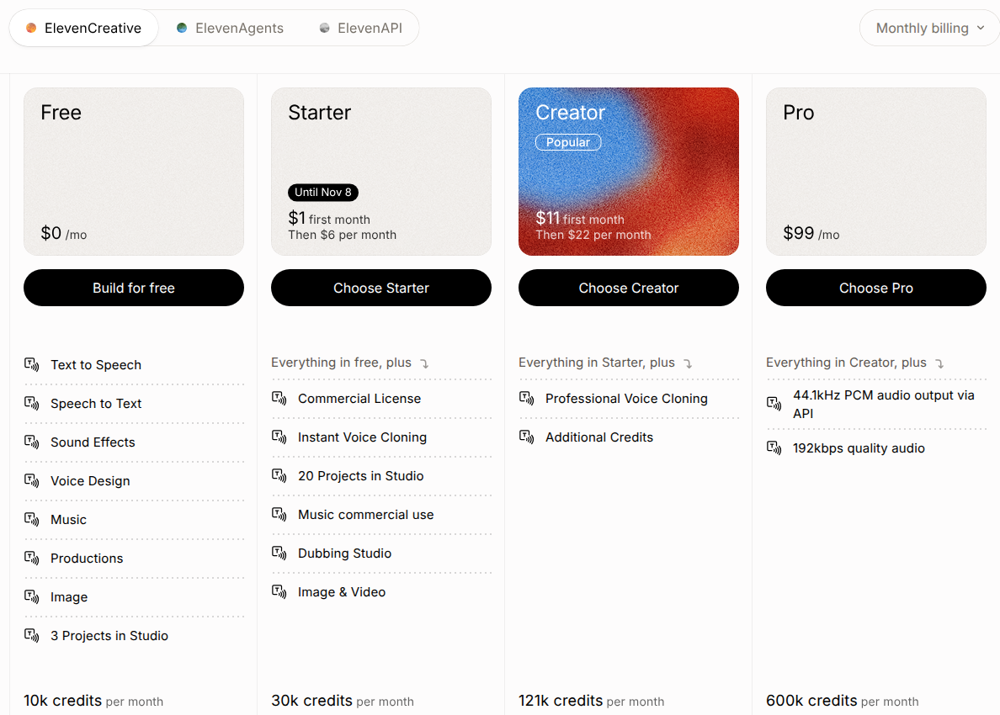

ElevenLabs combines a subscription fee with a shared credit allowance for audio generation and other products. Credits are not always characters: the conversion depends on the model and how it is used. This guide models **one ordinary monthly Creator billing cycle using only Eleven Multilingual v2 Text to Speech**, with a recurring fee and a metered quantity entitlement.

<Frame caption="ElevenLabs monthly plan cards, captured from its official pricing page on November 4, 2026. This teardown uses Creator's ordinary $22 monthly fee and 121,000-credit allowance for Multilingual v2 TTS only; first-month discounts and other plans and products are excluded.">
  
</Frame>

Source: [ElevenLabs's official pricing page](https://elevenlabs.io/pricing).

<Note>
  The example starts with no carried credits, uses ordinary voices without extra credit multipliers, and has no other products consuming the shared pool. It excludes the introductory discount, annual plans, paid top-ups, legacy overages, taxes, voice cloning entitlements, and other models. It does not implement rollover, so it is not a complete reproduction of an ongoing ElevenLabs account with unused credits.
</Note>

## Pricing profile

These labels describe only the self-serve monthly Creator offering modeled here, using the Multilingual v2 Text to Speech API. They do not classify ElevenLabs as a whole or include the excluded products and payment paths.

| Dimension | Labels | First-party basis |
| --- | --- | --- |
| **Pricing model** | Subscription; Credits | [Creator pricing](https://elevenlabs.io/pricing) bundles a monthly credit allowance with a recurring fee |
| **Industry** | AI | The [API overview](https://elevenlabs.io/docs/overview/intro) identifies text-to-speech as AI voice infrastructure |
| **Buyer** | Developers | The [API overview](https://elevenlabs.io/docs/overview/intro) describes developers embedding voice through the REST API and SDKs |
| **Sales motion** | Self-serve | [Billing](https://elevenlabs.io/docs/overview/administration/billing) describes account-based plan selection; the [self-serve tier list](https://elevenlabs.io/docs/overview/administration/pay-as-you-go) includes Creator |
| **Billing mechanics** | Shared credit pool; Included usage credits; Monthly credit reset | The [pricing FAQ](https://elevenlabs.io/pricing) documents the shared allowance and reset at the subscription billing-cycle boundary |

## Creator pricing and credit accounting

The [official pricing page](https://elevenlabs.io/pricing), with **monthly billing** selected, lists these terms:

| Dimension | Current published terms | Scope used here |
| --- | --- | --- |
| **Creator subscription** | $11 for the first month, then $22 per month | Ordinary recurring month at **$22**, not the introductory offer |
| **Monthly allowance** | **121,000 credits** per month | One customer-level pool, not an allowance per voice or request |
| **Multilingual v2 Text to Speech** | **1 credit per text character** | Model ID `eleven_multilingual_v2` |
| **Flash/Turbo API conversion** | Depending on the model and plan, **0.5 to 1 credit per character** | Excluded; do not apply the Multilingual v2 conversion to these models |
| **Subscription rollover** | Up to two months of unused credits, allowing a balance up to three times the monthly quota while eligible | No opening rollover balance in the worked cycle; rollover implementation excluded |
| **Taxes** | Prices exclude taxes, levies and duties | All example totals are before tax |

The allowance is shared across products. A separate 121,000-credit entitlement for every model would multiply the customer's included usage incorrectly. For this single-model example, 121,000 credits can fund 121,000 charged characters. The [model documentation](https://elevenlabs.io/docs/overview/models) also sets a **10,000-character limit per Multilingual v2 request**; that is a request limit, not a billing package size.

The pricing FAQ says credits are charged per generation request, not per download. Some unchanged regenerations can be free. Count charged usage, not downloads or every retry indiscriminately.

### What happens after the allowance

For new self-serve customers, [Pay As You Go](https://elevenlabs.io/docs/overview/administration/pay-as-you-go) extends usage with **prepaid top-ups**, not postpaid overage debt. Included subscription credits are consumed first. The minimum USD top-up is **$5**, and purchased credits expire **12 months after purchase**. With no available credits and Auto Top Up off, service pauses.

The [billing documentation](https://elevenlabs.io/docs/overview/administration/billing) separately describes usage-based billing for eligible legacy subscriptions and Enterprise. Do not apply a legacy postpaid rate to a new Creator subscription. This guide creates neither top-ups nor an overage price. Without that extension, your application must stop generation when the included allowance is exhausted.

## How ElevenLabs's pricing maps to Flexprice

| ElevenLabs's pricing uses | Flexprice setup |
| --- | --- |
| **Monthly Creator fee** | A [plan](/docs/product-catalogue/plans/create) with a fixed $22 monthly recurring charge |
| **Credit consumption for the selected model** | A [metered feature](/docs/product-catalogue/features/create) that sums a numeric `credits` property and filters on `model` |
| **Included customer-level allowance** | A [quantity entitlement](/docs/product-catalogue/features/linking-to-plans) of 121,000 credits, aligned with the monthly subscription cycle |
| **No paid extension in this example** | A hard-limit entitlement plus application-side request admission; no usage charge |
| **Rollover and purchased balances** | Outside this cycle-only configuration; a resetting entitlement alone does not reproduce credit carryover or purchased-credit expiry |

These are consumption credits, not USD wallet credits. Do not create a $121,000 wallet or infer a per-character overage rate by dividing the $22 fee by the allowance. There is no minimum-spend commitment, volume tier, or rounded character package in this example.

## Set up the feature and monthly plan

<Steps>
  <Step title="Create one credit-consumption feature">
    Go to **Product Catalog > Features > Add Feature**. Name the feature **ElevenLabs Multilingual v2 credits**, choose **Metered**, and use the following settings:

    | Setting | Value |
    | --- | --- |
    | **Event Name** | `elevenlabs_generation` |
    | **Aggregation** | `SUM` |
    | **Field** | `credits` |
    | **Filter** | `model` equals `eleven_multilingual_v2` |
    | **Usage Reset** | Periodic |
    | **Units** | `credit` / `credits` |

    Leave reporting conversion unset and retain raw credit counts. A reporting conversion divides raw usage by `conversion_rate` for display; it does not change billing arithmetic or perform the model's character-to-credit conversion.
  </Step>
  <Step title="Create the recurring charge">
    Go to **Product Catalog > Plans > Add** and create **ElevenLabs Creator TTS Example**. Add one recurring fixed charge in **USD**, amount **22.00**, billing period **Monthly**, count **1**, billed **in advance**. Do not add a per-character price, a package charge, or a second charge for included usage. This setup models an ordinary renewal, not the $11 introductory month.
  </Step>
  <Step title="Attach the included allowance">
    In the plan's **Entitlements** section, add the credit-consumption feature. Set the usage limit to **121000**, turn off the soft-limit option, and align the monthly reset with the subscription billing cycle, not the first day of the calendar month. The corresponding entitlement settings are `usage_limit: 121000`, `is_soft_limit: false`, and `usage_reset_period: "MONTHLY"`.

    This is a standard quantity entitlement, not a short-window entitlement grant. It does not roll unused credits forward. Do not reuse it unchanged for later cycles that begin with a carried balance.
  </Step>
  <Step title="Subscribe a customer and enforce admission">
    Create a customer and [subscription](/docs/subscriptions/customers-create-subscription), with subscription quantity **1**, to the example plan. Before calling the generation API, check the customer's remaining allowance and enforce the 10,000-character request limit in your application. Reserve credit capacity atomically for concurrent requests, then reconcile against actual charged usage.

    Flexprice meters events asynchronously; an entitlement is not an inline proxy that blocks the ElevenLabs API. Your application must prevent requests that would exceed the remaining allowance, release reservations for uncharged requests, and avoid starting additional generation once the pool is exhausted.
  </Step>
</Steps>

## Send usage and verify the bill

Select `model_id: "eleven_multilingual_v2"` in the [Text to Speech request](https://elevenlabs.io/docs/api-reference/text-to-speech/convert). For charged generations in the selected scope, normalize characters to credits at **1:1** on your server. Reconcile against the provider's charged usage rather than treating a failed request, a free regeneration, or a download as new consumption.

[Send one Flexprice usage event](/docs/core-concepts/usage-events/sending-events) per charged generation. This is an illustrative normalized event, not an ElevenLabs API response:

```json
{
  "event_name": "elevenlabs_generation",
  "external_customer_id": "customer_example",
  "event_id": "elevenlabs_generation_example_001",
  "timestamp": "2026-11-04T00:00:00Z",
  "properties": {
    "model": "eleven_multilingual_v2",
    "credits": 1500
  }
}
```

Use the actual generation timestamp. Keep both `event_id` and `timestamp` unchanged when retrying event delivery so the same generation is not counted twice. Do not emit both streaming fragments and a final total as separate charged usage.

Assume **80 charged generations of 1,500 characters each**, no opening rollover, and no other consumption. Every request is below the 10,000-character limit:

| Item | Exact calculation | Result |
| --- | --- | --- |
| **Characters generated** | 80 × 1,500 | 120,000 characters |
| **Credits consumed** | 120,000 × 1 | 120,000 credits |
| **Remaining allowance** | 121,000 − 120,000 | 1,000 credits |
| **Recurring fee** | 1 × $22.00 | $22.00 |
| **Additional usage charge** | Usage remains within the included pool | $0.00 |
| **Total before tax** | $22.00 + $0.00 | **$22.00** |

Use decimal arithmetic to reproduce the calculation without floating-point rounding:

```python
from decimal import Decimal

characters = Decimal("80") * Decimal("1500")
credits = characters * Decimal("1")
remaining = Decimal("121000") - credits
recurring_fee = Decimal("22.00")
additional_charge = Decimal("0.00")
total = recurring_fee + additional_charge

assert characters == Decimal("120000")
assert credits == Decimal("120000")
assert remaining == Decimal("1000")
assert total == Decimal("22.00")
```

Another 1,500-character request would exceed the remaining 1,000 credits, so the application must reject it in this no-top-up example rather than inventing an overage charge. On a real eligible ElevenLabs subscription, unused credits can carry forward under the documented rollover rules. Reproducing that next cycle requires tracking the remaining credit lots and expiry separately; the reset-only configuration above deliberately stops at this boundary. This guide describes a configuration and calculation, not a live setup performed in your account.

## Design takeaways

These are modeling recommendations for this example, not claims about ElevenLabs's business intent.

- **Separate allowance allocation from unit conversion.** The [pricing FAQ](https://elevenlabs.io/pricing) describes a shared credit pool and model-dependent character conversion. In this single-model Flexprice setup, sum normalized `credits` behind the model filter and attach one allowance. Treating characters as a universal credit unit or allocating fresh quota per model would change the entitlement.
- **A request ceiling is not a billing increment.** The [model documentation](https://elevenlabs.io/docs/overview/models) limits Multilingual v2 requests to 10,000 characters, while [pricing](https://elevenlabs.io/pricing) charges one credit per character for that model. Enforce the ceiling before calling the API, but meter actual charged credits; rounding a 1,500-character generation up to 10,000 would invent consumption.
- **An excluded payment path must not become implicit debt.** [PAYG documentation](https://elevenlabs.io/docs/overview/administration/pay-as-you-go) consumes subscription credits before a prepaid balance. Because this example excludes that extension, pair the fixed charge with a hard quantity entitlement and application-side admission, not a postpaid usage price. Supporting top-ups later would require a separate balance lifecycle rather than merely removing the limit.

## Pricing sources

Pricing checked on 2026-11-04.

- [ElevenLabs pricing](https://elevenlabs.io/pricing): monthly Creator price and allowance, introductory discount, model-dependent conversion, shared credits, request charging, rollover and tax exclusions.
- [ElevenLabs billing](https://elevenlabs.io/docs/overview/administration/billing): subscription cadence and the distinction between new self-serve top-ups and legacy usage-based billing.
- [ElevenLabs Pay As You Go](https://elevenlabs.io/docs/overview/administration/pay-as-you-go): consumption priority, $5 USD minimum top-up, 12-month expiry and service pause without available prepaid balance.
- [ElevenLabs models](https://elevenlabs.io/docs/overview/models): Multilingual v2 model identifier and 10,000-character request limit.
- [ElevenLabs Text to Speech API](https://elevenlabs.io/docs/api-reference/text-to-speech/convert): selecting the model for a generation request.
- [ElevenLabs API overview](https://elevenlabs.io/docs/overview/intro): AI voice infrastructure and the developer audience for the REST API and SDKs.

## Related recipe

<Card icon="book-open" horizontal={true} href="/cookbooks/billing-recipes/hybrid-pricing" title="Build Hybrid Pricing" />
