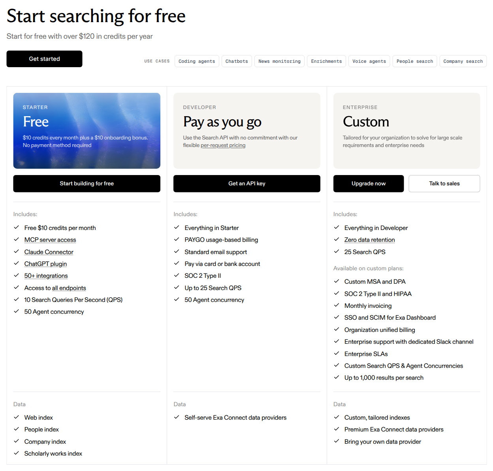
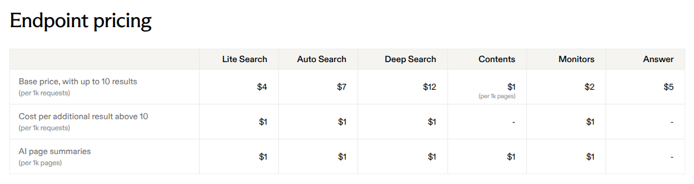

Exa prices its search API by request, with an additional charge when a request goes beyond ten results. **Auto Search costs $7 per 1,000 requests**, plus **$1 per 1,000 additional results above ten per request**. This guide models those two gross usage components in Flexprice, without reproducing Exa's prepaid credit balance or payment collection.

<Frame caption="Exa's complete Free, Pay as you go and Custom plan comparison, captured from its official pricing page on November 10, 2026. Free credits and Enterprise terms provide context but are not configured in this example.">
  
</Frame>

<Frame caption="Exa's complete endpoint rate table, captured on November 10, 2026. Only Auto Search base requests and additional results are modeled; summaries and other endpoints are excluded. The pricing documentation clarifies that the additional-result rate applies per result above ten.">
  
</Frame>

Source: [Exa pricing](https://exa.ai/pricing), with counting and credit definitions from the [pricing documentation](https://exa.ai/docs/reference/pricing).

<Note>
  **Modeled scope:** Auto Search requests and their billable results above ten per request, at public list rates. The example assumes verified charged usage with no AI-generated summaries. It excludes free and promotional credits, prepaid funding and balance enforcement, other search types, Contents, Answer, Monitors, Agent, third-party data, Enterprise contracts, discounts and taxes. It calculates gross usage cost, not the amount a real Exa account must pay or top up.
</Note>

## Pricing profile

These labels describe the Auto Search usage component, not every Exa product or contract.

| Dimension | Offering profile |
| --- | --- |
| Pricing model | [Usage-based](https://exa.ai/docs/reference/pricing) |
| Industry | [AI search infrastructure](https://exa.ai/pricing) |
| Buyer | [Developers](https://exa.ai/docs/reference/search) |
| Sales motion | [Self-serve](https://exa.ai/pricing) |
| Billing mechanics | [Per-request base charge; Per-request included results; Additional-result charge](https://exa.ai/docs/reference/pricing) |

## Exa's pricing at a glance

| Component | Published rule | Treatment in this example |
| --- | --- | --- |
| **Auto Search base request** | $7 per 1,000 requests, including up to 10 results per request | $0.007 per billable request |
| **Results above 10** | $1 per 1,000 additional results | $0.001 per billable additional result |
| **AI page summaries** | $1 per 1,000 pages | Excluded; do not request summaries in this workload |
| **Free credits** | Free balance resets to $10 on the first of each month; a one-time $10 onboarding bonus is available | Not deducted from the gross example |
| **Payment model** | Pay as you go with loaded credits; no subscription or minimum spend | Prepaid balance lifecycle is not configured |

The [pricing glossary](https://exa.ai/docs/reference/pricing) defines one request as one API call. It explicitly says that a request for 20 results costs the base price plus 10 additional results. The extra-result threshold belongs to **each request**, not to a monthly pool. The first ten results are included in a paid request; they are not ten free search requests.

## Design takeaways

1. **Keep request counts and result counts separate.** The [two published rates](https://exa.ai/docs/reference/pricing) apply to different units. One meter cannot represent both without hiding the rate conversion. Two SUM meters preserve each quantity and produce separate invoice lines.
2. **Apply request-level inclusions before monthly aggregation.** Exa's [20-result example](https://exa.ai/docs/reference/pricing) adds ten results to that request. Unused result capacity from a smaller request must not offset a larger one. Normalize additional results upstream rather than applying a monthly free-result tier.
3. **Do not confuse a rate card with a settlement model.** Exa's [credits are a prepaid dollar balance](https://exa.ai/docs/reference/pricing). Reproducing that account would also require credit funding, grants and balance enforcement. This guide isolates gross charges and does not claim that monthly arrears recreates those controls.

## How Exa's pricing maps to Flexprice

| Exa's pricing uses | Flexprice setup |
| --- | --- |
| **Auto Search request count** | A [metered feature](/docs/product-catalogue/features/create) with SUM aggregation on `search_requests` |
| **Additional results above ten per request** | A second SUM meter on upstream-normalized `additional_results` |
| **Different rates for different units** | Two [flat-fee usage prices](/docs/product-catalogue/plans/billing-models/flat-fee), $0.007 per request and $0.001 per additional result |
| **Auto Search only** | The same `search_type=auto` filter on both meters |
| **Paid access without a monthly quantity allowance** | Unlimited metered entitlements; no monthly free-result tier |

The illustrative Flexprice plan below bills **monthly in arrears** so both components can be inspected on an invoice. This is an implementation choice for the gross-cost example, not Exa's prepaid collection model. Do not use it as a complete Exa account configuration without separately implementing the excluded credit lifecycle and service controls.

## Create the two features and meters

Create **Exa Auto Search requests** with this illustrative feature payload:

```json
{
  "name": "Exa Auto Search requests",
  "lookup_key": "exa_auto_search_requests",
  "type": "metered",
  "unit_singular": "request",
  "unit_plural": "requests",
  "meter": {
    "name": "Exa Auto Search requests",
    "event_name": "exa_search_usage",
    "reset_usage": "BILLING_PERIOD",
    "aggregation": { "type": "SUM", "field": "search_requests" },
    "filters": [{ "key": "search_type", "values": ["auto"] }]
  }
}
```

Create **Exa Auto Search additional results** as a separate feature:

```json
{
  "name": "Exa Auto Search additional results",
  "lookup_key": "exa_auto_search_additional_results",
  "type": "metered",
  "unit_singular": "result",
  "unit_plural": "results",
  "meter": {
    "name": "Exa Auto Search additional results",
    "event_name": "exa_search_usage",
    "reset_usage": "BILLING_PERIOD",
    "aggregation": { "type": "SUM", "field": "additional_results" },
    "filters": [{ "key": "search_type", "values": ["auto"] }]
  }
}
```

Both meters read the same event but sum different numeric properties. Use **SUM**, not COUNT, so one event can also represent a non-overlapping batch of verified charged requests. Leave reporting conversion unset. The amounts below already divide each published price by 1,000.

## Configure the usage-only plan

Create a [plan](/docs/product-catalogue/plans/create) for this scoped model:

```json
{
  "name": "Exa Auto Search Usage Example",
  "lookup_key": "exa_auto_search_usage_example",
  "description": "Gross Auto Search request and additional-result charges only"
}
```

Attach the request feature as a usage-based flat-fee charge. Substitute the plan ID and the **meter ID** returned for the request feature:

```json
{
  "entity_type": "PLAN",
  "entity_id": "<created_plan_id>",
  "meter_id": "<search_requests_meter_id>",
  "type": "USAGE",
  "price_unit_type": "FIAT",
  "currency": "usd",
  "amount": "0.007",
  "billing_model": "FLAT_FEE",
  "billing_period": "MONTHLY",
  "billing_period_count": 1,
  "invoice_cadence": "ARREAR"
}
```

Add a second usage-based flat-fee charge to the same plan:

```json
{
  "entity_type": "PLAN",
  "entity_id": "<created_plan_id>",
  "meter_id": "<additional_results_meter_id>",
  "type": "USAGE",
  "price_unit_type": "FIAT",
  "currency": "usd",
  "amount": "0.001",
  "billing_model": "FLAT_FEE",
  "billing_period": "MONTHLY",
  "billing_period_count": 1,
  "invoice_cadence": "ARREAR"
}
```

`FLAT_FEE` here means a constant usage rate, not a fixed subscription fee. Do not add package rounding, a minimum charge, or a monthly allowance of ten results. Add an unlimited [metered entitlement](/docs/product-catalogue/features/linking-to-plans) for **each** feature, then create a customer and a [subscription](/docs/subscriptions/customers-create-subscription) to this plan with quantity **1**. Unlimited access does not make the usage free. No recurring fixed charge or credit grant belongs in this gross-cost example.

## Normalize and send usage

Your integration must record billable Auto Search requests and compute their additional-result quantities before sending [usage events](/docs/core-concepts/usage-events/sending-events). For requests whose billable result quantity is known, apply `max(billable_results - 10, 0)` **per request**, then sum those additional quantities.

| Verified billable request | `search_requests` | `additional_results` | Gross cost |
| --- | --- | --- | --- |
| 1 result | 1 | 0 | $0.007 |
| 10 results | 1 | 0 | $0.007 |
| 11 results | 1 | 1 | $0.008 |
| 20 results | 1 | 10 | $0.017 |

For example, a one-result request followed by a 20-result request contributes **2 requests and 10 additional results**, costing **$0.024**. Calculating `max(21 - 2 × 10, 0)` after aggregation would incorrectly bill only one additional result.

The following event illustrates one charged 20-result Auto Search request:

```json
{
  "event_name": "exa_search_usage",
  "event_id": "evt_exa_auto_search_0001",
  "external_customer_id": "customer_research_app_001",
  "timestamp": "2026-11-10T04:00:00Z",
  "properties": {
    "search_type": "auto",
    "search_requests": "1",
    "additional_results": "10"
  }
}
```

These properties are integration-defined Flexprice fields, not an Exa API response. Exa's [Search API](https://exa.ai/docs/reference/search) accepts `type` and `numResults`; the integration maps the selected type to `search_type`. Reconcile normalized quantities with Exa's charged usage. Do not infer failed-request charges or short-response adjustments from this example. Keep summary generation disabled and route other search types away from these prices.

Use a stable event ID and preserve the original timestamp when retrying delivery of the **same usage record**. Flexprice deduplication requires both to match. A separately charged provider request is a separate record. Do not send both a batch and its individual constituent records to these meters.

## Worked gross usage calculation

Suppose the example period contains **10,000 billable Auto Search requests with 10 results each** and **2,500 billable Auto Search requests with 20 results each**, with no summaries or other products.

| Calculation | Exact result |
| --- | --- |
| **Base request rate** | $7 ÷ 1,000 = $0.007 per request |
| **Additional-result rate** | $1 ÷ 1,000 = $0.001 per additional result |
| **Request meter quantity** | 10,000 + 2,500 = 12,500 requests |
| **Additional-result meter quantity** | 10,000 × 0 + 2,500 × 10 = 25,000 results |
| **Request line** | 12,500 × $0.007 = $87.50 |
| **Additional-result line** | 25,000 × $0.001 = $25.00 |
| **Gross usage total** | **$112.50**, before excluded credits, discounts and tax |

There is no rounding to whole blocks of 1,000. For instance, one charged 20-result request contributes $0.017 before currency rounding, not a $7 base package. Retain decimal precision through aggregation and round only the final currency amounts. The $112.50 is not a top-up requirement or a claim that a real Exa invoice ignores available credits. This guide documents configuration and arithmetic; it does not execute setup or API calls.

## Pricing sources

- [Exa pricing](https://exa.ai/pricing): plan comparison, self-serve entry point and endpoint rate card.
- [Exa pricing documentation](https://exa.ai/docs/reference/pricing): Auto Search rates, per-request result inclusion, additional-result counting, free credits and prepaid billing.
- [Exa Search API](https://exa.ai/docs/reference/search): search type and result-count parameters.

Pricing checked on 2026-11-10.

For the underlying workflow, see the [usage-based pricing recipe](/cookbooks/billing-recipes/usage-based-pricing). For a separate credit lifecycle, see the [credit-based pricing recipe](/cookbooks/billing-recipes/credit-based-pricing).
