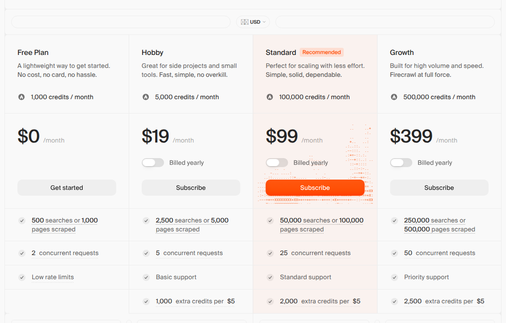
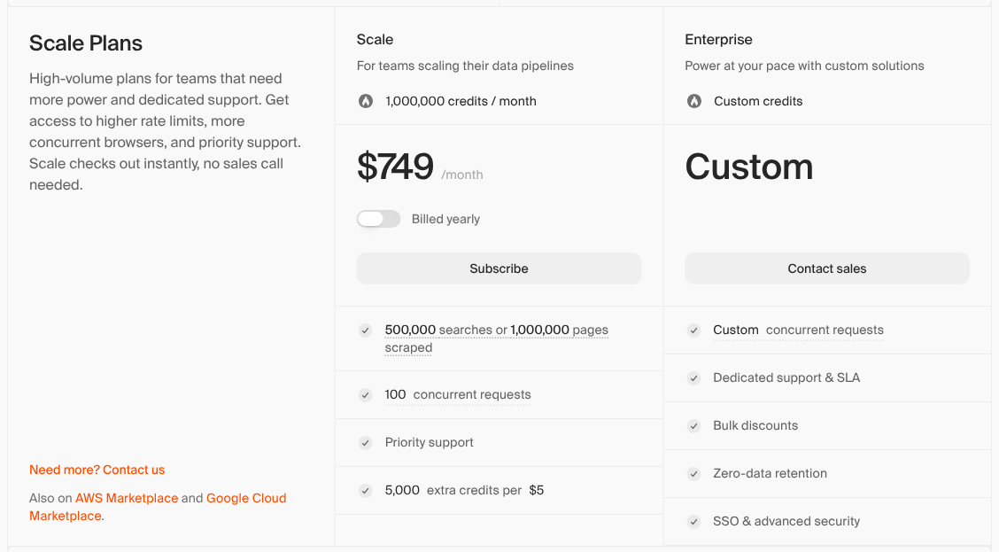
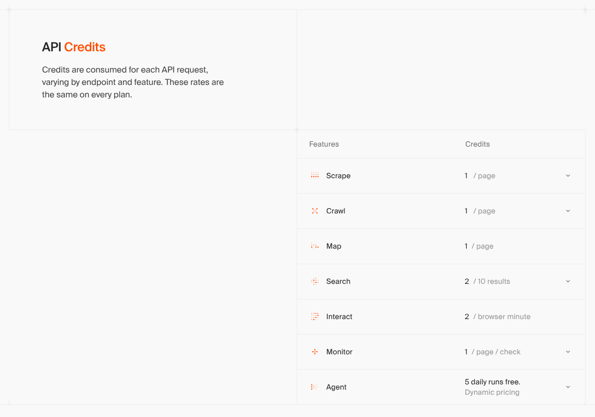

Firecrawl Hobby combines a $19 monthly subscription with 5,000 credits each month. A basic scrape uses one credit per page. Paid plans can add credits when the balance runs out, but that option can be turned off.

<Frame caption="Firecrawl pricing as shown on the official pricing page, 2026-11-19.">
  
</Frame>

<Frame caption="Firecrawl pricing as shown on the official pricing page, 2026-11-19.">
  
</Frame>

<Frame caption="Firecrawl pricing as shown on the official pricing page, 2026-11-19.">
  
</Frame>

[View the official pricing page](https://www.firecrawl.dev/pricing).

**Scope:** Monthly Hobby with pay-as-you-go off, using only successful basic scrapes.

**Not modeled:** Paid top-ups, annual prepayment, failed requests, other endpoints and extra-cost formats, discounts and tax.

## Pricing profile

| Dimension | Modeled offering |
| --- | --- |
| Pricing model | Subscription; Credits |
| Industry | Web data APIs |
| Buyer | Developers building data pipelines |
| Sales motion | Self-serve |
| Billing mechanics | Monthly allowance; Credit consumption; No rollover on Hobby |

## What Firecrawl charges

| Item | Published terms | Flexprice implication |
| --- | --- | --- |
| Hobby, monthly | $19 per month | A monthly fixed plan price |
| Included credits | 5,000 per month; no carryover on Hobby | Metered entitlement that resets monthly |
| Basic scrape | One credit per page | Sum rated credits, with no cash price per scrape |
| Optional paid usage | 1,000 extra credits per $5 on Hobby when enabled | Keep this out of an allowance-only example |

## Design takeaways

1. **Track credits, not requests.** An API call count cannot stand in for the published credit schedule. Record how many credits the operation consumed, so a later extension can account for endpoints or formats with different weights. [Published terms](https://docs.firecrawl.dev/features/scrape).
2. **Keep permission and charging separate.** The monthly fee buys an allowance. Running out with pay-as-you-go off is an access decision, not a reason to apply a per-page cash price. [Published terms](https://www.firecrawl.dev/pricing).

## How Firecrawl's pricing maps to Flexprice

| Firecrawl concept | Flexprice configuration |
| --- | --- |
| Base price per team subscription | Fixed monthly price of $19.00 USD in advance |
| Billable quantity | One base charge per subscription |
| Monthly included credits | Metered entitlement with a 5,000-credit monthly reset |
| Eligible basic scrape | SUM of rated `credits_used`; no USD usage price |

## Configure the plan and subscription

These requests are illustrative. Use your own test environment and replace all example IDs with the IDs returned by your setup. Create a [plan](/docs/product-catalogue/plans/create) with `POST /plans`:

```json
{
  "name": "Firecrawl Hobby example",
  "lookup_key": "firecrawl_pricing_example",
  "description": "Monthly Hobby with pay-as-you-go off, using only successful basic scrapes"
}
```

Create the [fixed price](/docs/product-catalogue/plans/pricing) with `POST /prices`. The amount covers the entire month and is in USD, not cents.

```json
{
  "entity_type": "PLAN",
  "entity_id": "plan_firecrawl_example",
  "currency": "usd",
  "price_unit_type": "FIAT",
  "billing_period": "MONTHLY",
  "billing_period_count": 1,
  "display_name": "Hobby",
  "type": "FIXED",
  "billing_model": "FLAT_FEE",
  "invoice_cadence": "ADVANCE",
  "amount": "19.00"
}
```

Create a [metered feature](/docs/product-catalogue/features/linking-to-plans) with `POST /features`, then attach a [quantity entitlement grant](/docs/product-catalogue/features/entitlement-grants) with `POST /entitlements`. Use the returned feature ID. Give the grant one subscription period of validity so it follows the monthly cycle. Neither the meter nor the grant creates a USD usage charge.

```json
{
  "name": "Firecrawl-style scrape credits",
  "lookup_key": "firecrawl_rated_credits_credits_used",
  "type": "metered",
  "meter": {
    "name": "Firecrawl-style scrape credits",
    "event_name": "firecrawl_rated_credits",
    "reset_usage": "BILLING_PERIOD",
    "aggregation": {
      "type": "SUM",
      "field": "credits_used"
    },
    "filters": [
      {
        "key": "billing_scope",
        "values": [
          "hobby_basic_scrape"
        ]
      },
      {
        "key": "endpoint",
        "values": [
          "scrape"
        ]
      }
    ]
  }
}
```

```json
{
  "entity_type": "PLAN",
  "entity_id": "plan_firecrawl_example",
  "feature_id": "feat_firecrawl_credits_example",
  "feature_type": "metered",
  "is_enabled": true,
  "grant_measure": "quantity",
  "grant_quota": "5000",
  "grant_duration_unit": "subscription_period",
  "grant_duration_value": 1,
  "grant_allocation_behavior": "unit_start"
}
```

Create a customer for the payer, then create the subscription with `POST /subscriptions`.

```json
{
  "customer_id": "cust_firecrawl_example",
  "plan_id": "plan_firecrawl_example",
  "currency": "usd",
  "billing_period": "MONTHLY",
  "billing_period_count": 1,
  "billing_cycle": "anniversary",
  "start_date": "2026-12-01T00:00:00Z"
}
```

Send one `POST /events` event per successful billable basic page, using the Flexprice customer's external ID. Reuse the same event ID and timestamp on retry.

```json
{
  "event_name": "firecrawl_rated_credits",
  "event_id": "evt_firecrawl_001",
  "external_customer_id": "account_firecrawl_example",
  "timestamp": "2026-12-02T12:00:00Z",
  "properties": {
    "credits_used": "1",
    "billing_scope": "hobby_basic_scrape",
    "endpoint": "scrape"
  }
}
```

Enforce the cap in your application before doing more work. Track or reserve credit consumption atomically if requests run in parallel; delayed event ingestion alone cannot prevent concurrent requests from exceeding the allowance. This example does not sell extra credits. Start the next monthly period with a new allowance, without carrying the unused balance forward.

## Worked bill

4,600 basic pages consume 4,600 credits, leaving 400 of the monthly 5,000. The bill remains **$19.00**. At 5,000 used, the application declines the next billable page under the modeled no-top-up configuration.

## Pricing sources

- [Firecrawl pricing](https://www.firecrawl.dev/pricing): Hobby monthly price, included credits, paid top-ups and rollover rules.
- [Firecrawl product documentation](https://docs.firecrawl.dev/features/scrape): Basic scrape credit cost and extra-format charges.

Pricing checked on 2026-11-19. This example does not reproduce a full provider invoice.

## Related guide

[Credit-based pricing](/cookbooks/billing-recipes/credit-based-pricing)
