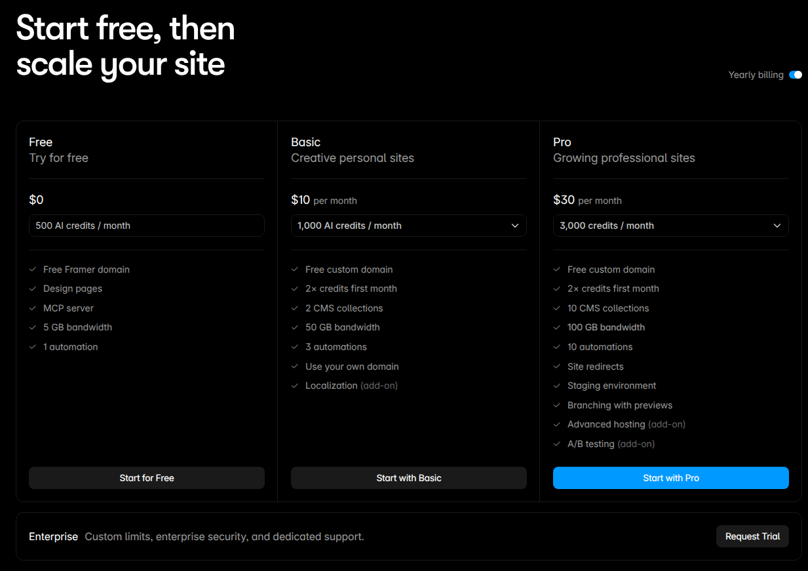

Framer quotes its annual Basic site price as $10 per month and collects the full year upfront. This guide models the published base price for one site, keeping workspace editors and other charges out of the annual site line.

<Frame caption="Framer site comparison with yearly billing selected from the official site, 2026-11-27. This guide models only Basic annual site fee.">
  
</Frame>

[View the official pricing page](https://www.framer.com/pricing).

**Scope:** USD annual Basic site fee for one site at the displayed 1,000 AI credits per month setting.

**Not modeled:** Higher AI credit settings, workspace editor charges, usage, optional add-ons, taxes, and monthly site pricing.

## Pricing profile

| Dimension | Modeled offering |
| --- | --- |
| Pricing model | Subscription |
| Industry | Website builder |
| Buyer | Individual site owners |
| Sales motion | Self-serve |
| Billing mechanics | Annual payment upfront; Per-site base fee |

## What Framer charges

| Item | Published terms | Flexprice implication |
| --- | --- | --- |
| Basic site base | $10 per month shown with yearly billing at the base setting | Configure $120 for the full annual term |
| Annual payment | Billed upfront for the year and renews on the subscription anniversary | Use annual anniversary billing in advance |
| Editor fees | Workspace editor seats are billed separately from the site plan | Keep workspace seats off the annual site subscription in this example |

## Design takeaways

1. **Store the charge and the display rate separately.** Keep $120 as the billing amount and use $10 per month for display. That gives checkout and invoicing the same annual total without raising twelve monthly invoices [Published terms](https://www.framer.com/help/articles/subscriptions-and-charges/).
2. **Keep site and workspace ownership separate.** Editor permissions are managed and billed at the workspace level. Key the base subscription to the site so an editor change cannot implicitly change the site fee [Published terms](https://www.framer.com/help/articles/subscriptions-and-charges/).

## How Framer's pricing maps to Flexprice

| Framer concept | Flexprice configuration |
| --- | --- |
| Base charge | Fixed annual price of $120.00 USD in advance |
| Charge quantity | One charge per subscription |
| Billing boundaries | Anniversary subscription billing |

## Configure the plan and subscription

These requests are illustrative. Use your test environment and replace example IDs with the IDs returned by your setup. Create a [plan](/docs/product-catalogue/plans/create) with `POST /plans`:

```json
{
  "name": "Framer Basic annual site fee example",
  "lookup_key": "framer_pricing_example",
  "description": "USD annual Basic site fee for one site at the displayed 1,000 AI credits per month setting"
}
```

Use `POST /prices` to create the [fixed recurring price](/docs/product-catalogue/plans/pricing). The amount is USD for the entire billing period.

```json
{
  "entity_type": "PLAN",
  "entity_id": "plan_framer_example",
  "currency": "usd",
  "price_unit_type": "FIAT",
  "billing_period": "ANNUAL",
  "billing_period_count": 1,
  "display_name": "Basic annual site fee",
  "type": "FIXED",
  "billing_model": "FLAT_FEE",
  "invoice_cadence": "ADVANCE",
  "amount": "120.00"
}
```

Attach this price to a subscription for one site. Use the site owner or workspace payer as the Flexprice customer. Start the annual subscription when the site enters its paid term.

Use `POST /subscriptions` with the returned customer, plan, and price IDs. Set `include_price_ids` to the modeled price ID. If you need to prepare the subscription ahead of the paid start, [save it as a draft](/docs/core-concepts/subscriptions#choosing-a-subscription-start-date) and activate it when billing begins. Creating an active advance-billed subscription can raise its opening invoice at creation.

```json
{
  "customer_id": "cust_framer_example",
  "plan_id": "plan_framer_example",
  "currency": "usd",
  "billing_period": "ANNUAL",
  "billing_period_count": 1,
  "billing_cycle": "anniversary",
  "include_price_ids": [
    "price_framer_example"
  ]
}
```

## Worked bill

The rate displayed on annual billing is $10 per month. For one site, 12 × $10.00 gives an opening invoice of **$120.00** before taxes. The same interval renews one year later.

## Pricing sources

- [Framer pricing](https://www.framer.com/pricing): Annual site rate and included features at the shown setting.
- [Framer subscriptions and charges](https://www.framer.com/help/articles/subscriptions-and-charges/): Annual advance charge, anniversary renewal, and separate editor billing.

Pricing checked on 2026-11-27.

## Related guide

[Subscriptions and billing cycles](/docs/core-concepts/subscriptions)
