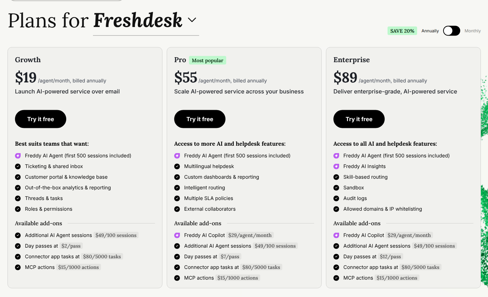

Freshdesk Growth lists $19 per agent per month when billed annually. The recurring agent license is separate from add-ons such as day passes and extra AI sessions. Flexprice can represent the base fee with a fixed annual price and an explicit agent-seat quantity.

<Frame caption="Freshdesk pricing comparison from the official site, 2026-11-23.">
  
</Frame>

[View the official pricing page](https://www.freshworks.com/freshdesk/pricing/).

**Scope:** The published USD annual Growth base fee for regular Freshdesk agent seats.

**Not modeled:** Freshdesk Omni, day passes, AI sessions, connector tasks, MCP actions, seat changes within a term, and taxes.

## Pricing profile

| Dimension | Modeled offering |
| --- | --- |
| Pricing model | Per-seat |
| Industry | Customer support software |
| Buyer | Helpdesk teams |
| Sales motion | Self-serve |
| Billing mechanics | Annual fixed price; Licensed agent count |

## What Freshdesk charges

| Item | Published terms | Flexprice implication |
| --- | --- | --- |
| Growth annual rate | $19 USD per agent per month, billed annually | $228 USD fixed per agent seat per year |
| Billable unit | Agent license, rather than a ticket or contact | Set the subscription quantity from the ordered agent seats |
| Add-ons | Day passes and extra AI Agent sessions have separate rates | Do not fold them into the annual seat price |

## Design takeaways

1. **Price capacity, not ticket throughput.** With the same ordered agent seats, a busy helpdesk month does not change the base fee. Do not meter tickets to calculate this line. [Published terms](https://www.freshworks.com/freshdesk/pricing/).
2. **Keep occasional access separate from the annual commitment.** Published day passes have their own price. Store regular agent seats as fixed quantity and do not translate a pass into an extra annual seat. [Published terms](https://www.freshworks.com/freshdesk/pricing/).

## How Freshdesk's pricing maps to Flexprice

| Freshdesk concept | Flexprice configuration |
| --- | --- |
| Annual price per agent seat | Fixed price of $228.00 USD in advance |
| Billable quantity | Application or checkout calculation, passed as the fixed-line quantity |

## Configure the plan and subscription

These requests are illustrative. Use your test environment and replace example IDs with the IDs returned by your setup. Create a [plan](/docs/product-catalogue/plans/create) with `POST /plans`:

```json
{
  "name": "Freshdesk Growth example",
  "lookup_key": "freshdesk_pricing_example",
  "description": "The published USD annual Growth base fee for regular Freshdesk agent seats"
}
```

Create the [fixed price](/docs/product-catalogue/plans/pricing) with `POST /prices`. Enter the full annual amount per seat in USD, not cents.

```json
{
  "entity_type": "PLAN",
  "entity_id": "plan_freshdesk_example",
  "currency": "usd",
  "price_unit_type": "FIAT",
  "billing_period": "ANNUAL",
  "billing_period_count": 1,
  "display_name": "Growth",
  "type": "FIXED",
  "billing_model": "FLAT_FEE",
  "invoice_cadence": "ADVANCE",
  "amount": "228"
}
```

Set the line quantity to the number of regular agent seats the buyer orders. Do not include customer contacts, ticket volume, or people who only use day passes in this quantity.

Create or select a customer to bill, then use `POST /subscriptions`. Set the quantity on the returned fixed price using a [line-item override](/docs/subscriptions/plan-price-overrides).

```json
{
  "customer_id": "cust_freshdesk_example",
  "plan_id": "plan_freshdesk_example",
  "currency": "usd",
  "billing_period": "ANNUAL",
  "billing_period_count": 1,
  "billing_cycle": "anniversary",
  "start_date": "2026-12-01T00:00:00Z",
  "override_line_items": [
    {
      "price_id": "price_freshdesk_example",
      "quantity": "5"
    }
  ]
}
```

## Worked bill

Five regular agent seats cost **5 × ($19 × 12) = $1,140.00 for the year** before tax and add-ons. If those same five agents handle twice as many tickets, the modeled base charge stays the same.

Verify that the opening invoice shows the annual unit amount and the fixed-line quantity, with no metered line in this example.

## Pricing sources

- [Freshdesk pricing](https://www.freshworks.com/freshdesk/pricing/): Freshdesk annual agent pricing and separate day-pass and AI add-on rates.

Pricing checked on 2026-11-23. This example does not reproduce a full provider invoice.

## Related guide

[Plan price overrides](/docs/subscriptions/plan-price-overrides)
