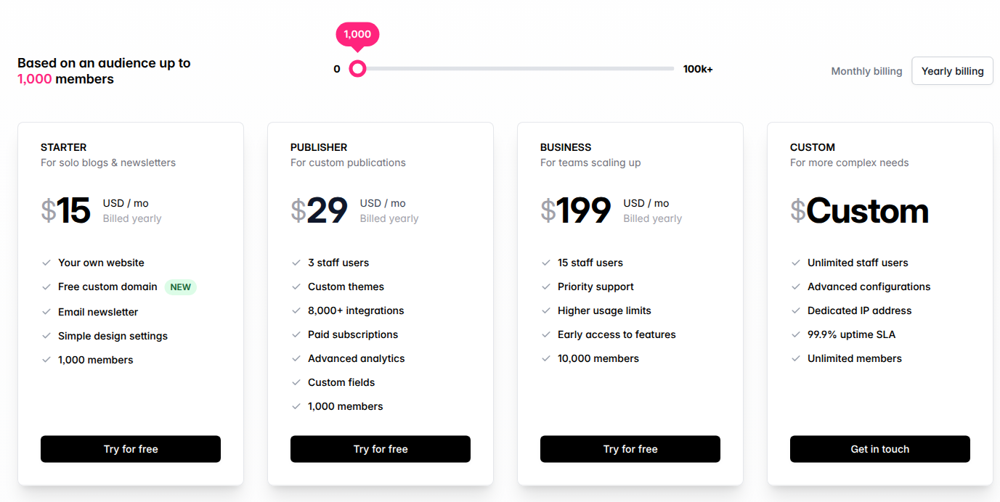

Ghost(Pro) Publisher is $29 per month billed yearly for a hosted publication with up to 1,000 registered members. The plan includes three staff users. Members are the publication's audience, not its staff.

<Frame caption="Ghost plan pricing from the official site, 2026-11-20.">
  
</Frame>

[View the official pricing page](https://ghost.org/pricing/).

**Scope:** One Ghost(Pro) Publisher publication at the yearly USD price for up to 1,000 registered members.

**Not modeled:** Other plans and audience bands, monthly billing, automatic upgrades, payments from readers, processing fees and tax.

## Pricing profile

| Dimension | Modeled offering |
| --- | --- |
| Pricing model | Subscription |
| Industry | Managed publishing and newsletter software |
| Buyer | Independent publishers |
| Sales motion | Self-serve |
| Billing mechanics | Annual billing; Audience-band price; Separate staff limit |

## What Ghost charges

| Item | Published terms | Flexprice implication |
| --- | --- | --- |
| Publisher, yearly | $29 per month at the shown 1,000-member setting | One $348 annual hosting charge for the publication |
| Registered audience | Free and paid registered members both count | Use registered members to choose a plan price, not page views |
| Staff | Up to three staff users on Publisher | Keep staff access separate from the audience count |

## Design takeaways

1. **Use audience size to select a price.** Within the selected band the hosting fee is fixed. Track registered members for eligibility and evaluate a plan change at the boundary instead of adding a cash charge for each registration. [Published terms](https://ghost.org/pricing/).
2. **Keep publisher and reader payments separate.** Publisher supports paid subscriptions, but those are payments from readers to the publisher. Model hosting as its own subscription, not as a share of reader revenue. [Published terms](https://ghost.org/pricing/).

## How Ghost's pricing maps to Flexprice

| Ghost concept | Flexprice configuration |
| --- | --- |
| USD base price per publication | Fixed annual price of $348.00 in advance |
| Quantity | One fixed charge for the publication |

## Configure the plan and subscription

These requests are illustrative. Use your test environment and replace example IDs with the IDs returned by your setup. Create a [plan](/docs/product-catalogue/plans/create) with `POST /plans`:

```json
{
  "name": "Ghost Publisher annual hosting example",
  "lookup_key": "ghost_pricing_example",
  "description": "One Ghost(Pro) Publisher publication at the yearly USD price for up to 1,000 registered members"
}
```

Create the [fixed price](/docs/product-catalogue/plans/pricing) with `POST /prices`. Enter the amount for the full billing period in USD, not cents.

```json
{
  "entity_type": "PLAN",
  "entity_id": "plan_ghost_example",
  "currency": "usd",
  "price_unit_type": "FIAT",
  "billing_period": "ANNUAL",
  "billing_period_count": 1,
  "display_name": "Publisher annual hosting",
  "type": "FIXED",
  "billing_model": "FLAT_FEE",
  "invoice_cadence": "ADVANCE",
  "amount": "348.00"
}
```

Associate this subscription with the publication in your application. Count free and paid registered members there to check the selected band. If the count exceeds 1,000, choose an eligible option separately; this example does not set an upgrade price or trigger. Track staff access independently.

Create a customer for the payer and use its ID with `POST /subscriptions`. Use one subscription per publication. Do not use the registered-member count as line quantity.

```json
{
  "customer_id": "cust_ghost_example",
  "plan_id": "plan_ghost_example",
  "currency": "usd",
  "billing_period": "ANNUAL",
  "billing_period_count": 1,
  "billing_cycle": "anniversary",
  "start_date": "2026-12-01T00:00:00Z"
}
```

## Worked bill

At 900 registered members, $29 × 12 = **$348.00** for the year before tax. At exactly 1,000 registered members, the same price applies. The member count is an eligibility input, not a quantity multiplier.

## Pricing sources

- [Ghost pricing](https://ghost.org/pricing/): Publisher yearly pricing, registered member definition, staff access and feature comparison.

Pricing checked on 2026-11-20. This example does not reproduce a full provider invoice.

## Related guide

[Create a plan](/docs/product-catalogue/plans/create)
