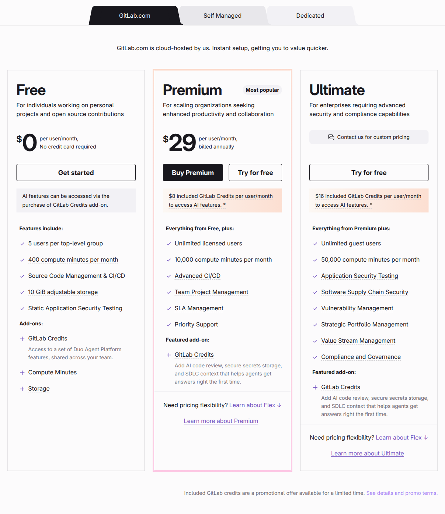

GitLab.com Premium lists $29 per user per month when billed annually. Premium Guests can occupy seats, but the same user does not consume more seats by joining more projects within the subscribed group. Flexprice can bill the starting purchase using a fixed annual seat price.

<Frame caption="GitLab pricing comparison from the official site, 2026-11-23.">
  
</Frame>

[View the official pricing page](https://about.gitlab.com/pricing/).

**Scope:** The public GitLab.com Premium base fee for an initial annual seat purchase in one top-level group.

**Not modeled:** Quarterly or annual seat reconciliation, mid-term adjustments, other GitLab tiers, Flex commitments, AI credits, compute, storage, and taxes.

## Pricing profile

| Dimension | Modeled offering |
| --- | --- |
| Pricing model | Per-seat |
| Industry | DevSecOps software |
| Buyer | Software engineering teams |
| Sales motion | Self-serve |
| Billing mechanics | Annual fixed price; Unique billable users per subscribed top-level group |

## What GitLab charges

| Item | Published terms | Flexprice implication |
| --- | --- | --- |
| Premium annual rate | $29 USD per user per month, billed annually | $348 USD per purchased seat per year |
| Role eligibility | Guests count as billable on Premium | Include Premium Guests when estimating the seat purchase |
| Subscription boundary | A user in multiple projects under the same subscribed top-level group counts once | Deduplicate by user within that group before setting quantity |

## Design takeaways

1. **Count users, not memberships.** Adding an already counted user to a second project does not increase the starting purchase. Deduplicate at the subscribed top-level group rather than summing each project's roster. [Published terms](https://docs.gitlab.com/subscriptions/manage_users_and_seats/).
2. **Separate the initial purchase from true-ups.** GitLab checks seat use on its own reconciliation schedule. Keep the opening purchase on a fixed line and model any later settlement separately instead of treating each invitation as an annual charge. [Published terms](https://docs.gitlab.com/subscriptions/manage_users_and_seats/).

## How GitLab's pricing maps to Flexprice

| GitLab concept | Flexprice configuration |
| --- | --- |
| Annual price per seat | Fixed price of $348.00 USD in advance |
| Billable quantity | Application or checkout calculation, passed as the fixed-line quantity |

## Configure the plan and subscription

These requests are illustrative. Use your test environment and replace example IDs with the IDs returned by your setup. Create a [plan](/docs/product-catalogue/plans/create) with `POST /plans`:

```json
{
  "name": "GitLab GitLab.com Premium example",
  "lookup_key": "gitlab_pricing_example",
  "description": "The public GitLab.com Premium base fee for an initial annual seat purchase in one top-level group"
}
```

Create the [fixed price](/docs/product-catalogue/plans/pricing) with `POST /prices`. Enter the full annual amount per seat in USD, not cents.

```json
{
  "entity_type": "PLAN",
  "entity_id": "plan_gitlab_example",
  "currency": "usd",
  "price_unit_type": "FIAT",
  "billing_period": "ANNUAL",
  "billing_period_count": 1,
  "display_name": "GitLab.com Premium",
  "type": "FIXED",
  "billing_model": "FLAT_FEE",
  "invoice_cadence": "ADVANCE",
  "amount": "348"
}
```

Count the eligible unique users in the subscribed top-level group, then use the purchased seat count as the subscription quantity. Here five Developers and two Guests require seven seats. If a Developer belongs to two projects under that group, count that person only once.

Create or select a customer to bill, then use `POST /subscriptions`. Set the quantity on the returned fixed price using a [line-item override](/docs/subscriptions/plan-price-overrides).

```json
{
  "customer_id": "cust_gitlab_example",
  "plan_id": "plan_gitlab_example",
  "currency": "usd",
  "billing_period": "ANNUAL",
  "billing_period_count": 1,
  "billing_cycle": "anniversary",
  "start_date": "2026-12-01T00:00:00Z",
  "override_line_items": [
    {
      "price_id": "price_gitlab_example",
      "quantity": "7"
    }
  ]
}
```

## Worked bill

Seven seats at $29 × 12 = $348.00 per seat produce **7 × $348.00 = $2,436.00 for the year** before taxes or later seat reconciliation.

Verify that the opening invoice shows the annual unit amount and the fixed-line quantity, with no metered line in this example.

## Pricing sources

- [GitLab pricing](https://about.gitlab.com/pricing/): GitLab.com Premium list rate and annual billing.
- [GitLab billing documentation](https://docs.gitlab.com/subscriptions/manage_users_and_seats/): Billable roles, group-level deduplication, and seat reconciliation.

Pricing checked on 2026-11-23. This example does not reproduce a full provider invoice.

## Related guide

[Plan price overrides](/docs/subscriptions/plan-price-overrides)
