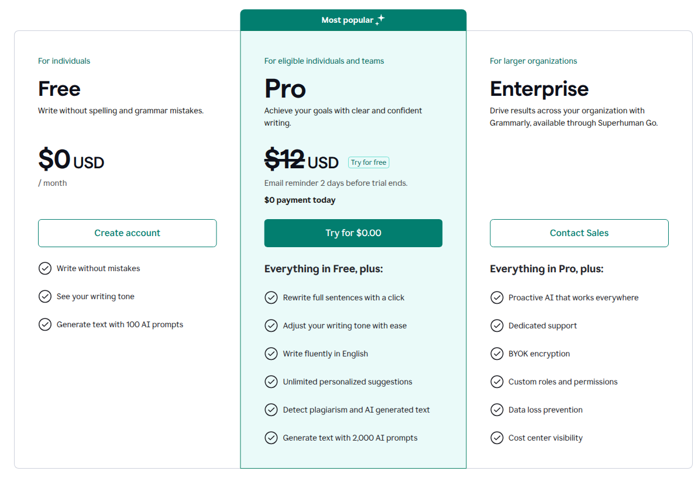
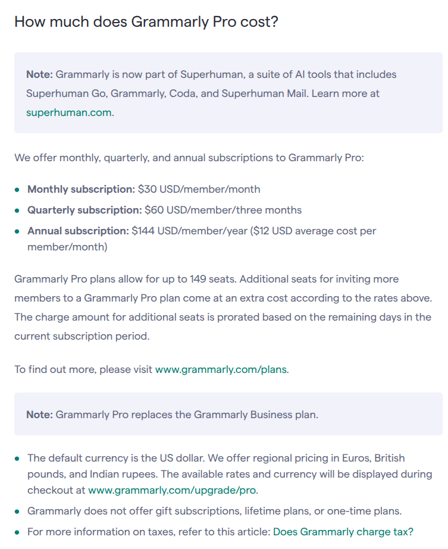

Grammarly Pro's annual rate is $144 per member, equivalent to $12 per member per month. Its pricing page also advertises a trial, so the amount due today is not the recurring annual price. Flexprice can represent the paid annual subscription with a fixed yearly price and a purchased-seat quantity.

<Frame caption="Grammarly pricing comparison from the official site, 2026-11-24. This guide models only Pro annual.">
  
</Frame>

<Frame caption="Grammarly Pro rate schedule from the official site, 2026-11-24. This guide models only Pro annual.">
  
</Frame>

[View the official pricing page](https://www.grammarly.com/plans).

**Scope:** A paid Grammarly Pro subscription at the published USD annual per-member rate after any trial, with a stable seat count.

**Not modeled:** Trial setup or conversion, monthly and quarterly subscriptions, Enterprise, regional currencies, AI prompt metering, extra seats added during a term, refunds, discounts and tax.

## Pricing profile

| Dimension | Modeled offering |
| --- | --- |
| Pricing model | Per-seat; Subscription |
| Industry | Writing assistance software |
| Buyer | Individuals and teams improving written communication |
| Sales motion | Self-serve |
| Billing mechanics | Annual advance subscription; Purchased member seats; Monthly-equivalent price display |

## What Grammarly charges

| Item | Published terms | Flexprice implication |
| --- | --- | --- |
| Pro annual | $144 USD per member per year; $12 average per month | Fixed $144.00 annual unit amount |
| Other payment periods | $30 per member monthly or $60 per member every three months | Different rates, not alternative displays of the $144 annual total |
| Seat range | Pro supports up to 149 seats | Validate the requested Pro quantity before creating the subscription |
| AI prompts | Pro includes 2,000 AI prompts per member per month | Separate recurring access allowance; not a USD wallet or annual prompt grant configured here |
| Billing and additions | Subscriptions bill in advance; extra seats are prorated for the remaining subscription period | Annual advance base line; mid-term additions require a separate workflow |

## Design takeaways

1. **Keep trial cash flow separate from the recurring rate.** The pricing page can show zero due today while the annual subscription remains $144 per member. Start this example at the paid period; a zero-price recurring line would lose the conversion charge. [Published terms](https://www.grammarly.com/plans).
2. **Do not stretch monthly product limits to the invoice year.** Pro's prompt allowance is monthly even though the selected payment is annual. If you later implement that allowance, give it a monthly reset instead of releasing twelve months of prompts at signup. [Published terms](https://www.grammarly.com/plans).

## How Grammarly's pricing maps to Flexprice

| Grammarly concept | Flexprice configuration |
| --- | --- |
| Annual price per purchased Pro member seat | Fixed price of $144.00 USD in advance |
| Billable quantity | Application or checkout calculation, passed as the fixed-line quantity |

## Configure the plan and subscription

These requests are illustrative. Use your test environment and replace example IDs with the IDs returned by your setup. Create a [plan](/docs/product-catalogue/plans/create) with `POST /plans`:

```json
{
  "name": "Grammarly Pro annual example",
  "lookup_key": "grammarly_pricing_example",
  "description": "A paid Grammarly Pro subscription at the published USD annual per-member rate after any trial, with a stable seat count"
}
```

Create the [fixed price](/docs/product-catalogue/plans/pricing) with `POST /prices`. Enter the full amount per seat for one year in USD, not cents.

```json
{
  "entity_type": "PLAN",
  "entity_id": "plan_grammarly_example",
  "currency": "usd",
  "price_unit_type": "FIAT",
  "billing_period": "ANNUAL",
  "billing_period_count": 1,
  "display_name": "Pro annual",
  "type": "FIXED",
  "billing_model": "FLAT_FEE",
  "invoice_cadence": "ADVANCE",
  "amount": "144.00"
}
```

Validate that the purchased Pro seat count is between one and 149. Set this example to ten purchased member seats and start at the first paid annual period, not the start of a free trial. Activity or prompt counts do not change this fixed quantity. Enforce any monthly prompt access separately if you extend the example; no prompt meter, entitlement or money wallet is created here.

Create or select a customer to bill. Send `POST /subscriptions` only when the paid period begins, after any trial. This request omits `start_date` so the period begins at creation. Set the quantity on the returned fixed price using a [line-item override](/docs/subscriptions/plan-price-overrides).

A future `start_date` does not defer the opening advance invoice. To prepare the subscription early without invoicing, [create a draft and activate it when billing should begin](/docs/core-concepts/subscriptions#choosing-a-subscription-start-date).

```json
{
  "customer_id": "cust_grammarly_example",
  "plan_id": "plan_grammarly_example",
  "currency": "usd",
  "billing_period": "ANNUAL",
  "billing_period_count": 1,
  "billing_cycle": "anniversary",
  "override_line_items": [
    {
      "price_id": "price_grammarly_example",
      "quantity": "10"
    }
  ]
}
```

## Worked bill

Ten paid member seats cost **10 × $144.00 = $1,440.00 upfront for one year** before tax. The $120 monthly equivalent for ten seats is not a monthly invoice. Eleven seats purchased for the full year would cost $1,584.00. An order for 150 Pro seats must be rejected or directed to an appropriate offering rather than silently billed as Pro.

Verify that the opening invoice shows the annual unit amount and the fixed-line quantity, with no metered line in this example.

## Pricing sources

- [Grammarly plans](https://www.grammarly.com/plans): Free, Pro and Enterprise comparison, Pro's trial display and included AI prompts.
- [Grammarly Pro rate schedule](https://support.grammarly.com/hc/en-us/articles/115000090011-How-much-does-Grammarly-Pro-cost): Monthly, quarterly and annual USD rates, 149-seat Pro limit and prorated additional seats.
- [Grammarly terms](https://www.grammarly.com/terms): Advance recurring subscription billing and automatic renewal terms.

Pricing checked on 2026-11-24. This example does not reproduce a full provider invoice.

## Related guide

[Plan price overrides](/docs/subscriptions/plan-price-overrides)
