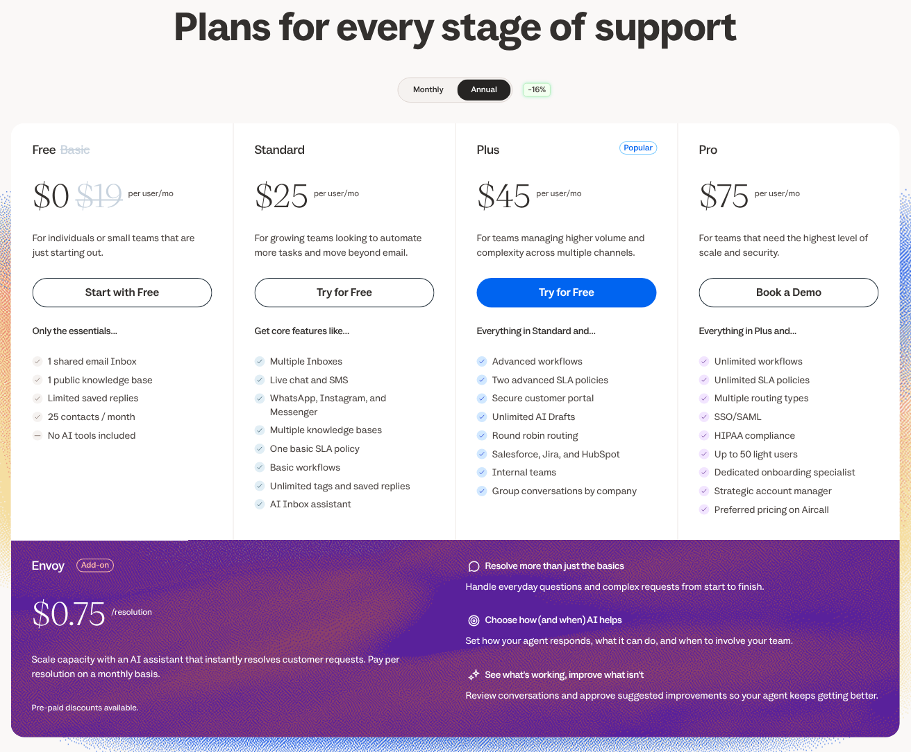

Help Scout Envoy charges $0.75 for an eligible AI resolution, not for every AI reply. A conversation can generate at most one billable resolution. In Flexprice, send one qualified event per conversation and bill the count monthly in arrears.

<Frame caption="Help Scout pricing comparison from the official site, 2026-11-23.">
  
</Frame>

[View the official pricing page](https://www.helpscout.com/pricing/).

**Scope:** The published USD Envoy pay-as-you-go resolution charge, modeled separately from the parent subscription.

**Not modeled:** The underlying Help Scout plan, prepaid discounts, automatic spend-cap enforcement, tax, and refunds or corrections after billing.

## Pricing profile

| Dimension | Modeled offering |
| --- | --- |
| Pricing model | Usage-based |
| Industry | Customer support software |
| Buyer | Support teams using AI assistance |
| Sales motion | Self-serve |
| Billing mechanics | Per eligible resolution; Monthly billing; One resolution per conversation |

## What Help Scout charges

| Item | Published terms | Flexprice implication |
| --- | --- | --- |
| List rate | $0.75 USD per billable resolution, charged monthly | Per-unit monthly usage price in arrears |
| Qualification | The AI must resolve the conversation without human assistance. Help Scout also excludes escalation, knowledge-base search, follow-up questions, and signals that more help is needed | Classify outcomes before emitting metered usage |
| Counting grain | At most one charged resolution per conversation | Use one stable event ID per qualified conversation |

## Design takeaways

1. **Meter outcomes rather than messages.** An AI response is necessary but not sufficient. Have the application apply the published qualification rules, then send the outcome to a simple COUNT meter instead of inferring success from reply activity. [Published terms](https://www.helpscout.com/pricing/).
2. **Keep the cap outside the usage price.** Help Scout describes a monthly cap that stops its AI from taking further resolutions. That is application behavior, not a cheaper tier above a threshold. A Flexprice price alone will not disable the agent. [Published terms](https://www.helpscout.com/pricing/).

## How Help Scout's pricing maps to Flexprice

| Help Scout concept | Flexprice configuration |
| --- | --- |
| Qualified AI resolution | Application checks the conversation outcome; COUNT one qualified event |
| Monthly usage charge | $0.75 USD per resolution, in arrears |
| Spend cap | Excluded; the application must enforce any cap before taking more resolutions |

## Configure the plan and subscription

These requests are illustrative. Use your test environment and replace example IDs with the IDs returned by your setup. Create a [plan](/docs/product-catalogue/plans/create) with `POST /plans`:

```json
{
  "name": "Help Scout Envoy pay-as-you-go example",
  "lookup_key": "helpscout_pricing_example",
  "description": "The published USD Envoy pay-as-you-go resolution charge, modeled separately from the parent subscription"
}
```

Create a [metered feature](/docs/product-catalogue/features/create) with `POST /features`. The filter only admits events marked billable by your application. [COUNT](/docs/product-catalogue/features/aggregation/count) counts distinct matching event IDs in the billing period, not deliveries, and does not require a numeric field.

```json
{
  "name": "Envoy-style billable resolutions",
  "lookup_key": "envoy_resolution_rated",
  "type": "metered",
  "meter": {
    "name": "Envoy-style billable resolutions",
    "event_name": "envoy_resolution_rated",
    "reset_usage": "BILLING_PERIOD",
    "aggregation": {
      "type": "COUNT"
    },
    "filters": [
      {
        "key": "billing_outcome",
        "values": [
          "billable_resolution"
        ]
      }
    ]
  }
}
```

Create the [usage price](/docs/product-catalogue/plans/pricing) with `POST /prices`. Use the meter ID from the feature response, not the feature ID. This is a per-resolution unit price, not a monthly fixed fee.

```json
{
  "entity_type": "PLAN",
  "entity_id": "plan_helpscout_example",
  "currency": "usd",
  "price_unit_type": "FIAT",
  "billing_period": "MONTHLY",
  "billing_period_count": 1,
  "display_name": "Envoy-style resolution",
  "type": "USAGE",
  "billing_model": "FLAT_FEE",
  "invoice_cadence": "ARREAR",
  "amount": "0.75",
  "meter_id": "meter_helpscout_example"
}
```

Create a monthly subscription for the billable account with `POST /subscriptions`. This example starts December 1 at midnight UTC and bills December usage at the January 1 renewal. Choose dates that match the account you are modeling.

```json
{
  "customer_id": "cust_helpscout_example",
  "plan_id": "plan_helpscout_example",
  "currency": "usd",
  "billing_period": "MONTHLY",
  "billing_period_count": 1,
  "billing_cycle": "anniversary",
  "start_date": "2026-12-01T00:00:00Z"
}
```

When the outcome is known, apply the qualification rules in your application. Do not report a resolution at the first AI reply. Store one billing record for each qualified conversation, including its original resolution timestamp. Send it with `POST /events`, using the account's external customer ID:

```json
{
  "event_name": "envoy_resolution_rated",
  "event_id": "envoy_resolution_conversation_024",
  "external_customer_id": "account_helpscout_example",
  "timestamp": "2026-12-04T12:30:00Z",
  "properties": {
    "billing_outcome": "billable_resolution"
  }
}
```

Use the same event ID **and** timestamp on every retry so [deduplication](/docs/core-concepts/usage-events/idempotency) can identify the original. Do not send positive events for escalations or count the turns within a conversation.

## Worked bill

| December activity | Billable resolutions | Gross period charge |
| --- | ---: | ---: |
| Three escalations, no qualified resolutions | 0 | $0.00 |
| One qualified conversation with two delivery retries and one escalation | 1 | $0.75 |
| 24 qualified conversations, one duplicate delivery and three escalations | 24 | **$18.00** |

For the last row, verify that the December usage line at renewal is **24 × $0.75 = $18.00** before taxes, separate from the parent subscription.

## Pricing sources

- [Help Scout pricing](https://www.helpscout.com/pricing/): Envoy list rate, monthly charging, and the AI resolution FAQ.

Pricing checked on 2026-11-23. This example does not reproduce a full provider invoice.

## Related guide

[Usage-based pricing](/cookbooks/billing-recipes/usage-based-pricing)
