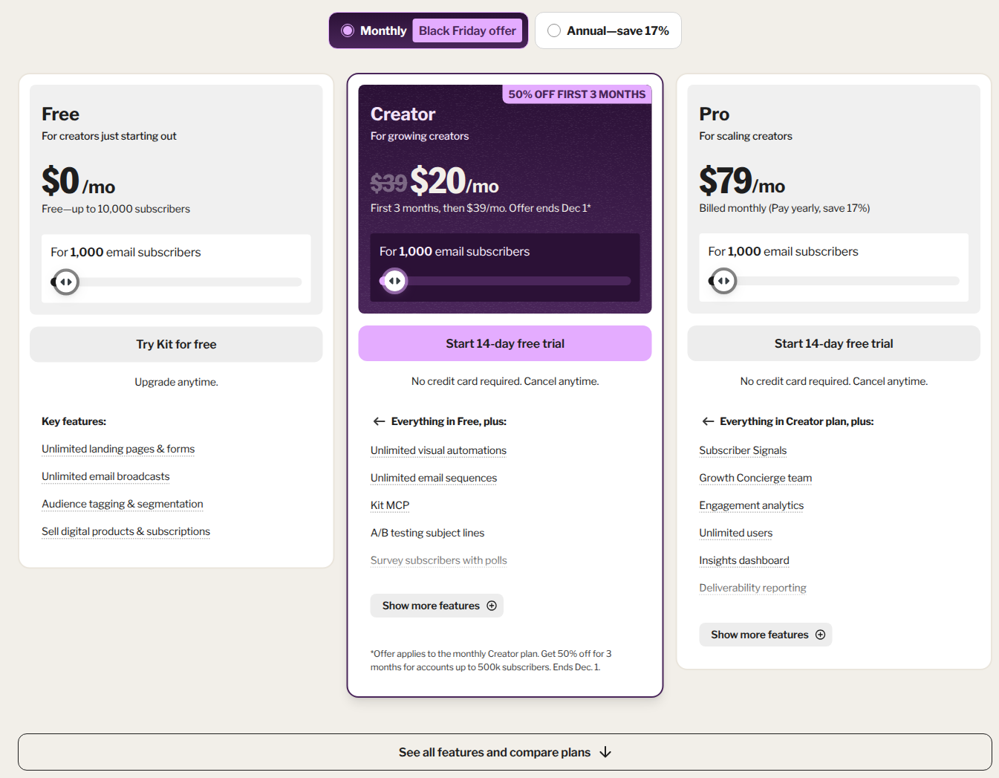

Kit Creator charges one recurring rate for the subscriber tier. Flexprice can bill the tier as a fixed price for a month when the subscriber band stays the same.

<Frame caption="Kit monthly plan comparison from the official site, 2026-11-26. This guide models only Creator monthly at 1,000 subscribers.">
  
</Frame>

[View the official pricing page](https://kit.com/pricing).

**Scope:** The standard USD monthly Creator price at the 1,000-subscriber band.

**Not modeled:** Promotional and trial pricing, annual billing, other plan tiers, proration, automatic tier changes, and taxes.

## Pricing profile

| Dimension | Modeled offering |
| --- | --- |
| Pricing model | Subscription; Tiered pricing |
| Industry | Creator email marketing |
| Buyer | Newsletter operators and creators |
| Sales motion | Self-serve |
| Billing mechanics | Monthly advance billing; Fixed price per subscriber band; Automatic upgrades |

## What Kit charges

| Item | Published terms | Flexprice implication |
| --- | --- | --- |
| Creator band | $39 USD per month at up to 1,000 subscribers after any introductory offer | Set one fixed $39 price for the account |
| Upgrade | Exceeding a tier moves the account up automatically. Monthly upgrade proration appears on the next bill | Define a separate price for each verified band and handle tier changes separately |
| Downgrade | A lower tier is selectable when the account qualifies. It takes effect at the next billing date | Keep the current tier's price through the period already paid |

## Design takeaways

1. **Treat the subscriber limit as a price selector.** Select a band price once per account. Multiplying the $39 by subscribers or sends would turn the band into a different billing model [Published terms](https://kit.com/pricing).
2. **Use separate rules for growth and downgrades.** Kit moves an account up when it crosses a tier and leaves a move down to the customer. If you add this behavior, store the active band and the effective date of a requested change separately [Published terms](https://help.kit.com/en/articles/2502679-how-does-kit-pricing-work).

## How Kit's pricing maps to Flexprice

| Kit concept | Flexprice configuration |
| --- | --- |
| Creator 1,000-subscriber band | Fixed monthly price of $39.00 USD in advance |

## Configure the plan and subscription

These requests are illustrative. Use your test environment and replace example IDs with the IDs returned by your setup. Create a [plan](/docs/product-catalogue/plans/create) with `POST /plans`:

```json
{
  "name": "Kit Creator monthly at 1,000 subscribers example",
  "lookup_key": "kit_pricing_example",
  "description": "The standard USD monthly Creator price at the 1,000-subscriber band"
}
```

Use `POST /prices` for each [fixed recurring price](/docs/product-catalogue/plans/pricing) below. Set the amount in USD for the full billing period.

```json
{
  "entity_type": "PLAN",
  "entity_id": "plan_kit_example",
  "currency": "usd",
  "price_unit_type": "FIAT",
  "billing_period": "MONTHLY",
  "billing_period_count": 1,
  "display_name": "Creator 1,000-subscriber band",
  "type": "FIXED",
  "billing_model": "FLAT_FEE",
  "invoice_cadence": "ADVANCE",
  "amount": "39.00"
}
```

Select this plan only for the Creator 1,000-subscriber band. Your application should track subscriber eligibility separately. A fixed price does not automatically change when eligibility changes.

Create or select the payer's customer record. When paid billing begins, use `POST /subscriptions` with that customer ID and the returned plan and price IDs. To set up a subscription now without raising the advance invoice yet, [create a draft](/docs/core-concepts/subscriptions#choosing-a-subscription-start-date) and activate it when billing begins.

```json
{
  "customer_id": "cust_kit_example",
  "plan_id": "plan_kit_example",
  "currency": "usd",
  "billing_period": "MONTHLY",
  "billing_period_count": 1,
  "billing_cycle": "anniversary"
}
```

## Worked bill

A Creator account starts and ends the cycle in the 1,000-subscriber band. Its non-promotional opening bill has one charge of **$39.00** before taxes. Growing from 700 to 950 subscribers during that month does not add another invoice line.

Verify the fixed charge amounts and quantities on the opening invoice. No usage line should be present in this example.

## Pricing sources

- [Kit pricing](https://kit.com/pricing): Monthly plan cards, subscriber tiers, and the standard price after the promotion.
- [Kit billing guide](https://help.kit.com/en/articles/2502679-how-does-kit-pricing-work): Advance billing, tier upgrades, and the effective date of downgrades.

Pricing checked on 2026-11-26.

## Related guide

[Plan price overrides](/docs/subscriptions/plan-price-overrides)
