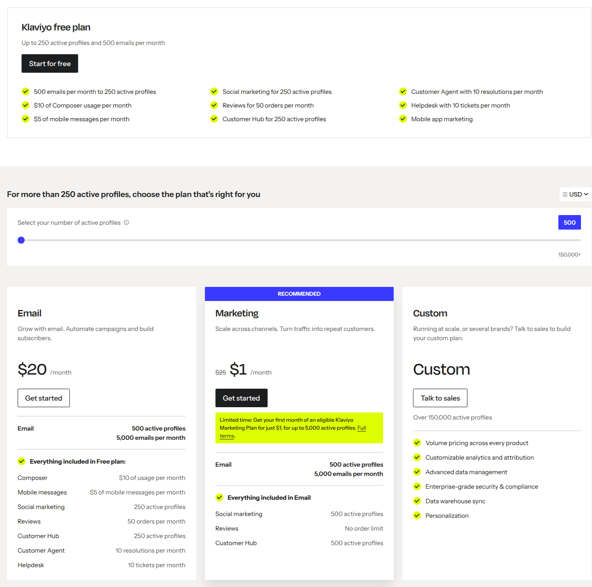

Klaviyo's Email plan pairs an active-profile band with a monthly send allowance. This Flexprice example bills one stable band and leaves profile eligibility and send consumption to the product.

<Frame caption="Klaviyo plan comparison from the official site, 2026-11-26. This guide models only Email monthly at 500 active profiles.">
  
</Frame>

[View the official pricing page](https://www.klaviyo.com/pricing).

**Scope:** The USD monthly Email plan at 500 active profiles and 5,000 monthly emails.

**Not modeled:** Automatic upgrades, additional sends, other profile bands, Marketing offers, other products and add-ons, custom terms, and taxes.

## Pricing profile

| Dimension | Modeled offering |
| --- | --- |
| Pricing model | Subscription; Tiered pricing |
| Industry | Ecommerce marketing software |
| Buyer | Brand and lifecycle marketing teams |
| Sales motion | Self-serve |
| Billing mechanics | Monthly advance billing; Active-profile band; Included email sends |

## What Klaviyo charges

| Item | Published terms | Flexprice implication |
| --- | --- | --- |
| Email band | $20 USD per month for 500 active profiles and 5,000 email sends | Use one fixed monthly line per billing account |
| Active email profiles | Klaviyo counts profiles that can receive marketing email, including eligible checkout contacts who never opted in. Suppressed profiles are excluded | Use the active email profile count for the tier |
| Plan at renewal | Paid plans renew monthly on the paid billing anniversary. The plan must cover active profiles at the end of the cycle | Evaluate the eligible count before renewal and keep the standard send window aligned to subscription billing |

## Design takeaways

1. **Use the billing count for tier selection.** Store email eligibility separately from opt-in status. An opt-in-only count can put an account in a lower band even though eligible checkout contacts count toward its limit [Published terms](https://help.klaviyo.com/hc/en-us/articles/24263920096027).
2. **Check tier fit at the billing boundary.** Evaluate active profiles separately from send consumption. Using only the number of sends at renewal would miss a growing marketable list that has not yet received a campaign [Published terms](https://help.klaviyo.com/hc/en-us/articles/115000976672).

## How Klaviyo's pricing maps to Flexprice

| Klaviyo concept | Flexprice configuration |
| --- | --- |
| Email 500-active-profile band | Fixed monthly price of $20.00 USD in advance |

## Configure the plan and subscription

These requests are illustrative. Use your test environment and replace example IDs with the IDs returned by your setup. Create a [plan](/docs/product-catalogue/plans/create) with `POST /plans`:

```json
{
  "name": "Klaviyo Email monthly at 500 active profiles example",
  "lookup_key": "klaviyo_pricing_example",
  "description": "The USD monthly Email plan at 500 active profiles and 5,000 monthly emails"
}
```

Use `POST /prices` for each [fixed recurring price](/docs/product-catalogue/plans/pricing) below. Set the amount in USD for the full billing period.

```json
{
  "entity_type": "PLAN",
  "entity_id": "plan_klaviyo_example",
  "currency": "usd",
  "price_unit_type": "FIAT",
  "billing_period": "MONTHLY",
  "billing_period_count": 1,
  "display_name": "Email 500-active-profile band",
  "type": "FIXED",
  "billing_model": "FLAT_FEE",
  "invoice_cadence": "ADVANCE",
  "amount": "20.00"
}
```

Select this price when the account is in the 500-active-profile Email band. Track sends separately against the allowance. If you support other verified tiers, select the appropriate renewal price before the next invoice is generated.

Create or select the payer's customer record. When paid billing begins, use `POST /subscriptions` with that customer ID and the returned plan and price IDs. To set up a subscription now without raising the advance invoice yet, [create a draft](/docs/core-concepts/subscriptions#choosing-a-subscription-start-date) and activate it when billing begins.

```json
{
  "customer_id": "cust_klaviyo_example",
  "plan_id": "plan_klaviyo_example",
  "currency": "usd",
  "billing_period": "MONTHLY",
  "billing_period_count": 1,
  "billing_cycle": "anniversary"
}
```

## Worked bill

An account has 480 active profiles at renewal and sent 4,200 emails during the cycle that just ended. Both are within the modeled band's limits. The new month's Email charge is **$20.00** before taxes.

Verify the fixed charge amounts and quantities on the opening invoice. No usage line should be present in this example.

## Pricing sources

- [Klaviyo pricing](https://www.klaviyo.com/pricing): Email price and included email sends.
- [Klaviyo billing guide](https://help.klaviyo.com/hc/en-us/articles/115000976672): Paid anniversary renewals, usage windows, and profile-compliant plans.
- [Klaviyo terms of service](https://www.klaviyo.com/legal/terms-of-service): Section 6.3 advance billing terms.
- [Klaviyo active profile guide](https://help.klaviyo.com/hc/en-us/articles/24263920096027): Which email profiles count toward the plan, including profiles added through checkout and excluded suppressions.

Pricing checked on 2026-11-26.

## Related guide

[Plan price overrides](/docs/subscriptions/plan-price-overrides)
