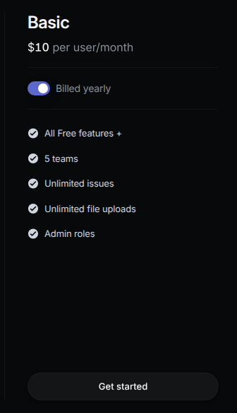
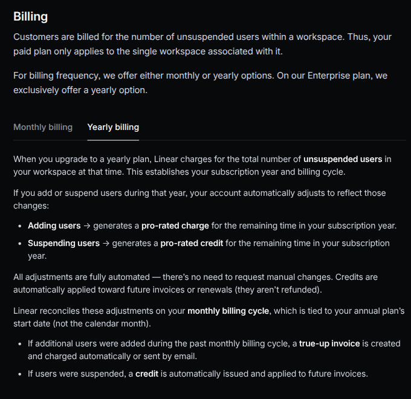

Linear's Basic plan displays **$10 per user/month when billed yearly**. The billable quantity is the number of unsuspended users in a workspace, not the number of issues created or teams configured. This guide models the base annual subscription for a workspace whose user count stays unchanged during the year.

<Frame caption="Linear Basic's official pricing card, captured on November 6, 2026 with Billed yearly selected. The $10 figure is a per-user monthly equivalent, not a monthly invoice on this annual option.">
  
</Frame>

<Frame caption="Linear's official billing documentation, captured on November 6, 2026 with Yearly billing selected. The annual base charge uses unsuspended workspace users; subsequent prorated seat changes are reconciled monthly and are outside this example.">
  
</Frame>

Sources: [Linear pricing](https://linear.app/pricing) and [billing and plans](https://linear.app/docs/billing-and-plans).

<Note>
  This example uses USD and covers only Basic's full-year base charge at signup or renewal with a stable user count. It excludes the monthly plan option, Free, Business, Enterprise, optional AI credits, taxes, special-program discounts, cancellations, and midyear additions or suspensions. Linear supports prorated annual-seat changes with monthly true-up invoices or credits. The configuration below does not implement that adjustment workflow and is not a complete reproduction of Linear's billing lifecycle.
</Note>

## Pricing profile

These labels describe the self-serve Basic annual subscription modeled here, not every Linear plan or purchasing path.

| Dimension | Offering profile |
| --- | --- |
| Pricing model | [Per-seat; Subscription](https://linear.app/pricing) |
| Industry | [Product development software](https://linear.app) |
| Buyer | [Product teams](https://linear.app) |
| Sales motion | [Self-serve](https://linear.app/pricing) |
| Billing mechanics | [Unsuspended-user quantity; Annual advance charge; Workspace-specific billing cycle](https://linear.app/docs/billing-and-plans) |

## Basic annual pricing

Linear's [pricing page](https://linear.app/pricing) and [billing documentation](https://linear.app/docs/billing-and-plans) establish the following facts:

| Item | Published rule | Treatment in this example |
| --- | --- | --- |
| Displayed Basic rate | $10 per user/month with yearly billing selected | Convert to $120 per user per year |
| Billable population | Unsuspended users within one workspace | Use one fixed-price line item's user quantity |
| Initial annual charge | Charge for the workspace's unsuspended users when the yearly plan starts | Annual price invoiced in advance |
| Seat changes during an annual term | Prorated charges or credits for the remaining term, reconciled on the monthly cycle tied to the annual start date | Excluded; requires a separate adjustment workflow |
| Included Basic capabilities | Five teams, unlimited issues, unlimited file uploads and admin roles | Application access rules, not additional usage charges |
| Optional AI credits | Separate optional purchase described in the billing documentation | Excluded; no agent-work allowance inferred from a seat |

The five-team limit is not a five-user limit. Likewise, unlimited issues do not make the paid subscription free for additional users.

## Design takeaways

1. **Convert the display period before configuring the charge.** Basic's card expresses a monthly equivalent while selecting annual billing. A $10 annual price would undercharge; a $120 monthly price would overcharge. Keep the amount and billing period together: $120 per user, once per year. The premise is visible on the [Basic card](https://linear.app/pricing).
2. **Keep membership pricing separate from product limits.** Users determine the charge, while Basic's team cap and included capabilities describe access. Store the billable user count as a fixed-price quantity; enforce the team limit in the application rather than adding a second priced meter. These are distinct dimensions in the [pricing comparison](https://linear.app/pricing) and [billing rules](https://linear.app/docs/billing-and-plans).
3. **An annual base fee does not imply annual-only adjustments.** Linear reconciles annual-seat changes on a monthly anniversary cycle. Reproducing that behavior requires timing, proration and credit handling in addition to the base price. The [billing documentation](https://linear.app/docs/billing-and-plans) makes that boundary explicit; changing a quantity alone should not be presented as the complete workflow.

## How Linear pricing maps to Flexprice

| Linear concept | Flexprice configuration |
| --- | --- |
| Basic annual offering | One plan named `Linear Basic Annual Example` |
| $10 monthly equivalent per user | A $120 annual `FIXED` price using `FLAT_FEE` |
| Number of unsuspended workspace users | `quantity` on the subscription's fixed-price line item |
| Full-year payment at signup | `invoice_cadence: "ADVANCE"` and `billing_period: "ANNUAL"` |
| Workspace subscription year | Anniversary subscription cycle starting on the chosen signup date |
| Five-team cap and other included features | Application-side access rules; no usage price in this example |
| Annual-seat true-ups and optional AI credits | Not configured in this scoped example |

`FIXED` identifies the charge type. `FLAT_FEE` identifies its pricing model: one constant annual unit amount multiplied by the line-item quantity. No usage meter or usage events are needed for the base subscription.

## Set up the annual base charge

The following are illustrative API request bodies. Use your Flexprice environment's API base URL and authentication, and replace example IDs with returned IDs. No requests were executed for this guide.

### 1. Create the plan

Create a plan with `POST /plans`:

```json
{
  "name": "Linear Basic Annual Example",
  "lookup_key": "linear_basic_annual_example",
  "description": "Basic annual base charge for a workspace with a stable user count"
}
```

You can also [create the plan in the dashboard](/docs/product-catalogue/plans/create).

### 2. Add one fixed annual price

Multiply the advertised monthly equivalent by twelve before creating the price:

```text
$10 per user/month × 12 months = $120 per user/year
```

Use `POST /prices`, replacing `plan_linear_basic_example` with the plan ID:

```json
{
  "entity_type": "PLAN",
  "entity_id": "plan_linear_basic_example",
  "type": "FIXED",
  "billing_model": "FLAT_FEE",
  "billing_period": "ANNUAL",
  "billing_period_count": 1,
  "invoice_cadence": "ADVANCE",
  "currency": "usd",
  "price_unit_type": "FIAT",
  "amount": "120",
  "display_name": "Basic annual user"
}
```

The amount is in dollars, not cents. It is the **per-user annual amount**, not the total workspace fee. This fixed price has no `meter_id`, package transformation or included usage allowance. See [plan pricing](/docs/product-catalogue/plans/pricing).

### 3. Set the workspace's user quantity

Create or select a Flexprice customer representing the workspace. Count its unsuspended users before starting the subscription. For a workspace with 12 users, create the subscription with `POST /subscriptions`:

```json
{
  "customer_id": "cust_workspace_example",
  "plan_id": "plan_linear_basic_example",
  "currency": "usd",
  "billing_period": "ANNUAL",
  "billing_period_count": 1,
  "billing_cycle": "anniversary",
  "start_date": "2026-11-06T00:00:00Z",
  "override_line_items": [
    {
      "price_id": "price_basic_annual_user",
      "quantity": "12"
    }
  ]
}
```

Replace the customer, plan and price IDs with actual IDs, and choose the intended start date. `price_basic_annual_user` must reference the fixed annual price created in the previous step. Keep this plan limited to that one price so no unrelated charges attach.

The [quantity override](/docs/subscriptions/plan-price-overrides) applies to fixed prices, not metered usage prices. Each workspace can use the same catalogue price with its own quantity. Do not emit daily user-count snapshots into a `SUM` meter: that would count the same users repeatedly instead of setting the subscription quantity.

### 4. Verify the annual invoice

Before collecting payment, inspect the subscription line item and invoice through your normal invoice workflow:

| Check | Expected result |
| --- | --- |
| Annual unit amount | $120 |
| Quantity | 12 unsuspended users |
| Billing period | One year, starting on the selected anniversary date |
| Invoice timing | In advance |
| Base charge before tax or discounts | $1,440 |
| Usage charges or AI credits | None in this example |

Keep the user count unchanged for this scoped example. If users are added or suspended during the year, implementing Linear's monthly reconciliation requires a separate verified workflow for effective dates, remaining-term prorations and credits. Do not assume a live [line-item quantity update](/docs/subscriptions/subscription-line-item-overrides) alone reproduces those rules.

## Worked bill

Assume 12 unsuspended workspace users at signup, with no changes during the year, discounts, taxes or optional AI-credit purchases:

```text
Annual amount per user = $10 × 12 = $120
Annual base charge = 12 users × $120 = $1,440

Monthly equivalent for comparison = $1,440 / 12 = $120
Actual initial base invoice in this example = $1,440, not $120
```

The monthly equivalent is a comparison figure, not twelve monthly invoices. At renewal, the example remains $1,440 only if the rate and billable user count are still unchanged.

## Pricing sources

- [Linear pricing](https://linear.app/pricing): Basic's yearly-selected rate and included capabilities.
- [Linear billing and plans](https://linear.app/docs/billing-and-plans): unsuspended workspace users, annual base charges, prorated seat changes, monthly reconciliation and optional AI credits.
- [Linear product overview](https://linear.app): product-development positioning and product-team audience.

Pricing checked on 2026-11-06.

## Related guides

- [Plan pricing](/docs/product-catalogue/plans/pricing)
- [Plan price overrides](/docs/subscriptions/plan-price-overrides)
- [Creating subscriptions](/docs/subscriptions/customers-create-subscription)
