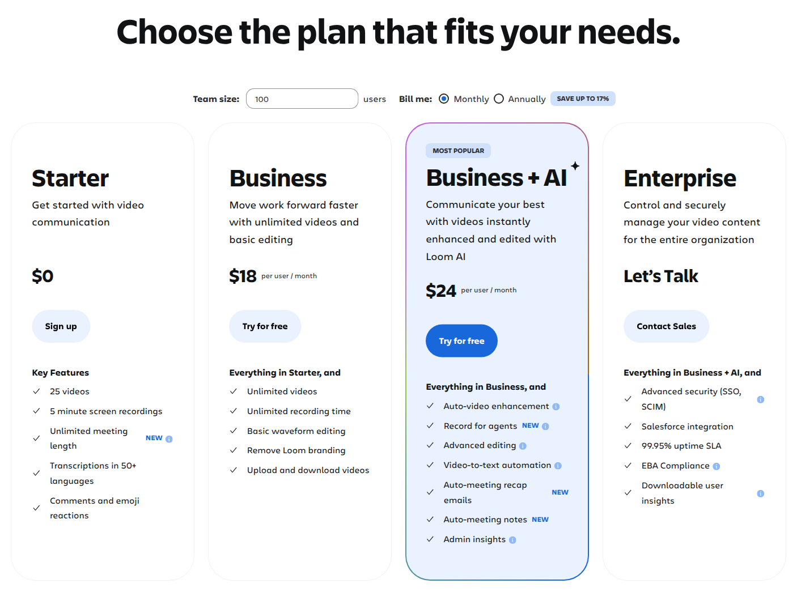

Loom Business shows $18 per user per month with monthly billing selected. On Business, Loom calculates price from paid Creator and admin seats; Creator Lite accounts are free.

<Frame caption="Loom plan pricing from the official site, 2026-11-20.">
  
</Frame>

[View the official pricing page](https://www.loom.com/pricing).

**Scope:** The USD base charge for a full month of Loom Business with six paid seats and no mid-cycle changes.

**Not modeled:** Other plans, annual billing, seat proration, trials, discounts and tax. Atlassian and legacy billing policies may differ.

## Pricing profile

| Dimension | Modeled offering |
| --- | --- |
| Pricing model | Subscription; Per-seat |
| Industry | Video communication software |
| Buyer | Teams sharing recorded updates |
| Sales motion | Self-serve |
| Billing mechanics | Monthly billing; Role-based paid seats |

## What Loom charges

| Item | Published terms | Flexprice implication |
| --- | --- | --- |
| Business, monthly | $18 per user per month | $18 per paid seat for one full month |
| Billable roles | Business pricing counts Creators and admins; Creator Lite is free | Determine quantity from distinct paid seats |
| Video and recording time | Unlimited on Business | Do not meter recording minutes for this base charge |

## Design takeaways

1. **Convert roles into a billable seat count.** Resolve paid access before sending a quantity to billing. Count each paid user once, rather than adding a separate charge for each role that user holds. [Published terms](https://support.atlassian.com/loom/docs/loom-billing-faq/).
2. **Treat recording access as a feature.** Business advertises unlimited videos and recording time. A recording meter would add a price dimension that doesn't exist in the base fee. [Published terms](https://www.loom.com/pricing).

## How Loom's pricing maps to Flexprice

| Loom concept | Flexprice configuration |
| --- | --- |
| USD base price per paid seat | Fixed monthly price of $18.00 in advance |
| Quantity | Set the fixed line's quantity on the subscription |

## Configure the plan and subscription

These requests are illustrative. Use your test environment and replace example IDs with the IDs returned by your setup. Create a [plan](/docs/product-catalogue/plans/create) with `POST /plans`:

```json
{
  "name": "Loom Business monthly creator seats example",
  "lookup_key": "loom_pricing_example",
  "description": "The USD base charge for a full month of Loom Business with six paid seats and no mid-cycle changes"
}
```

Create the [fixed price](/docs/product-catalogue/plans/pricing) with `POST /prices`. Enter the amount for the full billing period in USD, not cents.

```json
{
  "entity_type": "PLAN",
  "entity_id": "plan_loom_example",
  "currency": "usd",
  "price_unit_type": "FIAT",
  "billing_period": "MONTHLY",
  "billing_period_count": 1,
  "display_name": "Business monthly creator seats",
  "type": "FIXED",
  "billing_model": "FLAT_FEE",
  "invoice_cadence": "ADVANCE",
  "amount": "18.00"
}
```

Count the distinct paid seats, including admins where billed. Do not count Creator Lite accounts. In the example, five paid Creators and one separate admin yield six paid seats.

Create a customer for the payer and use its ID with `POST /subscriptions`. Use the returned price ID in `override_line_items` to set the fixed-line quantity.

```json
{
  "customer_id": "cust_loom_example",
  "plan_id": "plan_loom_example",
  "currency": "usd",
  "billing_period": "MONTHLY",
  "billing_period_count": 1,
  "billing_cycle": "anniversary",
  "start_date": "2026-12-01T00:00:00Z",
  "override_line_items": [
    {
      "price_id": "price_loom_example",
      "quantity": "6"
    }
  ]
}
```

## Worked bill

Five paid Creators, one separate paid admin and four Creator Lite accounts yield six paid seats. 6 × $18 = **$108.00** for the full month. The four Creator Lite accounts add $0.

## Pricing sources

- [Loom pricing](https://www.loom.com/pricing): Business monthly rate and plan features.
- [Loom billing documentation](https://support.atlassian.com/loom/docs/loom-billing-faq/): Role-based billing for Business and no charge for Creator Lite.

Pricing checked on 2026-11-20. This example does not reproduce a full provider invoice.

## Related guide

[Plan price overrides](/docs/subscriptions/plan-price-overrides)
