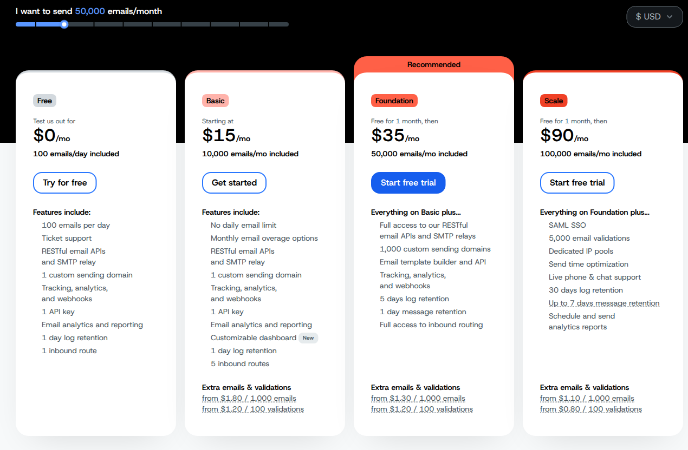
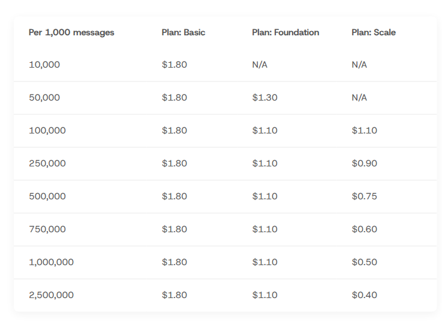

Mailgun Basic starts at $15 per month and includes 10,000 emails. Mailgun charges a prorated fee at signup. After signup, it bills the previous month's base fee and overage together at the start of each month. The Basic overage rate is $1.80 per 1,000 additional emails.

<Frame caption="Mailgun plan pricing from the official site, 2026-11-20.">
  
</Frame>

<Frame caption="Mailgun email overage rates from the official site, 2026-11-20.">
  
</Frame>

[View the official pricing page](https://www.mailgun.com/pricing/).

**Scope:** One Mailgun Basic account on the published $15 USD base rate for one full UTC calendar month after signup, using complete thousands of excess sends.

**Not modeled:** Signup proration, partial-thousand overage rules, other plans, validations, add-ons, mid-cycle upgrades, account-specific rates, discounts and tax.

## Pricing profile

| Dimension | Modeled offering |
| --- | --- |
| Pricing model | Hybrid; Subscription; Usage-based |
| Industry | Email delivery APIs |
| Buyer | Developers and email operations teams |
| Sales motion | Self-serve |
| Billing mechanics | Monthly base fee; Account-level allowance; Overages at renewal |

## What Mailgun charges

| Item | Published terms | Flexprice implication |
| --- | --- | --- |
| Basic | Starts at $15 per month | One monthly fixed price in arrears |
| Included sends | 10,000 per month | First 10,000 sends in the account's monthly meter cost $0 |
| Email overage | $1.80 per 1,000 additional sends | $0.0018 per extra send is equivalent for complete thousands in the worked example |
| Bill timing | The recurring base fee and overage are billed together for the previous UTC calendar month | Bill both charges in arrears |

## Design takeaways

1. **Apply the allowance once per account.** Share one monthly send meter across the billed account. Separate meters per sending domain would grant the same customer the included quantity more than once. [Published terms](https://help.mailgun.com/hc/en-us/articles/6745531451547-What-happens-if-I-send-more-emails-than-my-monthly-plan-provides).
2. **Split the fixed fee from variable usage.** Put the base fee and overage on separate lines of the renewal invoice for the same completed month. [Published terms](https://www.mailgun.com/pricing/).

## How Mailgun's pricing maps to Flexprice

| Mailgun concept | Flexprice configuration |
| --- | --- |
| Monthly plan fee | Fixed USD price in arrears |
| Eligible sends across a sending account | One account-level SUM meter that resets each billing period |
| Included volume and overage | Graduated usage price in arrears; zero through 10,000 sends |

## Configure the plan and subscription

These requests are illustrative. Use your test environment and replace example IDs with the IDs returned by your setup. The examples use December 2026. Choose an upcoming UTC calendar month for your test and use it for the usage price, subscription, and events. Create a [plan](/docs/product-catalogue/plans/create) with `POST /plans`:

```json
{
  "name": "Mailgun Basic monthly sending example",
  "lookup_key": "mailgun_pricing_example",
  "description": "One Mailgun Basic account on the published $15 USD base rate for one full UTC calendar month after signup, using complete thousands of excess sends"
}
```

### Base charge and included volume

Create the monthly base price with `POST /prices`:

```json
{
  "entity_type": "PLAN",
  "entity_id": "plan_mailgun_example",
  "currency": "usd",
  "price_unit_type": "FIAT",
  "billing_period": "MONTHLY",
  "billing_period_count": 1,
  "display_name": "Basic monthly sending",
  "type": "FIXED",
  "billing_model": "FLAT_FEE",
  "invoice_cadence": "ARREAR",
  "amount": "15.00"
}
```

Create a [metered feature](/docs/product-catalogue/features/linking-to-plans) with `POST /features`. Use one Flexprice customer per sending account, not per domain.

```json
{
  "name": "Basic emails sent",
  "lookup_key": "mailgun_basic_send_emails_sent",
  "type": "metered",
  "meter": {
    "name": "Basic emails sent",
    "event_name": "mailgun_basic_send",
    "reset_usage": "BILLING_PERIOD",
    "aggregation": {
      "type": "SUM",
      "field": "emails_sent"
    },
    "filters": [
      {
        "key": "billing_scope",
        "values": [
          "mailgun_basic"
        ]
      }
    ]
  }
}
```

### Overage price

Create a second price on the same plan using the meter ID returned by feature creation. Set the [graduated tiers](/docs/product-catalogue/plans/pricing) to charge zero through 10,000 sends and $0.0018 per send above that. This is a per-message equivalent for complete thousands of overage. The published terms do not establish how to charge a partial thousand here; verify that behavior for your account before using this configuration for partial amounts.

```json
{
  "entity_type": "PLAN",
  "entity_id": "plan_mailgun_example",
  "currency": "usd",
  "price_unit_type": "FIAT",
  "billing_period": "MONTHLY",
  "billing_period_count": 1,
  "display_name": "Basic additional sends",
  "type": "USAGE",
  "billing_model": "TIERED",
  "invoice_cadence": "ARREAR",
  "start_date": "2026-12-01T00:00:00Z",
  "tier_mode": "SLAB",
  "meter_id": "meter_mailgun_example",
  "tiers": [
    {
      "up_to": 10000,
      "unit_amount": "0"
    },
    {
      "unit_amount": "0.0018"
    }
  ]
}
```

### Subscription and sends

Create the customer and the subscription. Set the usage price and subscription to start at midnight UTC on the first day of the test month. Use event timestamps within that same month.

```json
{
  "customer_id": "cust_mailgun_example",
  "plan_id": "plan_mailgun_example",
  "currency": "usd",
  "billing_period": "MONTHLY",
  "billing_period_count": 1,
  "billing_cycle": "anniversary",
  "start_date": "2026-12-01T00:00:00Z"
}
```

Send usage with `POST /events` using the customer's external ID. The [Mailgun invoice guide](https://help.mailgun.com/hc/en-us/articles/360011701634-Where-can-I-find-my-Mailgun-invoices) describes message totals as processed messages. Use the count of new billable messages processed in your sending system, not the number of API calls or successful deliveries. The example event reports one batch of 1,000 messages. Record each batch once and reuse its event ID and timestamp on retry. Use the processing timestamp and do not combine messages from two billing periods into one event.

```json
{
  "event_name": "mailgun_basic_send",
  "event_id": "evt_mailgun_batch_001",
  "external_customer_id": "account_mailgun_example",
  "timestamp": "2026-12-02T12:00:00Z",
  "properties": {
    "emails_sent": "1000",
    "billing_scope": "mailgun_basic"
  }
}
```

## Worked bill

| Sends in one UTC month | Included sends used | Monthly overage | Renewal invoice before tax |
| ---: | ---: | ---: | ---: |
| 9,000 | 9,000 | $0.00 | $15.00 |
| 10,000 | 10,000 | $0.00 | $15.00 |
| 12,000 | 10,000 | 2 × $1.80 = $3.60 | $18.60 |

For 12,000 sends in a full recurring month, the next invoice includes the $15.00 base fee and $3.60 in overage for that month, for a total of **$18.60** before tax.

## Pricing sources

- [Mailgun pricing](https://www.mailgun.com/pricing/): Basic starting price, included monthly sending, and recurring billing timing.
- [Mailgun billing documentation](https://help.mailgun.com/hc/en-us/articles/6745531451547-What-happens-if-I-send-more-emails-than-my-monthly-plan-provides): Overage rates, renewal timing and exceptions.
- [Mailgun invoice documentation](https://help.mailgun.com/hc/en-us/articles/360011701634-Where-can-I-find-my-Mailgun-invoices): Monthly usage window and UTC billing boundary.

Pricing checked on 2026-11-20. This example does not reproduce a full provider invoice.

## Related guide

[Hybrid pricing](/cookbooks/billing-recipes/hybrid-pricing)
