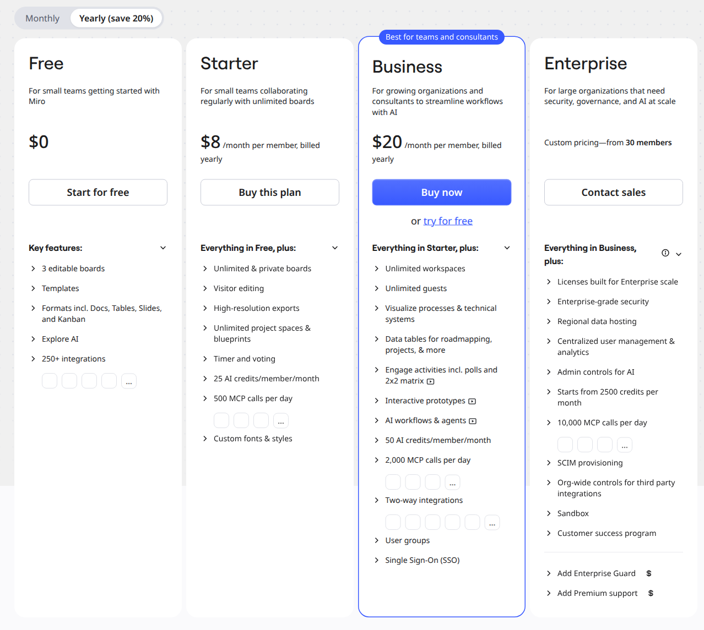

Miro Business shows $20 per member per month billed yearly. Miro bills for purchased licenses, not the number of people who happen to be on the team, and sharing boards with guests or visitors does not add a license charge.

<Frame caption="Miro plan pricing from the official site, 2026-11-20.">
  
</Frame>

[View the official pricing page](https://miro.com/pricing/).

**Scope:** The initial USD annual base fee for eight Miro Business licenses on a self-serve subscription.

**Not modeled:** Other plans, monthly billing, prorated license changes and true-up invoices, AI credits, discounts and tax.

## Pricing profile

| Dimension | Modeled offering |
| --- | --- |
| Pricing model | Subscription; Per-seat |
| Industry | Visual collaboration software |
| Buyer | Teams collaborating on shared boards |
| Sales motion | Self-serve |
| Billing mechanics | Annual billing; Purchased license quantity |

## What Miro charges

| Item | Published terms | Flexprice implication |
| --- | --- | --- |
| Business, yearly | $20 per member per month | $240 per purchased license for a year |
| License count | Miro bills for licenses, including unassigned licenses still on the subscription | Use purchased licenses, not active team members |
| Guests and visitors | Sharing with guests or visitors does not cost extra | Do not add a license for a board share |

## Design takeaways

1. **Separate assignment from purchase.** Keep purchased and assigned license counts separately. Assigning a member to an existing vacancy doesn't increase the purchased quantity. [Published terms](https://help.miro.com/hc/en-us/articles/360017571714-Miro-billing).
2. **Separate collaboration from billing.** A board invite is not itself a billing event. Determine whether access needs a purchased license before any change to the subscription. [Published terms](https://help.miro.com/hc/en-us/articles/360017571714-Miro-billing).

## How Miro's pricing maps to Flexprice

| Miro concept | Flexprice configuration |
| --- | --- |
| USD base price per purchased license | Fixed annual price of $240.00 in advance |
| Quantity | Set the fixed line's quantity on the subscription |

## Configure the plan and subscription

These requests are illustrative. Use your test environment and replace example IDs with the IDs returned by your setup. Create a [plan](/docs/product-catalogue/plans/create) with `POST /plans`:

```json
{
  "name": "Miro Business annual licenses example",
  "lookup_key": "miro_pricing_example",
  "description": "The initial USD annual base fee for eight Miro Business licenses on a self-serve subscription"
}
```

Create the [fixed price](/docs/product-catalogue/plans/pricing) with `POST /prices`. Enter the amount for the full billing period in USD, not cents.

```json
{
  "entity_type": "PLAN",
  "entity_id": "plan_miro_example",
  "currency": "usd",
  "price_unit_type": "FIAT",
  "billing_period": "ANNUAL",
  "billing_period_count": 1,
  "display_name": "Business annual licenses",
  "type": "FIXED",
  "billing_model": "FLAT_FEE",
  "invoice_cadence": "ADVANCE",
  "amount": "240.00"
}
```

If seven members occupy eight purchased licenses, set the quantity to eight. Do not add any board guests or visitors to the checkout count. This example holds the quantity constant; midyear purchases and credits have their own true-up rules.

Create a customer for the payer and use its ID with `POST /subscriptions`. Use the returned price ID in `override_line_items` to set the fixed-line quantity.

```json
{
  "customer_id": "cust_miro_example",
  "plan_id": "plan_miro_example",
  "currency": "usd",
  "billing_period": "ANNUAL",
  "billing_period_count": 1,
  "billing_cycle": "anniversary",
  "start_date": "2026-12-01T00:00:00Z",
  "override_line_items": [
    {
      "price_id": "price_miro_example",
      "quantity": "8"
    }
  ]
}
```

## Worked bill

$20 × 12 = $240 per license for one year. Eight licenses cost **$1,920.00**, whether seven or eight are assigned. Sharing a board with two guests leaves that price unchanged.

## Pricing sources

- [Miro pricing](https://miro.com/pricing/): Business yearly price and collaboration features.
- [Miro billing documentation](https://help.miro.com/hc/en-us/articles/360017571714-Miro-billing): Purchased licenses, guest and visitor access, proration and annual true-ups.

Pricing checked on 2026-11-20. This example does not reproduce a full provider invoice.

## Related guide

[Plan price overrides](/docs/subscriptions/plan-price-overrides)
