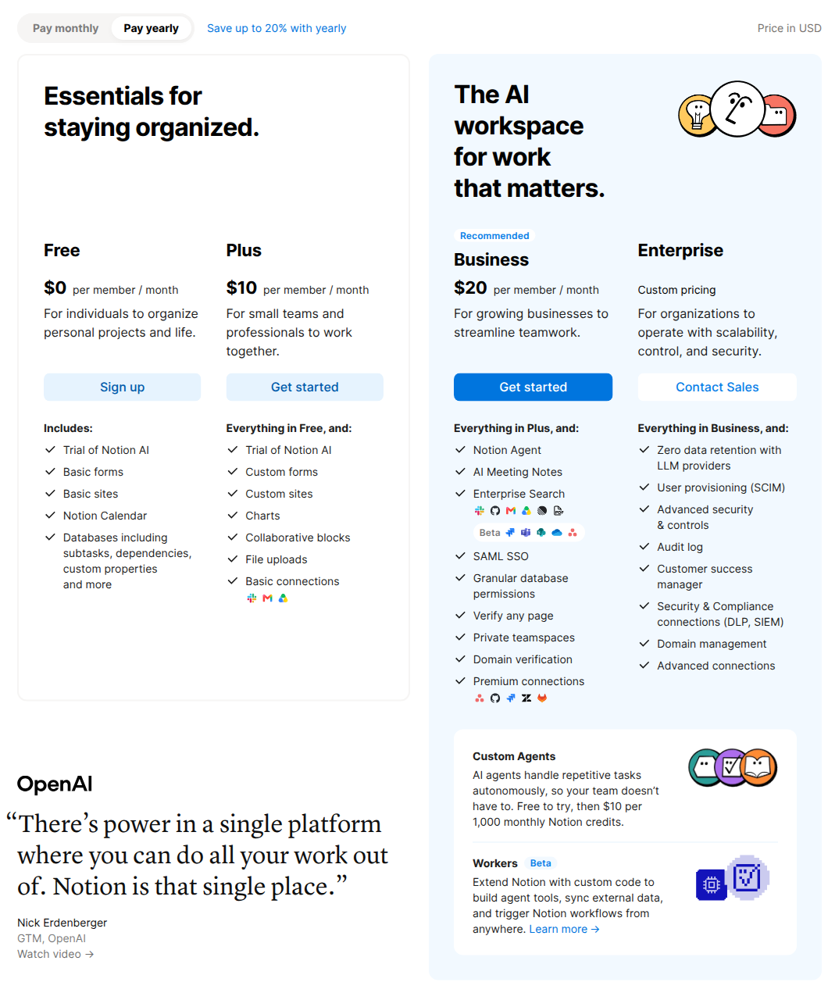

Notion Plus shows **$10 per member per month with Pay yearly selected** in USD. Notion bills by workspace, and eligible page guests are not billable members. For an unchanged member count, configure $120 per member per year and set the quantity separately on each workspace subscription.

<Frame caption="Notion's Free, Plus, Business and Enterprise plans with Pay yearly selected. Custom Agents and other tiers are outside the example. Captured November 18, 2026. Source: Notion's official pricing page, linked below.">
  
</Frame>

[View the original pricing page](https://www.notion.com/pricing).

**Scope:** USD Notion Plus yearly base subscription with stable paid membership in one workspace.

**Not modeled:** Other plans, monthly billing, Custom Agent credits, mid-cycle additions, reductions or seat reuse, discounts and taxes.

## Pricing profile

| Dimension | Modeled offering |
| --- | --- |
| Pricing model | Per-seat, Subscription |
| Industry | Collaborative workspaces |
| Buyer | Small teams and professionals |
| Sales motion | Self-serve |
| Billing mechanics | Annual base charge, Workspace-level member quantity, Page guests excluded |

## What Notion charges

| Item | Published terms | Flexprice implication |
| --- | --- | --- |
| Plus yearly display rate | $10 per member per month with Pay yearly selected | $120 per member per full year |
| Billing boundary | Each paid workspace is billed separately | Use one customer/subscription per workspace in this example |
| Guests | Page guests can collaborate at no seat charge within applicable limits | Exclude guests from the member quantity |
| Member changes | Additions can be prorated; removal reduces charges at renewal rather than generating a mid-interval credit | Keep this example at a stable count; no adjustment workflow |

## Design takeaways

1. **Use a workspace as the billing boundary.** The same person can be a member of two paid workspaces. A global distinct-user count would underbill; set separate line-item quantities. See [the published terms](https://www.notion.com/help/billing).
2. **Derive quantity from billing roles.** A page guest is not a member merely because they collaborate. Read the paid membership count, not the number of individuals who accessed a page. See [the published terms](https://www.notion.com/help/billing).
3. **Do not use symmetrical proration by default.** Notion documents different effects for additions and removals. Preserve that distinction if you implement the adjustment workflow separately. See [the published terms](https://www.notion.com/help/billing).

## How Notion's pricing maps to Flexprice

| Notion concept | Flexprice configuration |
| --- | --- |
| Plus member | Fixed annual price of $120 per billable unit |
| Billable quantity | Subscription line-item quantity; no usage meter |
| Billing schedule | One annual period, invoiced in advance |

## Set up the fixed subscription

Use the Flexprice API only in your own test environment. Replace the illustrative IDs with the IDs returned by your setup. Create a [plan](/docs/product-catalogue/plans/create) with `POST /plans`:

```json
{
  "name": "Notion Plus Annual example",
  "lookup_key": "notion_pricing_example",
  "description": "USD Notion Plus yearly base subscription with stable paid membership in one workspace"
}
```

Create the [fixed price](/docs/product-catalogue/plans/pricing) with `POST /prices`. The amount is in USD, not cents, and is the unit amount for the entire billing period:

```json
{
  "entity_type": "PLAN",
  "entity_id": "plan_notion_example",
  "type": "FIXED",
  "billing_model": "FLAT_FEE",
  "billing_period": "ANNUAL",
  "billing_period_count": 1,
  "invoice_cadence": "ADVANCE",
  "currency": "usd",
  "price_unit_type": "FIAT",
  "amount": "120",
  "display_name": "Plus Annual Plus member"
}
```

Create one customer for the billing account, then call `POST /subscriptions` with that customer, the plan and its fixed price. The [quantity override](/docs/subscriptions/plan-price-overrides) applies to the fixed line item.

```json
{
  "customer_id": "cust_notion_example",
  "plan_id": "plan_notion_example",
  "currency": "usd",
  "billing_period": "ANNUAL",
  "billing_period_count": 1,
  "billing_cycle": "anniversary",
  "start_date": "2026-12-01T00:00:00Z",
  "override_line_items": [
    {
      "price_id": "price_notion_example",
      "quantity": "8"
    }
  ]
}
```

Eight paid members and three eligible page guests give quantity eight. Use a different subscription for any other paid workspace, even if it has some of the same members.

## Worked bill

$10 × 12 = $120 per member per year; 8 paid members × $120 = $960. The invoice base is **$960** for quantity **8**, before excluded charges or adjustments.

## Pricing sources

- [Notion pricing](https://www.notion.com/pricing): USD yearly plan comparison and Plus rate.
- [Notion billing documentation](https://www.notion.com/help/billing): Workspace-specific billing, guest treatment and seat changes.

Pricing checked on 2026-11-18. Recheck the source before implementing. This is illustrative configuration, not a recreation of a full provider invoice.

## Related guide

[Plan price overrides](/docs/subscriptions/plan-price-overrides)
