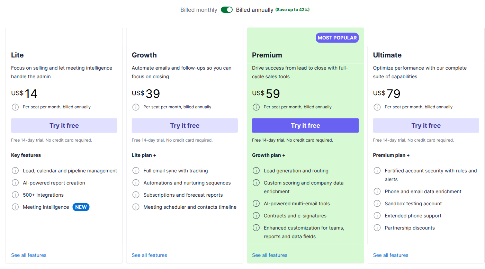

Pipedrive Growth displays a monthly equivalent on annual billing, but the checkout charges the full year per purchased seat. Flexprice can bill that year's amount up front without metering CRM activity.

<Frame caption="Pipedrive annual plan comparison from the official site, 2026-11-25. This guide models only Growth annual.">
  
</Frame>

[View the official pricing page](https://www.pipedrive.com/en/pricing).

**Scope:** Pipedrive Growth in USD on annual upfront billing, with the purchased seat count fixed for the worked year.

**Not modeled:** Monthly billing, other plans, add-ons, trials, taxes, refunds, and seat changes during the term.

## Pricing profile

| Dimension | Modeled offering |
| --- | --- |
| Pricing model | Per-seat; Subscription |
| Industry | Customer relationship management |
| Buyer | Sales teams |
| Sales motion | Self-serve |
| Billing mechanics | Annual upfront payment; Purchased seats |

## What Pipedrive charges

| Item | Published terms | Flexprice implication |
| --- | --- | --- |
| Annual Growth price | $39 USD per seat per month as displayed, one annual payment of $468 USD per seat | Store $468 as the annual unit price, not $39 |
| Billable seats | The account pays for purchased seats, even if some are empty | Set a fixed-line quantity from purchased seats |
| Seat reductions | Removing rather than retaining a seat takes effect at the next billing cycle | Apply renewal quantity from your seat ledger, not from login counts |

## Design takeaways

1. **Separate display rate from invoice amount.** Use the monthly figure for comparison copy, but send the full annual per-seat amount to billing. Otherwise the same headline can create an incorrect invoice [Published terms](https://support.pipedrive.com/en/article/what-is-the-difference-between-annual-and-monthly-billing-in-pipedrive).
2. **Separate access from purchasing.** Deactivating a user can leave a slot for their replacement. Use an explicit purchase or seat-removal operation to change the billed quantity [Published terms](https://support.pipedrive.com/en/article/what-is-the-difference-between-a-user-and-a-seat).

## How Pipedrive's pricing maps to Flexprice

| Pipedrive concept | Flexprice configuration |
| --- | --- |
| Growth seat | Fixed annual price of $468.00 USD in advance |

## Configure the plan and subscription

These requests are illustrative. Use your test environment and replace example IDs with the IDs returned by your setup. Create a [plan](/docs/product-catalogue/plans/create) with `POST /plans`:

```json
{
  "name": "Pipedrive Growth annual example",
  "lookup_key": "pipedrive_pricing_example",
  "description": "Pipedrive Growth in USD on annual upfront billing, with the purchased seat count fixed for the worked year"
}
```

Use `POST /prices` for each [fixed recurring price](/docs/product-catalogue/plans/pricing) below. Amounts are in USD for the full billing period, not cents.

```json
{
  "entity_type": "PLAN",
  "entity_id": "plan_pipedrive_example",
  "currency": "usd",
  "price_unit_type": "FIAT",
  "billing_period": "ANNUAL",
  "billing_period_count": 1,
  "display_name": "Growth seat",
  "type": "FIXED",
  "billing_model": "FLAT_FEE",
  "invoice_cadence": "ADVANCE",
  "amount": "468.00"
}
```

Set the price quantity to purchased seats at the annual boundary. Reassigning an existing purchased seat to a new user does not change this quantity.

Create or select the payer's customer record. When paid billing begins, use `POST /subscriptions` with that customer ID and the returned plan and price IDs. Where a quantity is needed, set it through a [line-item override](/docs/subscriptions/plan-price-overrides). To set up a subscription now without raising the advance invoice yet, [create a draft](/docs/core-concepts/subscriptions#choosing-a-subscription-start-date) and activate it when billing begins.

```json
{
  "customer_id": "cust_pipedrive_example",
  "plan_id": "plan_pipedrive_example",
  "currency": "usd",
  "billing_period": "ANNUAL",
  "billing_period_count": 1,
  "billing_cycle": "anniversary",
  "override_line_items": [
    {
      "price_id": "price_pipedrive_1_example",
      "quantity": "4"
    }
  ]
}
```

## Worked bill

One purchased seat costs $39.00 × 12 = $468.00 per year. With four purchased seats and three assigned, the annual invoice is 4 × $468.00 = **$1,872.00** before taxes.

Verify the fixed charge amounts and quantities on the opening invoice. No usage line should be present in this example.

## Pricing sources

- [Pipedrive pricing](https://www.pipedrive.com/en/pricing): Growth annual list price and monthly equivalent.
- [Pipedrive seats and users](https://support.pipedrive.com/en/article/what-is-the-difference-between-a-user-and-a-seat): Purchased seats versus user assignments and seat removals.
- [Pipedrive annual and monthly billing](https://support.pipedrive.com/en/article/what-is-the-difference-between-annual-and-monthly-billing-in-pipedrive): Annual charge at the start of the term.

Pricing checked on 2026-11-25. This example does not reproduce a full provider invoice.

## Related guide

[Plan price overrides](/docs/subscriptions/plan-price-overrides)
