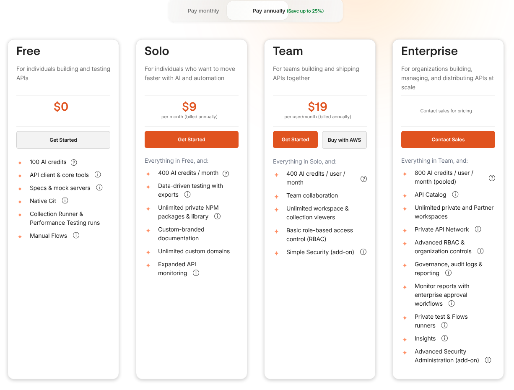

Postman's annual Team plan shows $19 per user per month. The plan includes shared collaboration features and a monthly AI credit allowance per paid user, but the base subscription is priced by user count.

<Frame caption="Postman pricing as shown on the official pricing page, 2026-11-19.">
  
</Frame>

[View the official pricing page](https://www.postman.com/pricing/).

**Scope:** The initial annual base charge for Postman Team in USD, with six paid users.

**Not modeled:** AI credit allocation and overages, other metered services, add-ons, Enterprise, and midterm adjustments or tax.

## Pricing profile

| Dimension | Modeled offering |
| --- | --- |
| Pricing model | Subscription; Per-seat |
| Industry | API development tools |
| Buyer | API development teams |
| Sales motion | Self-serve |
| Billing mechanics | Annual billing; Paid-user quantity |

## What Postman charges

| Item | Published terms | Flexprice implication |
| --- | --- | --- |
| Team, annual | $19 per paid user per month | One annual fixed price of $228 per paid user |
| Collaboration | Team lists unlimited workspace and collection viewers | Do not treat viewer count as paid-seat quantity |
| AI credits | 400 per user per month on Team | Track allowance and consumption separately if needed |

## Design takeaways

1. **Separate viewers and paid users.** Viewer access and paid membership can grow independently. Resolve seat quantity from the billing system rather than counting everyone who opens a shared collection. [Published terms](https://www.postman.com/pricing/).
2. **Separate renewal from allowance reset.** The yearly subscription and monthly AI credit allocation have different time scales. A fixed annual line should not be multiplied by monthly credit consumption. [Published terms](https://www.postman.com/pricing/).

## How Postman's pricing maps to Flexprice

| Postman concept | Flexprice configuration |
| --- | --- |
| Base price per paid user | Fixed annual price of $228.00 USD in advance |
| Billable quantity | Fixed line-item quantity override |

## Configure the plan and subscription

These requests are illustrative. Use your own test environment and replace all example IDs with the IDs returned by your setup. Create a [plan](/docs/product-catalogue/plans/create) with `POST /plans`:

```json
{
  "name": "Postman Team example",
  "lookup_key": "postman_pricing_example",
  "description": "The initial annual base charge for Postman Team in USD, with six paid users"
}
```

Create the [fixed price](/docs/product-catalogue/plans/pricing) with `POST /prices`. The amount covers the entire year and is in USD, not cents.

```json
{
  "entity_type": "PLAN",
  "entity_id": "plan_postman_example",
  "currency": "usd",
  "price_unit_type": "FIAT",
  "billing_period": "ANNUAL",
  "billing_period_count": 1,
  "display_name": "Team",
  "type": "FIXED",
  "billing_model": "FLAT_FEE",
  "invoice_cadence": "ADVANCE",
  "amount": "228.00"
}
```

Create a customer for the payer, then create the subscription with `POST /subscriptions`. The [quantity override](/docs/subscriptions/plan-price-overrides) applies to the fixed line.

```json
{
  "customer_id": "cust_postman_example",
  "plan_id": "plan_postman_example",
  "currency": "usd",
  "billing_period": "ANNUAL",
  "billing_period_count": 1,
  "billing_cycle": "anniversary",
  "start_date": "2026-12-01T00:00:00Z",
  "override_line_items": [
    {
      "price_id": "price_postman_example",
      "quantity": "6"
    }
  ]
}
```

Use the billing account's purchased seat count rather than the number of API requests, viewers, or AI credits consumed.

## Worked bill

$19 × 12 = $228 per paid user per year. Six paid users cost **$1,368.00** for the initial year.

## Pricing sources

- [Postman pricing](https://www.postman.com/pricing/): Annual plan comparison, Team seats, included AI credits and viewer access.
- [Postman product documentation](https://learning.postman.com/docs/billing/billing-overview/): Separate seats, add-ons and usage-based activity in billing.

Pricing checked on 2026-11-19. This example does not reproduce a full provider invoice.

## Related guide

[Plan price overrides](/docs/subscriptions/plan-price-overrides)
