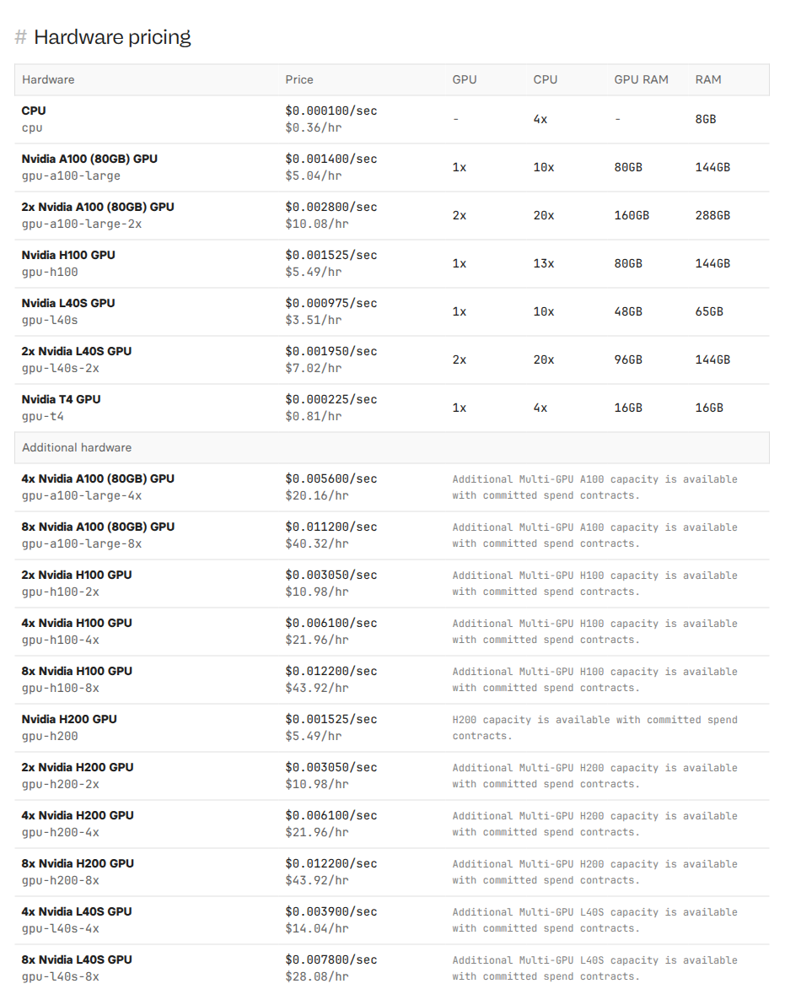

Replicate lists **$0.000100 per second** for its CPU hardware configuration. For public models priced by hardware time, it charges for active processing, not instance setup or idle time. Model that charge with a SUM meter for active seconds on CPU instances, rather than a per-prediction fee.

<Frame caption="Replicate's complete hardware pricing table, including hardware offered on committed-spend contracts. Only the CPU row for time-priced public predictions is modeled. Captured November 18, 2026. Source: Replicate's official pricing page, linked below.">
  
</Frame>

[View the original pricing page](https://replicate.com/pricing).

**Scope:** Gross active CPU runtime cost for hardware-time-priced public model predictions only.

**Not modeled:** Public models with output-based rates, other hardware, private models, deployments, training, failure and cancellation adjustments, prepaid credit collection, taxes and discounts.

## Pricing profile

| Dimension | Modeled offering |
| --- | --- |
| Pricing model | Usage-based |
| Industry | Hosted machine learning inference |
| Buyer | Developers integrating public models |
| Sales motion | Self-serve |
| Billing mechanics | Per-second CPU charge, Active processing time only |

## What Replicate charges

| Item | Published terms | Flexprice implication |
| --- | --- | --- |
| CPU rate | $0.000100 per second, also listed as $0.36 per hour, for the CPU hardware row | Rate instance seconds directly; do not multiply by the four listed CPU cores or round into hour packages |
| Public models priced by hardware time | Charge for active processing; setup and idle time are free | Ingest only finalized billable processing seconds |
| Exceptions | Some public models charge by output, and dedicated deployments have different rules | Filter hardware and pricing class before aggregation |

## Design takeaways

1. **Choose the interval that drives the charge.** Client-observed elapsed time can include nonbillable work. Carry provider-equivalent active seconds, not request latency, to the meter. See [the published terms](https://replicate.com/docs/topics/billing).
2. **Filter the pricing class separately from the hardware.** A public prediction is not automatically billed by runtime. Keep output-priced predictions out of the CPU seconds meter even when the event stream covers all predictions. See [the published terms](https://replicate.com/pricing).
3. **Keep prepaid funding out of the usage formula.** Replicate describes credit balances for prepaid accounts. The Flexprice example calculates gross usage before applying any funding or payment collection. See [the published terms](https://replicate.com/docs/topics/billing).

## How Replicate's pricing maps to Flexprice

| Replicate concept | Flexprice configuration |
| --- | --- |
| billable active CPU seconds | SUM of `active_cpu_seconds` on eligible usage events |
| Eligible usage | Filter by `hardware`, `pricing_class`, `billing_scope` |
| Usage price | Constant rate of $0.000100 per unit |
| Account | One metered subscription with no fixed fee |

## Configure the metered subscription

These examples are illustrative. Replace example IDs with IDs returned by your Flexprice environment. Create a [metered feature](/docs/product-catalogue/features/linking-to-plans) with `POST /features`:

```json
{
  "name": "Replicate billable active CPU seconds",
  "lookup_key": "replicate_rated_usage",
  "type": "metered",
  "meter": {
    "name": "Replicate billable active CPU seconds",
    "event_name": "replicate_rated_usage",
    "reset_usage": "BILLING_PERIOD",
    "aggregation": {
      "type": "SUM",
      "field": "active_cpu_seconds"
    },
    "filters": [
      {
        "key": "hardware",
        "values": [
          "cpu"
        ]
      },
      {
        "key": "pricing_class",
        "values": [
          "public_hardware_time"
        ]
      },
      {
        "key": "billing_scope",
        "values": [
          "replicate_example"
        ]
      }
    ]
  }
}
```

Create the [plan](/docs/product-catalogue/plans/create) with `POST /plans`:

```json
{
  "name": "Replicate Public CPU Runtime example",
  "lookup_key": "replicate_pricing_example",
  "description": "Gross active CPU runtime cost for hardware-time-priced public model predictions only"
}
```

Create the usage price with `POST /prices`. Use the returned meter ID, not the feature ID. The USD price bills at the end of each period:

```json
{
  "entity_type": "PLAN",
  "entity_id": "plan_replicate_example",
  "type": "USAGE",
  "billing_model": "FLAT_FEE",
  "billing_period": "MONTHLY",
  "billing_period_count": 1,
  "invoice_cadence": "ARREAR",
  "currency": "usd",
  "price_unit_type": "FIAT",
  "amount": "0.000100",
  "display_name": "Public CPU Runtime billable active CPU seconds",
  "meter_id": "meter_replicate_example"
}
```

The usage price is a constant rate per second, not a recurring fee. There is no fixed subscription price, volume tier or quantity transformation.

Create one customer for the account. If you configure a metered entitlement, make it unlimited so it does not cap the priced usage. Start the [subscription](/docs/subscriptions/customers-create-subscription) with `POST /subscriptions`:

```json
{
  "customer_id": "cust_replicate_example",
  "plan_id": "plan_replicate_example",
  "currency": "usd",
  "billing_period": "MONTHLY",
  "billing_period_count": 1,
  "billing_cycle": "anniversary",
  "start_date": "2026-12-01T00:00:00Z"
}
```

### Send finalized usage

Set `external_customer_id` to the external ID of the same customer used on the subscription. The [event](/docs/core-concepts/usage-events/sending-events) uses integration-defined properties, not a provider response:

```json
{
  "event_name": "replicate_rated_usage",
  "event_id": "evt_replicate_0001",
  "external_customer_id": "account_replicate_example",
  "timestamp": "2026-12-02T12:00:00Z",
  "properties": {
    "hardware": "cpu",
    "pricing_class": "public_hardware_time",
    "billing_scope": "replicate_example",
    "prediction_id": "prediction_example",
    "active_cpu_seconds": "12.375"
  }
}
```

Supply finalized active billable seconds for predictions known to be on the CPU hardware rate. Preserve precision; reconcile your input with priced usage. Exclude setup and idle time, rather than subtracting an assumed startup time from request latency. The monthly arrears schedule here is illustrative, not a claim about Replicate's collection window.

Keep the same event ID and original timestamp when retrying. Do not emit both individual records and an interval total covering the same usage. Aggregate before rounding currency.

## Worked bill

133,750 active CPU seconds × $0.000100 = $13.375 before currency rounding. An individual prediction with 12.375 rated seconds contributes $0.0012375 to that total before currency rounding. Do not round individual predictions to cents.

## Pricing sources

- [Replicate pricing](https://replicate.com/pricing): Complete hardware rate table and public-model pricing exceptions.
- [Replicate billing documentation](https://replicate.com/docs/topics/billing): Active versus setup/idle time, differences for deployments and billing collection.

Pricing checked on 2026-11-18. Recheck the source before implementing. This is illustrative configuration, not a recreation of a full provider invoice.

## Related guide

[Usage-based pricing recipe](/cookbooks/billing-recipes/usage-based-pricing)
