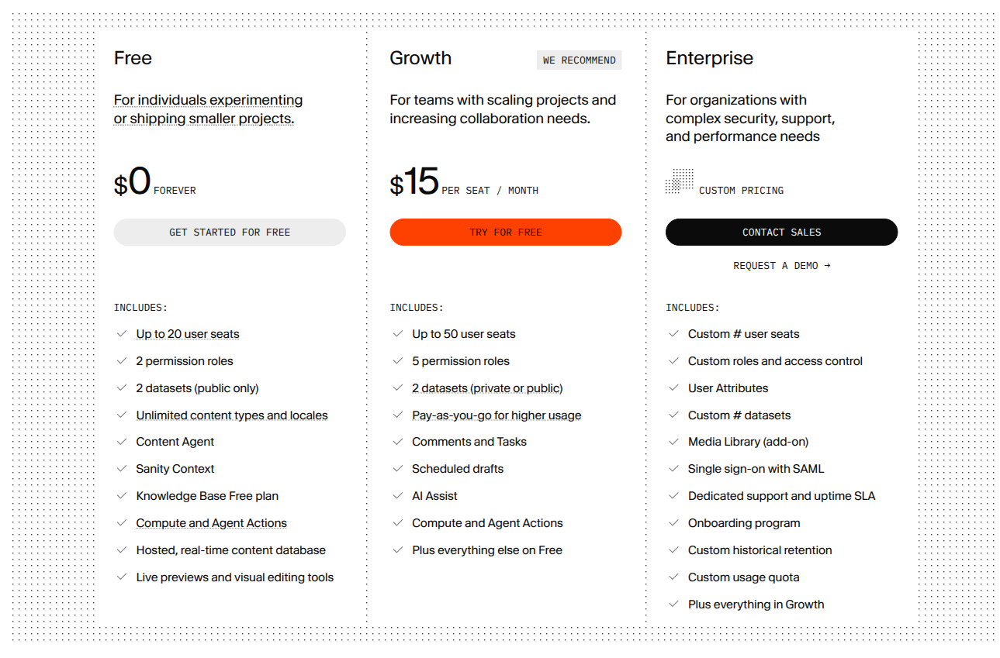

Sanity Growth charges $15 per billable seat per calendar month. Members who only hold the Viewer role are free. This guide maps a stable seat count for one Growth project to a fixed monthly price with a quantity in Flexprice.

<Frame caption="Sanity plan comparison from the official site, 2026-11-27. This guide models only Growth monthly seats.">
  
</Frame>

[View the official pricing page](https://www.sanity.io/pricing).

**Scope:** USD seat fees for one Growth project with four billable members and two Viewer-only members throughout a full calendar month.

**Not modeled:** Add-ons, metered overages, mid-month membership or plan changes, multi-project consolidation, and taxes.

## Pricing profile

| Dimension | Modeled offering |
| --- | --- |
| Pricing model | Per-seat |
| Industry | Headless CMS |
| Buyer | Content and engineering teams |
| Sales motion | Self-serve |
| Billing mechanics | Calendar-month billing; Viewer-only exemption |

## What Sanity charges

| Item | Published terms | Flexprice implication |
| --- | --- | --- |
| Growth seats | $15 per seat per month, up to 50 billable seats | Fixed monthly USD price with a seat quantity |
| Free viewers | A member with only the built-in Viewer role is free. Assigning an additional role makes that member billable | Derive quantities from unique project members and their roles |
| Billing cadence | Projects are billed monthly in advance. The organization is charged on the first of the month, including any prior-month overages | Use calendar billing for the seats. Prior-month overages are outside this example |

## Design takeaways

1. **Count people after resolving roles.** Reduce each member's role assignments to a single billing decision before counting seats. That keeps a member with two paid roles from being charged twice and still counts a Viewer who also has an Editor role [Published terms](https://www.sanity.io/docs/user-guides/roles).
2. **Keep the project and payer IDs separate.** The organization can pay for several projects. Preserve a project identifier when counting seats so the organization can reconcile project charges independently [Published terms](https://www.sanity.io/docs/platform-management/plans-and-payments).

## How Sanity's pricing maps to Flexprice

| Sanity concept | Flexprice configuration |
| --- | --- |
| Base charge | Fixed monthly price of $15.00 USD in advance |
| Charge quantity | One quantity per billable seat on the project |
| Billing boundaries | Calendar subscription billing |

## Configure the plan and subscription

These requests are illustrative. Use your test environment and replace example IDs with the IDs returned by your setup. Create a [plan](/docs/product-catalogue/plans/create) with `POST /plans`:

```json
{
  "name": "Sanity Growth monthly seats example",
  "lookup_key": "sanity_pricing_example",
  "description": "USD seat fees for one Growth project with four billable members and two Viewer-only members throughout a full calendar month"
}
```

Use `POST /prices` to create the [fixed recurring price](/docs/product-catalogue/plans/pricing). The amount is USD for the entire billing period.

```json
{
  "entity_type": "PLAN",
  "entity_id": "plan_sanity_example",
  "currency": "usd",
  "price_unit_type": "FIAT",
  "billing_period": "MONTHLY",
  "billing_period_count": 1,
  "display_name": "Growth monthly seats",
  "type": "FIXED",
  "billing_model": "FLAT_FEE",
  "invoice_cadence": "ADVANCE",
  "amount": "15.00"
}
```

Count unique members with at least one non-Viewer role. For the example, use four members with billable roles and two members who only have the Viewer role. Set the price quantity to four with a [line-item override](/docs/subscriptions/plan-price-overrides). For an entire calendar month, create the active subscription at the start of that month in the customer's billing timezone.

Use `POST /subscriptions` with the returned customer, plan, and price IDs. Set `include_price_ids` to the modeled price ID. If you need to prepare the subscription ahead of the paid start, [save it as a draft](/docs/core-concepts/subscriptions#choosing-a-subscription-start-date) and activate it when billing begins. Creating an active advance-billed subscription can raise its opening invoice at creation.

```json
{
  "customer_id": "cust_sanity_example",
  "plan_id": "plan_sanity_example",
  "currency": "usd",
  "billing_period": "MONTHLY",
  "billing_period_count": 1,
  "billing_cycle": "calendar",
  "include_price_ids": [
    "price_sanity_example"
  ],
  "override_line_items": [
    {
      "price_id": "price_sanity_example",
      "quantity": "4"
    }
  ]
}
```

## Worked bill

At the start of a full month, four billable seats at $15.00 each produce **$60.00** before taxes. The two Viewer-only members add $0.00. Check the opening invoice for four units of the seat price.

## Pricing sources

- [Sanity pricing](https://www.sanity.io/pricing): Growth seat price, seat limit, and plan comparison.
- [Sanity plans and payments](https://www.sanity.io/docs/platform-management/plans-and-payments): Project billing in advance on a calendar month.
- [Sanity roles](https://www.sanity.io/docs/user-guides/roles): Viewer-only exemption and role combinations.

Pricing checked on 2026-11-27.

## Related guide

[Plan price overrides](/docs/subscriptions/plan-price-overrides)
