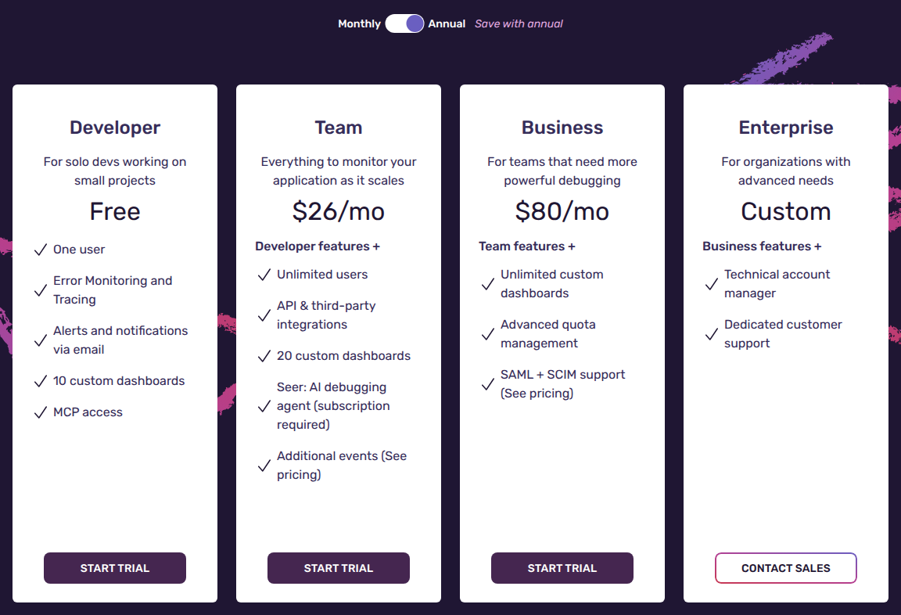

Sentry Team charges an organization-level base fee and includes monthly data allowances. The annual price and the monthly allowance are independent: paying for the year does not turn the allowance into a yearly pool.

<Frame caption="Sentry annual plan comparison from the official site, 2026-11-25. This guide models only Team annual base.">
  
</Frame>

[View the official pricing page](https://sentry.io/pricing/).

**Scope:** The USD base fee for one Sentry Team organization on an annual prepaid subscription.

**Not modeled:** Additional reserved data, PAYG budgets and charges, metering and quota enforcement, add-ons such as Seer, trials, and taxes.

## Pricing profile

| Dimension | Modeled offering |
| --- | --- |
| Pricing model | Subscription |
| Industry | Application observability |
| Buyer | Software engineering teams |
| Sales motion | Self-serve |
| Billing mechanics | Annual upfront base fee; Monthly included data allowances |

## What Sentry charges

| Item | Published terms | Flexprice implication |
| --- | --- | --- |
| Team annual base | $26 USD per month displayed with annual billing selected; the year is paid up front | One fixed annual charge of $312 per organization |
| Users | Team includes unlimited users | Do not make the subscription quantity a user count |
| Included data | Paid plans include monthly volumes such as 50,000 errors and 5 GB of logs | Treat allowance periods separately from the annual base price |
| Additional volume | Reserved volumes and pay-as-you-go budgets can cover extra data | These rates and controls are outside the base-price example |

## Design takeaways

1. **Keep payment and quota clocks separate.** Annual payment sets the invoice interval, not the interval for usage allowances. Do not multiply the monthly allowances by twelve and permit them all up front [Published terms](https://docs.sentry.io/pricing/).
2. **Do not rate by headcount.** Team includes unlimited users. Model the organization as a single fixed line; increments in event volume and changes in headcount do not alter this base price [Published terms](https://sentry.io/pricing/).

## How Sentry's pricing maps to Flexprice

| Sentry concept | Flexprice configuration |
| --- | --- |
| Team organization base | Fixed annual price of $312.00 USD in advance |

## Configure the plan and subscription

These requests are illustrative. Use your test environment and replace example IDs with the IDs returned by your setup. Create a [plan](/docs/product-catalogue/plans/create) with `POST /plans`:

```json
{
  "name": "Sentry Team annual base example",
  "lookup_key": "sentry_pricing_example",
  "description": "The USD base fee for one Sentry Team organization on an annual prepaid subscription"
}
```

Use `POST /prices` for each [fixed recurring price](/docs/product-catalogue/plans/pricing) below. Amounts are in USD for the full billing period, not cents.

```json
{
  "entity_type": "PLAN",
  "entity_id": "plan_sentry_example",
  "currency": "usd",
  "price_unit_type": "FIAT",
  "billing_period": "ANNUAL",
  "billing_period_count": 1,
  "display_name": "Team organization base",
  "type": "FIXED",
  "billing_model": "FLAT_FEE",
  "invoice_cadence": "ADVANCE",
  "amount": "312.00"
}
```

Use one unit of the fixed price per organization. Manage any included-usage enforcement separately; this payload does not create a meter, a PAYG budget, or a quota. Do not use subscription billing dates to infer monthly reset logic.

Create or select the payer's customer record. When paid billing begins, use `POST /subscriptions` with that customer ID and the returned plan and price IDs. Where a quantity is needed, set it through a [line-item override](/docs/subscriptions/plan-price-overrides). To set up a subscription now without raising the advance invoice yet, [create a draft](/docs/core-concepts/subscriptions#choosing-a-subscription-start-date) and activate it when billing begins.

```json
{
  "customer_id": "cust_sentry_example",
  "plan_id": "plan_sentry_example",
  "currency": "usd",
  "billing_period": "ANNUAL",
  "billing_period_count": 1,
  "billing_cycle": "anniversary"
}
```

## Worked bill

One organization pays 12 × $26.00 = **$312.00** up front for the year before taxes. With 12 users and 42,000 errors in a month, the fixed base is still $312.00 per year, and the 42,000 errors are below the published monthly error allowance. This is not a calculation of charges for other data categories.

Verify the fixed charge amounts and quantities on the opening invoice. No usage line should be present in this example.

## Pricing sources

- [Sentry pricing](https://sentry.io/pricing/): Team annual display rate and unlimited users.
- [Sentry pricing and billing docs](https://docs.sentry.io/pricing/): Included monthly allowances and separately priced data.
- [Sentry annual contract FAQ](https://www.sentry.help/en/articles/13964791-do-you-offer-any-discounts): Annual upfront payment.

Pricing checked on 2026-11-25. This example does not reproduce a full provider invoice.

## Related guide

[Plan price overrides](/docs/subscriptions/plan-price-overrides)
