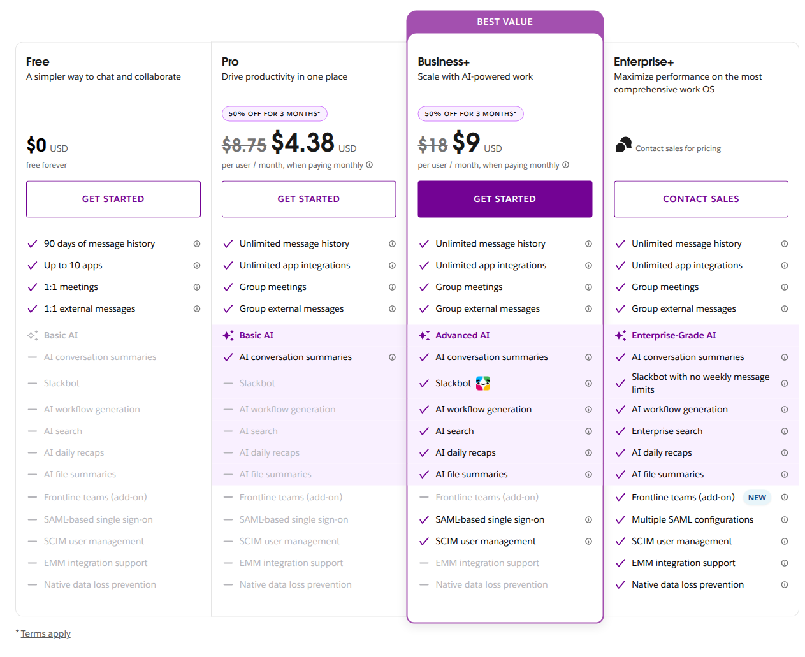

Slack Pro's regular monthly rate is $8.75 per active paid member. Slack's Fair Billing Policy distinguishes active billable members from free guests and bots, and separately settles changes during a period. Flexprice can model the stable full-month base fee with a fixed price and an application-calculated member quantity.

<Frame caption="Slack pricing comparison from the official site, 2026-11-24. This guide models only Pro monthly list rate.">
  
</Frame>

[View the official pricing page](https://slack.com/pricing).

**Scope:** One self-serve Slack Pro Workspace at the regular USD monthly rate, paid by credit card, with unchanged member activity throughout the full month.

**Not modeled:** The temporary 50%-off promotion visible in the capture, annual billing, other plans, mid-month additions or activity changes, prorated charges and credits, add-ons, discounts and tax.

## Pricing profile

| Dimension | Modeled offering |
| --- | --- |
| Pricing model | Per-seat; Subscription |
| Industry | Business messaging |
| Buyer | Teams using a shared messaging Workspace |
| Sales motion | Self-serve |
| Billing mechanics | Monthly advance base charge; Active paid-member quantity; One-member billing floor |

## What Slack charges

| Item | Published terms | Flexprice implication |
| --- | --- | --- |
| Regular Pro rate | $8.75 USD per member per month when paying monthly | Use the regular rate, not the temporary $4.38 offer shown in the capture |
| Paid member types | Active owners, admins, full members and Multi-Channel Guests | Compute the eligible active-member count outside Flexprice |
| Free member types | Single-Channel Guests and bots | Do not include them in the paid quantity |
| Minimum and changes | One member minimum when everyone is inactive; activity changes produce prorated charges or account credits | Apply the floor to an ongoing paid plan; the change-and-credit workflow is not configured |
| Charge dates | First credit-card charge on purchase, then on the monthly renewal date | Fixed monthly price in advance |

## Design takeaways

1. **Activity is a qualification rule, not a message counter.** A quiet active member still occupies one billable seat. Classify member type and activity before choosing quantity; a SUM of messages would price a different product. [Published terms](https://slack.com/help/articles/218915077-Slacks-Fair-Billing-Policy).
2. **Do not treat the starting quantity as the full Fair Billing Policy.** An initial count cannot detect later inactivity or produce prorated credits. A production implementation needs a separate activity and adjustment workflow; keep the unchanged-member example distinct from that lifecycle. [Published terms](https://slack.com/help/articles/218915077-Slacks-Fair-Billing-Policy).

## How Slack's pricing maps to Flexprice

| Slack concept | Flexprice configuration |
| --- | --- |
| Monthly price per active paid member | Fixed price of $8.75 USD in advance |
| Billable quantity | Application or checkout calculation, passed as the fixed-line quantity |

## Configure the plan and subscription

These requests are illustrative. Use your test environment and replace example IDs with the IDs returned by your setup. Create a [plan](/docs/product-catalogue/plans/create) with `POST /plans`:

```json
{
  "name": "Slack Pro monthly list rate example",
  "lookup_key": "slack_pricing_example",
  "description": "One self-serve Slack Pro Workspace at the regular USD monthly rate, paid by credit card, with unchanged member activity throughout the full month"
}
```

Create the [fixed price](/docs/product-catalogue/plans/pricing) with `POST /prices`. Enter the full amount per seat for one month in USD, not cents.

```json
{
  "entity_type": "PLAN",
  "entity_id": "plan_slack_example",
  "currency": "usd",
  "price_unit_type": "FIAT",
  "billing_period": "MONTHLY",
  "billing_period_count": 1,
  "display_name": "Pro monthly list rate",
  "type": "FIXED",
  "billing_model": "FLAT_FEE",
  "invoice_cadence": "ADVANCE",
  "amount": "8.75"
}
```

At the start of the modeled cycle, count each active owner, admin, full member and Multi-Channel Guest once. Exclude Single-Channel Guests and bots. Use at least one paid member while the Workspace remains on a paid plan, even if all members are inactive. This example has one active owner, one active admin and ten active full members, plus three Single-Channel Guests and two bots. Set the paid quantity to 12. No member changes type or activity during the month.

Create or select a customer to bill, then use `POST /subscriptions`. Set the quantity on the returned fixed price using a [line-item override](/docs/subscriptions/plan-price-overrides).

```json
{
  "customer_id": "cust_slack_example",
  "plan_id": "plan_slack_example",
  "currency": "usd",
  "billing_period": "MONTHLY",
  "billing_period_count": 1,
  "billing_cycle": "anniversary",
  "start_date": "2026-12-01T00:00:00Z",
  "override_line_items": [
    {
      "price_id": "price_slack_example",
      "quantity": "12"
    }
  ]
}
```

## Worked bill

The 12 active paid members cost **12 × $8.75 = $105.00 for the full month** before tax. The three Single-Channel Guests and two bots do not increase it. An ongoing paid Workspace with all members inactive has a one-member baseline of $8.75 per full month, not zero. These are full-period examples, not calculations of Slack's mid-period credits.

Verify that the opening invoice shows the monthly unit amount and the fixed-line quantity, with no metered line in this example.

## Pricing sources

- [Slack pricing](https://slack.com/pricing): Public USD monthly Pro list rate and separately displayed temporary promotion.
- [Slack Fair Billing Policy](https://slack.com/help/articles/218915077-Slacks-Fair-Billing-Policy): Active-member qualification, minimum billing, first charge, renewals and prorated adjustments.

Pricing checked on 2026-11-24. This example does not reproduce a full provider invoice.

## Related guide

[Plan price overrides](/docs/subscriptions/plan-price-overrides)
