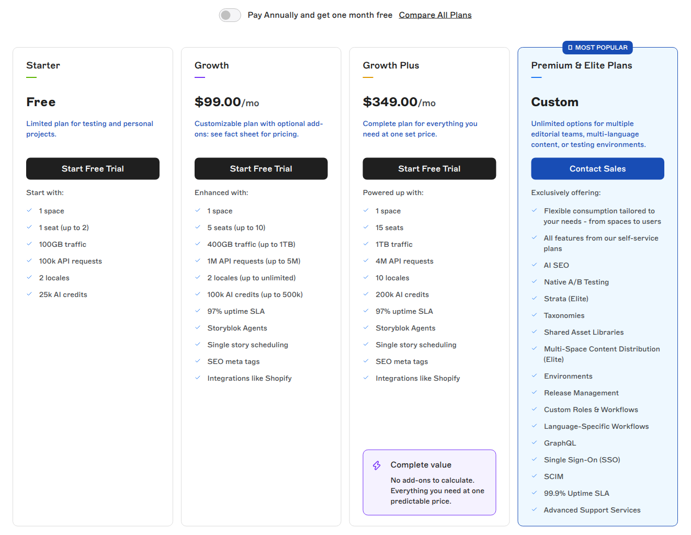

Storyblok Growth has a monthly base price for a space, with five seats and usage allowances included. This guide models the base fee for one space whose usage stays within its allowances.

<Frame caption="Storyblok monthly plan comparison from the official site, 2026-11-27. This guide models only Growth monthly base.">
  
</Frame>

[View the official pricing page](https://www.storyblok.com/pricing).

**Scope:** USD monthly Growth base fee for one Storyblok space after paid service begins.

**Not modeled:** Annual contracts, trial conversion rules, optional seats and usage packs, taxes, and custom tiers.

## Pricing profile

| Dimension | Modeled offering |
| --- | --- |
| Pricing model | Subscription |
| Industry | Headless CMS |
| Buyer | Editorial and development teams |
| Sales motion | Self-serve |
| Billing mechanics | Monthly fee per space; Included seats and usage |

## What Storyblok charges

| Item | Published terms | Flexprice implication |
| --- | --- | --- |
| Growth base | $99.00 per month per space on monthly billing | One fixed monthly charge per paid space |
| Included capacity | Five seats, 400 GB traffic, and 1 million API requests in the Growth card | Keep included usage separate from any optional purchase |
| Paid start and renewal | Subscriptions renew for the same term. A paid subscription following the trial is charged from the first day after the trial ends | Create the paid subscription when the monthly term starts |

## Design takeaways

1. **Give each space its own paid start.** An account can upgrade spaces independently. Keep a subscription per paid space so starting a second project leaves the first project's renewal date intact [Published terms](https://www.storyblok.com/pricing).
2. **Separate included users from purchases.** The first five seats come with Growth. Store the allowance on the plan and track optional seat purchases separately so adding someone within the allowance leaves the base fee unchanged [Published terms](https://www.storyblok.com/pricing).

## How Storyblok's pricing maps to Flexprice

| Storyblok concept | Flexprice configuration |
| --- | --- |
| Base charge | Fixed monthly price of $99.00 USD in advance |
| Charge quantity | One charge per subscription |
| Billing boundaries | Anniversary subscription billing |

## Configure the plan and subscription

These requests are illustrative. Use your test environment and replace example IDs with the IDs returned by your setup. Create a [plan](/docs/product-catalogue/plans/create) with `POST /plans`:

```json
{
  "name": "Storyblok Growth monthly base example",
  "lookup_key": "storyblok_pricing_example",
  "description": "USD monthly Growth base fee for one Storyblok space after paid service begins"
}
```

Use `POST /prices` to create the [fixed recurring price](/docs/product-catalogue/plans/pricing). The amount is USD for the entire billing period.

```json
{
  "entity_type": "PLAN",
  "entity_id": "plan_storyblok_example",
  "currency": "usd",
  "price_unit_type": "FIAT",
  "billing_period": "MONTHLY",
  "billing_period_count": 1,
  "display_name": "Growth monthly base",
  "type": "FIXED",
  "billing_model": "FLAT_FEE",
  "invoice_cadence": "ADVANCE",
  "amount": "99.00"
}
```

Use the paying account as the Flexprice customer and create one subscription per paid space. Start the paid subscription when the space enters its monthly paid term.

Use `POST /subscriptions` with the returned customer, plan, and price IDs. Set `include_price_ids` to the modeled price ID. If you need to prepare the subscription ahead of the paid start, [save it as a draft](/docs/core-concepts/subscriptions#choosing-a-subscription-start-date) and activate it when billing begins. Creating an active advance-billed subscription can raise its opening invoice at creation.

```json
{
  "customer_id": "cust_storyblok_example",
  "plan_id": "plan_storyblok_example",
  "currency": "usd",
  "billing_period": "MONTHLY",
  "billing_period_count": 1,
  "billing_cycle": "anniversary",
  "include_price_ids": [
    "price_storyblok_example"
  ]
}
```

## Worked bill

One space, four seats, 200 GB of traffic, and 600,000 API requests stay within the listed allowances. Its monthly subscription invoice has one base charge of **$99.00** before taxes.

## Pricing sources

- [Storyblok pricing](https://www.storyblok.com/pricing): Space unit, monthly plan rate, and included capacity.
- [Storyblok self-service terms](https://www.storyblok.com/legal/self-service-terms): Self-service term, first payment after a trial, and renewal.
- [Storyblok plan checkout guide](https://support.storyblok.com/hc/en-us/articles/49048475604369-How-to-upgrade-to-another-plan): Per-space checkout and interval selection.

Pricing checked on 2026-11-27.

## Related guide

[Subscriptions and billing cycles](/docs/core-concepts/subscriptions)
