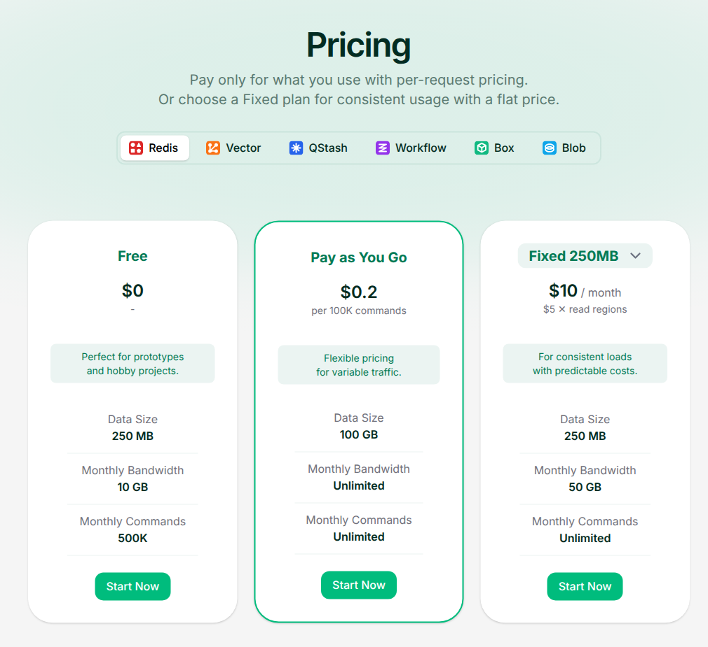

Upstash Redis offers both per-command pricing and fixed monthly plans. On **Pay as You Go**, the published command rate is **$0.20 per 100,000 commands**. This guide models that command charge for one database in a single primary region, using a SUM meter and a decimal per-command price in Flexprice.

<Frame caption="Upstash's complete Free, Pay as You Go and selected Fixed 250MB pricing cards, captured from its official Redis pricing page on November 9, 2026. All three cards include their limits and Start Now buttons. Only the Pay as You Go command charge is modeled here; the other cards provide comparison context.">
  
</Frame>

Source: [Upstash's official Redis pricing page](https://upstash.com/pricing/redis).

<Note>
  This is a **command-charge-only** example in USD, not a reproduction of an entire Upstash invoice. It covers ordinary billable Redis commands and pipelines on one Pay as You Go database. It excludes storage, bandwidth, additional-database fees, read-region replication, transactions, Lua scripts, Prod Pack, budgets and rate limiting, plan changes, the Free and Fixed plans, Enterprise terms, other Upstash products, credits, discounts and taxes. Configuration names below are examples, not Upstash resource identifiers.
</Note>

## Pricing profile

These labels describe only the Redis Pay as You Go command component modeled here, not every Upstash product or plan.

| Dimension | Offering profile |
| --- | --- |
| Pricing model | [Usage-based](https://upstash.com/pricing/redis) |
| Industry | [Serverless databases](https://upstash.com/redis) |
| Buyer | [Developers](https://upstash.com/redis) |
| Sales motion | [Self-serve](https://upstash.com/pricing/redis) |
| Billing mechanics | [Per-command metering; No free command allowance on paid databases](https://upstash.com/pricing/redis) |

## Redis Pay as You Go command pricing

The [pricing page](https://upstash.com/pricing/redis) and [billing documentation](https://upstash.com/docs/redis/overall/billing) establish the selected rate and what is counted.

| Pricing dimension | Selected scope |
| --- | --- |
| **Published command rate** | $0.20 per 100,000 commands |
| **Equivalent amount per command** | $0.20 ÷ 100,000 = $0.000002 |
| **Metered quantity** | Billable commands executed, not keys returned or HTTP round trips |
| **Pipelines** | Each billable command inside the pipeline contributes separately |
| **Operational commands** | `AUTH`, `HELLO`, `RESET`, `PING`, `SELECT`, `QUIT`, `INFO`, `CONFIG` and `COMMAND` are not billed |
| **Free-plan allowance** | The Free plan's 500K monthly commands do not carry into Pay as You Go |

The denominator is a display unit, not a requirement to buy blocks of 100,000 commands. Upstash documents per-command billing and gives a [worked example charging 72,000 commands](https://upstash.com/kb/redis-pipeline-vs-mget). Keep the meter in raw billable commands; do not round each record up to 100,000.

The Pay as You Go card's **Unlimited** bandwidth and command rows do not mean all usage is free. The pricing documentation separately lists **$0.25/GB per month for storage after the first 1 GB**, **$0.03/GB for bandwidth beyond 200 GB/month**, and **$0.50 per month for each database after the first ten**. These are separate dimensions and are **not configured or included in this worked charge**. A complete implementation needs verified storage measurement, bandwidth allowances and account-level database aggregation in addition to this command meter.

## Design takeaways

1. **Measure the billable operation, not its transport envelope.** Upstash's [pipeline example](https://upstash.com/kb/redis-pipeline-vs-mget) shows that one HTTP batch can contain many charged commands, while one `MGET` can retrieve many keys as a single command. A normalized command quantity and SUM aggregation preserve that distinction; counting HTTP requests or keys would change the bill.
2. **A free plan is not automatically a paid-plan allowance.** The [paid-database FAQ](https://upstash.com/pricing/redis) explicitly excludes the Free plan's initial command grant after upgrading. Do not add a zero-priced first tier or subtract 500,000 commands from this paid meter.
3. **Billing and service controls need separate implementations.** Upstash's [monthly budget](https://upstash.com/docs/redis/overall/billing) rate-limits the database when reached. A usage price alone does not enforce that behavior. This configuration deliberately leaves budget enforcement out rather than claiming that a monetary threshold automatically stops Redis traffic.

## How Upstash's pricing maps to Flexprice

| Upstash's pricing uses | Flexprice setup |
| --- | --- |
| **Billable Redis commands** | A [metered feature](/docs/product-catalogue/features/create) with SUM aggregation on `billable_commands` |
| **$0.20 per 100,000 commands** | A [flat-fee usage charge](/docs/product-catalogue/plans/billing-models/flat-fee) with amount `"0.000002"` per raw command |
| **One selected paid database and product** | Explicit offering and database filters; route other resources away from this meter |
| **No free command allowance on paid databases** | Price every recorded billable command, without a free tier, package transform or credit grant |
| **Access to metered usage** | An unlimited metered entitlement, which permits access but does not make usage free |

This example uses **monthly usage billing in arrears** in Flexprice to illustrate the command component of a gross bill. That cadence is an implementation choice, not a claim about Upstash's invoice dates or payment collection. Storage, bandwidth and other excluded charges would need their own configuration before calling this a complete bill.

## Create the command feature and meter

Create a feature named **Upstash Redis billable commands**. Use **SUM**, not **COUNT**: one event can carry the billable commands from a whole pipeline or a non-overlapping usage interval.

```json
{
  "name": "Upstash Redis billable commands",
  "lookup_key": "upstash_redis_billable_commands",
  "type": "metered",
  "unit_singular": "command",
  "unit_plural": "commands",
  "meter": {
    "name": "Upstash Redis billable commands",
    "event_name": "upstash_redis_usage",
    "reset_usage": "BILLING_PERIOD",
    "aggregation": {
      "type": "SUM",
      "field": "billable_commands"
    },
    "filters": [
      { "key": "offering", "values": ["redis_payg"] },
      { "key": "database_id", "values": ["database_primary_example"] }
    ]
  }
}
```

Replace `database_primary_example` with the integration's stable identifier for the selected database and use the same value on its events. The offering label is integration metadata, not an Upstash API parameter. Leave reporting conversion unset: usage and price both use raw commands, so dividing the quantity by 100,000 again would undercharge.

## Configure the usage-only plan

Create a [plan](/docs/product-catalogue/plans/create) for this command component:

```json
{
  "name": "Upstash Redis PAYG Commands Example",
  "lookup_key": "upstash_redis_payg_commands_example",
  "description": "Single-database Redis Pay as You Go command charge only"
}
```

Attach the feature as a usage-based flat-fee charge. Substitute the plan ID and the **meter ID** returned by feature creation, not the feature ID:

```json
{
  "entity_type": "PLAN",
  "entity_id": "<created_plan_id>",
  "meter_id": "<returned_meter_id>",
  "type": "USAGE",
  "price_unit_type": "FIAT",
  "currency": "usd",
  "amount": "0.000002",
  "billing_model": "FLAT_FEE",
  "billing_period": "MONTHLY",
  "billing_period_count": 1,
  "invoice_cadence": "ARREAR"
}
```

Here `FLAT_FEE` means one constant **usage rate**, not a fixed monthly subscription fee. Omit package transforms, tiers and minimum quantities. Keep the amount as a decimal string with all six decimal places; rounding it to cents before applying usage would erase the charge.

Add an unlimited [metered entitlement](/docs/product-catalogue/features/linking-to-plans) for this feature, then create a customer and a [subscription](/docs/subscriptions/customers-create-subscription) to the example plan with quantity **1**. The entitlement's billing-period reset is not a recurring free-command grant. Do not add the Free plan's 500K allowance or a separate recurring charge.

## Send normalized billable commands

Normalize usage on your server before sending [Flexprice usage events](/docs/core-concepts/usage-events/sending-events). For the ordinary commands in this example:

| Operation | Quantity contributed |
| --- | --- |
| One executed `GET` or `SET` | 1 billable command |
| One executed `MGET`, regardless of keys requested | 1 billable command |
| A pipeline of 3 billable commands | 3 billable commands, not 1 HTTP request |
| An unbilled operational command such as `PING` | 0; omit it from charged usage |

This is an illustrative Flexprice event for a pipeline containing three billable commands, not an Upstash API response:

```json
{
  "event_name": "upstash_redis_usage",
  "event_id": "evt_redis_commands_0001",
  "external_customer_id": "customer_cache_app_001",
  "timestamp": "2026-11-09T04:00:00Z",
  "properties": {
    "offering": "redis_payg",
    "database_id": "database_primary_example",
    "billable_commands": "3"
  }
}
```

Send non-overlapping command deltas, not repeated cumulative database counters. Do not report a pipeline both as a batch total and as individual command events. Reconcile normalized counts to the provider's charged usage; an attempted operation or a retry is not proof that it was billed.

Keep the original `event_id` **and timestamp** when retrying delivery of the same usage record. Flexprice deduplication requires both to match. A separately billable Redis execution is a new usage record, even if the application requested it as a retry.

<Warning>
  This normalizer does not cover transactions, Lua scripts or replicated writes. Upstash's [billing rules](https://upstash.com/docs/redis/overall/billing) count transaction wrappers, script-internal calls and replicated writes separately. Verify and implement those counting rules before sending such workloads to this meter; neither HTTP COUNT nor a naive count of top-level SDK calls reproduces them.
</Warning>

## Verify a worked command charge

Suppose one billing period contains **1,750,250 billable commands** from ordinary standalone commands and **1,000,000 billable commands** delivered in pipelines. These are command quantities after excluding unbilled operational commands, not HTTP-request totals.

| Calculation | Exact result |
| --- | --- |
| **Unit amount** | $0.20 ÷ 100,000 = $0.000002 per command |
| **Total SUM-metered quantity** | 1,750,250 + 1,000,000 = 2,750,250 commands |
| **Gross command charge before currency rounding** | 2,750,250 × $0.000002 = $5.5005 |
| **Illustrative USD command total rounded to cents** | **$5.50**, before excluded charges, credits, discounts and tax |

Aggregate usage before rounding the monetary total. As boundary checks, **100,000 commands cost $0.20** and **500,000 commands cost $1.00** on this paid plan. The latter must not become free simply because the Free card shows 500K monthly commands.

Before relying on the command total, verify that:

- Only the selected database's Pay as You Go usage matches the meter filters.
- A pipeline of three billable commands adds three units, while one `MGET` adds one.
- Operational commands and duplicate usage deliveries do not add charged units.
- The unit amount remains `"0.000002"`, with no package rounding or second 100,000-unit conversion.
- Storage, bandwidth and any other applicable fees are accounted for separately before presenting a complete invoice.

## Pricing sources

- [Upstash Redis pricing cards, rate details and paid-database FAQ](https://upstash.com/pricing/redis)
- [Upstash Redis pricing and billing rules](https://upstash.com/docs/redis/overall/billing)
- [Upstash's pipeline versus MGET explanation and cost example](https://upstash.com/kb/redis-pipeline-vs-mget)
- [Upstash Redis product overview](https://upstash.com/redis)

Pricing checked on 2026-11-09. Public rates and terms can change; recheck the selected offering before implementing it. This guide describes a configuration and calculation, not an executed Flexprice setup.

For the general meter → plan → subscription flow, see the [usage-based pricing recipe](/cookbooks/billing-recipes/usage-based-pricing).
