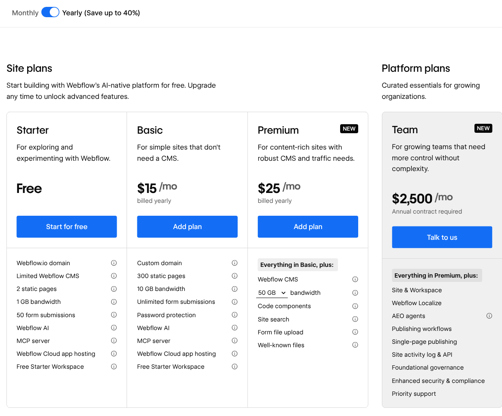

Webflow prices paid Site plans per website. Basic, the option for sites that do not need a CMS, is $15 per site per month billed yearly. It is distinct from Workspace billing.

<Frame caption="Webflow pricing as shown on the official pricing page, 2026-11-19.">
  
</Frame>

[View the official pricing page](https://webflow.com/pricing).

**Scope:** The initial annual base charge for one Webflow Basic Site plan in USD.

**Not modeled:** Workspace and Platform plans, CMS plans, bandwidth adjustments, hosting add-ons, migrations and tax.

## Pricing profile

| Dimension | Modeled offering |
| --- | --- |
| Pricing model | Subscription |
| Industry | Website building and hosting |
| Buyer | Website owners and designers |
| Sales motion | Self-serve |
| Billing mechanics | Per-site pricing; Annual billing |

## What Webflow charges

| Item | Published terms | Flexprice implication |
| --- | --- | --- |
| Basic, yearly | $15 per site per month | One $180 annual line per Basic site |
| Billing subject | Pricing is per site, with taxes added at checkout | Use a subscription keyed to the site, under the payer |
| Published inclusions | Custom domain, 300 static pages and 10 GB bandwidth | These are not metered charges in this example |

## Design takeaways

1. **Use the site as the subscription boundary.** Two sites under one payer can have different plans or start dates. One subscription per site lets you change or renew one site without changing the other. [Published terms](https://webflow.com/pricing).
2. **Keep hosting and collaboration separate.** Basic is a site-level purchase, while Workspace plans address a different set of needs. Do not use team member count to price site hosting. [Published terms](https://help.webflow.com/hc/en-us/articles/33961232582419-Site-plans).

## How Webflow's pricing maps to Flexprice

| Webflow concept | Flexprice configuration |
| --- | --- |
| Base price per site | Fixed annual price of $180.00 USD in advance |
| Billable quantity | One base charge per subscription |

## Configure the plan and subscription

These requests are illustrative. Use your own test environment and replace all example IDs with the IDs returned by your setup. Create a [plan](/docs/product-catalogue/plans/create) with `POST /plans`:

```json
{
  "name": "Webflow Basic Site plan example",
  "lookup_key": "webflow_pricing_example",
  "description": "The initial annual base charge for one Webflow Basic Site plan in USD"
}
```

Create the [fixed price](/docs/product-catalogue/plans/pricing) with `POST /prices`. The amount covers the entire year and is in USD, not cents.

```json
{
  "entity_type": "PLAN",
  "entity_id": "plan_webflow_example",
  "currency": "usd",
  "price_unit_type": "FIAT",
  "billing_period": "ANNUAL",
  "billing_period_count": 1,
  "display_name": "Basic Site plan",
  "type": "FIXED",
  "billing_model": "FLAT_FEE",
  "invoice_cadence": "ADVANCE",
  "amount": "180.00"
}
```

Create a customer for the payer, then create the subscription with `POST /subscriptions`.

```json
{
  "customer_id": "cust_webflow_example",
  "plan_id": "plan_webflow_example",
  "currency": "usd",
  "billing_period": "ANNUAL",
  "billing_period_count": 1,
  "billing_cycle": "anniversary",
  "start_date": "2026-12-01T00:00:00Z"
}
```

Store the returned subscription ID against the site in your application. If the same customer buys a second site, create a second subscription for it rather than changing this site's quantity.

## Worked bill

$15 × 12 = **$180.00** for one Basic site for its first year. A second Basic site with the same terms has its own $180.00 subscription.

## Pricing sources

- [Webflow pricing](https://webflow.com/pricing): Yearly Site plan rates and per-site pricing.
- [Webflow product documentation](https://help.webflow.com/hc/en-us/articles/33961232582419-Site-plans): Site plan selection, hosting and plan limits.

Pricing checked on 2026-11-19. This example does not reproduce a full provider invoice.

## Related guide

[Create a plan](/docs/product-catalogue/plans/create)
