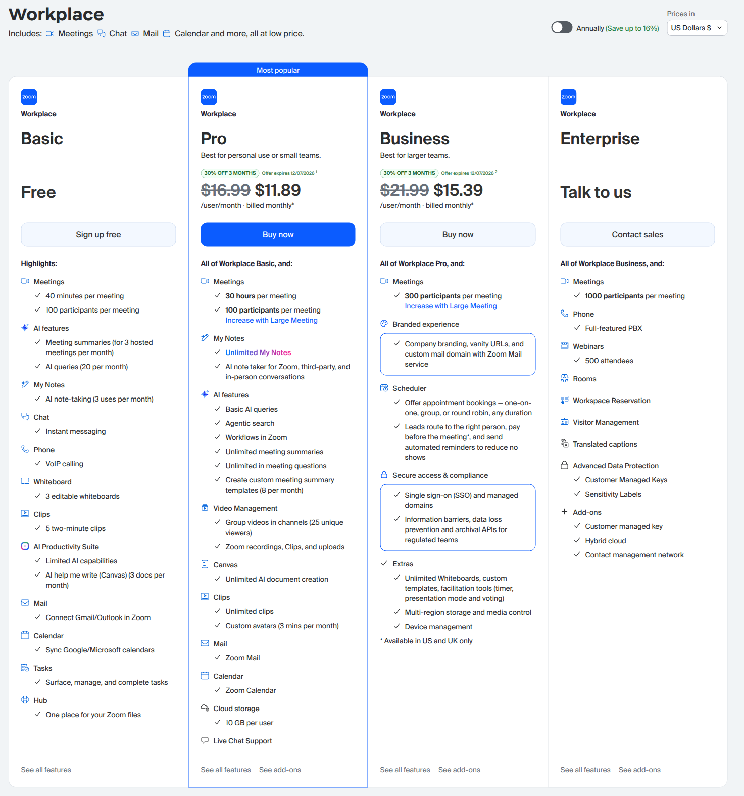

Zoom Workplace Pro's regular monthly price is $16.99 per user. A paid license lets a user host the plan's longer meetings; the bill is not based on how many people attend those meetings. Use a fixed monthly license price in Flexprice and set its quantity to the purchased Pro licenses.

<Frame caption="Zoom pricing comparison from the official site, 2026-11-24. This guide models only Workplace Pro monthly list rate.">
  
</Frame>

[View the official pricing page](https://zoom.us/pricing).

**Scope:** One self-serve Zoom Workplace Pro account at the regular USD monthly rate, with five purchased licenses and no changes during the month.

**Not modeled:** The temporary 30%-off promotion visible in the capture, annual purchases, other Workplace plans, Basic users without Pro licenses, add-ons, phone usage, license changes, account-specific payment terms, discounts and taxes.

## Pricing profile

| Dimension | Modeled offering |
| --- | --- |
| Pricing model | Per-seat; Subscription |
| Industry | Video meetings and workplace collaboration |
| Buyer | Small teams hosting meetings |
| Sales motion | Self-serve |
| Billing mechanics | Monthly license subscription; Purchased license quantity; Purchase and renewal charges |

## What Zoom charges

| Item | Published terms | Flexprice implication |
| --- | --- | --- |
| Regular monthly Pro | $16.99 USD per user per month, billed monthly | Fixed $16.99 monthly unit amount |
| Temporary offer | The capture separately displays $11.89 for three months and an offer-expiry date | Excluded; do not persist this introductory amount as the regular rate |
| License purchase | Choose licensed-user quantity when upgrading; Basic users can remain without paid licenses | Use purchased Pro licenses, not every user on the account |
| Meeting capacity | Pro shows 100 participants per meeting and meetings up to 30 hours | Product limits, not invoice quantities or usage charges in this example |
| Renewal | Subscription charges can already be processed when cancellation occurs on or after renewal | Model the regular base charge at the beginning of its monthly cycle; no payment-collection timing is asserted |

## Design takeaways

1. **Count purchased licenses rather than meeting attendance.** A single licensed host can meet with many participants. Counting everyone who joins a call would turn a license subscription into a participant charge. [Published terms](https://support.zoom.com/hc/en/article?id=zm_kb&sysparm_article=KB0063375).
2. **Keep acquisition offers separate from the regular price.** The page shows a temporary reduction alongside the regular monthly rate. Retain the regular price as the durable base and implement an eligible offer separately if needed; this example deliberately omits it. [Published terms](https://zoom.us/pricing).

## How Zoom's pricing maps to Flexprice

| Zoom concept | Flexprice configuration |
| --- | --- |
| Monthly price per purchased Pro license | Fixed price of $16.99 USD in advance |
| Billable quantity | Application or checkout calculation, passed as the fixed-line quantity |

## Configure the plan and subscription

These requests are illustrative. Use your test environment and replace example IDs with the IDs returned by your setup. Create a [plan](/docs/product-catalogue/plans/create) with `POST /plans`:

```json
{
  "name": "Zoom Workplace Pro monthly list rate example",
  "lookup_key": "zoom_pricing_example",
  "description": "One self-serve Zoom Workplace Pro account at the regular USD monthly rate, with five purchased licenses and no changes during the month"
}
```

Create the [fixed price](/docs/product-catalogue/plans/pricing) with `POST /prices`. Enter the full amount per seat for one month in USD, not cents.

```json
{
  "entity_type": "PLAN",
  "entity_id": "plan_zoom_example",
  "currency": "usd",
  "price_unit_type": "FIAT",
  "billing_period": "MONTHLY",
  "billing_period_count": 1,
  "display_name": "Workplace Pro monthly list rate",
  "type": "FIXED",
  "billing_model": "FLAT_FEE",
  "invoice_cadence": "ADVANCE",
  "amount": "16.99"
}
```

Create one subscription for the paying account. Set quantity to its purchased Workplace Pro licenses, not the meeting count, attendee count or all registered Basic users. In the example, the account buys five Pro licenses and has three additional Basic users without Pro licenses. Keep quantity at five even if one purchased license is temporarily unassigned. Confirm the account's renewal date and billing period from its invoice before copying the example dates.

Create or select a customer to bill, then use `POST /subscriptions`. Set the quantity on the returned fixed price using a [line-item override](/docs/subscriptions/plan-price-overrides).

```json
{
  "customer_id": "cust_zoom_example",
  "plan_id": "plan_zoom_example",
  "currency": "usd",
  "billing_period": "MONTHLY",
  "billing_period_count": 1,
  "billing_cycle": "anniversary",
  "start_date": "2026-12-01T00:00:00Z",
  "override_line_items": [
    {
      "price_id": "price_zoom_example",
      "quantity": "5"
    }
  ]
}
```

## Worked bill

Five purchased licenses cost **5 × $16.99 = $84.95 per full month** at the regular rate. Three unlicensed Basic users and a meeting with 80 participants do not change this line. Buying six licenses for a full month would cost $101.94. The introductory $11.89 rate is not used in either result.

Verify that the opening invoice shows the monthly unit amount and the fixed-line quantity, with no metered line in this example.

## Pricing sources

- [Zoom pricing](https://zoom.us/pricing): Workplace monthly USD cards with regular and temporary promotional prices.
- [Zoom upgrade guide](https://support.zoom.com/hc/en/article?id=zm_kb&sysparm_article=KB0063375): Buying license quantities, selecting a subscription cycle and distinguishing Basic users from licensed users.
- [Zoom billing FAQ](https://support.zoom.com/hc/en/article?id=zm_kb&sysparm_article=KB0086079): Charges processed at renewal, different product renewal dates and invoice-period reconciliation.

Pricing checked on 2026-11-24. This example does not reproduce a full provider invoice.

## Related guide

[Plan price overrides](/docs/subscriptions/plan-price-overrides)
