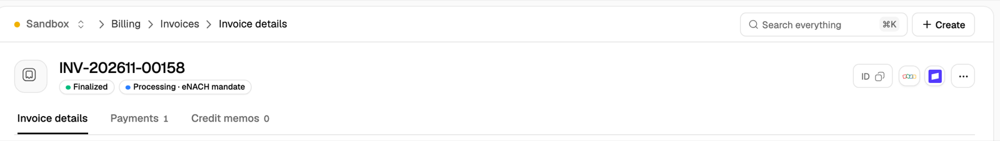
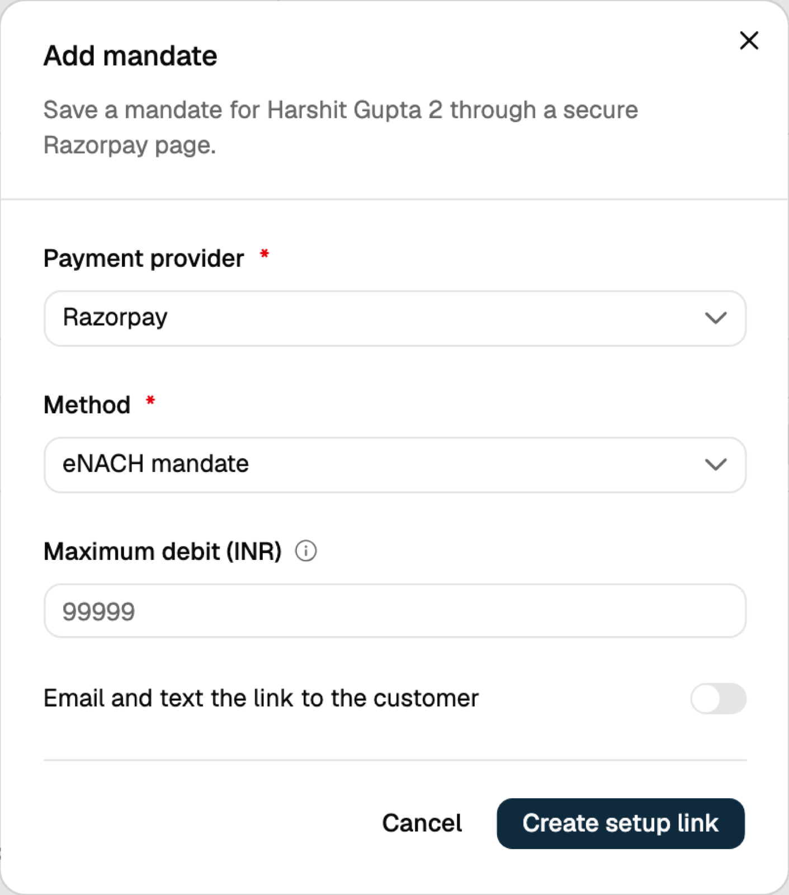
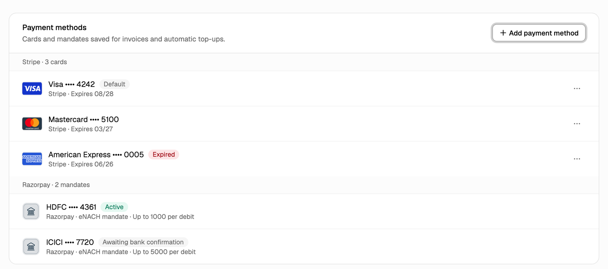
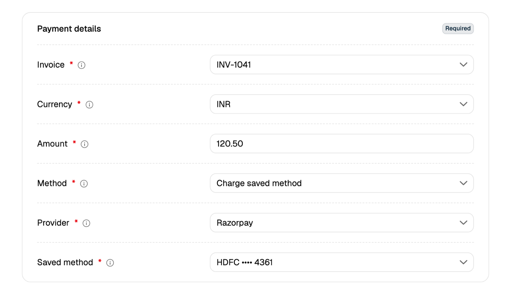

Cards and UPI Autopay don't suit every customer in India. Many businesses pay large invoices straight from a bank account, and card or UPI limits get in the way. An eNACH mandate is a one-time approval from the customer's bank. Once it is active, Flexprice can debit that account for each invoice, up to the limit the customer approved.

eNACH runs through Razorpay. Setting up a mandate never collects money. The customer approves it on a Razorpay page, and their bank confirms it.

## How It Works

- **Setup:** you create a setup link for the customer, from the API, the dashboard or the customer portal. The customer opens it, picks their bank, and authorises the mandate.
- **Confirmation:** the bank confirms the mandate. Until then the payment method shows **Awaiting bank confirmation** and can't be charged.
- **Charging:** an invoice can be charged against an active mandate automatically, or from **Record payment → Charge saved method** in the dashboard.
- **Processing:** an eNACH debit takes up to 2 working days to settle. Meanwhile the payment is `PROCESSING` and the invoice shows **Processing · eNACH mandate**. The invoice can't be charged again or voided until the debit settles.
- **Result:** when the bank answers, the payment becomes `SUCCEEDED` or `FAILED`. A failed debit is not retried. Flexprice records the bank's reason and sends `invoice.payment.failed`.

<Frame>
  
</Frame>

## Prerequisites

- A [Razorpay connection](/integrations/razorpay/connection-setup).
- An **email** and a **phone number** (`contact`) on the customer. Razorpay requires both for the mandate and for every debit.
- These Razorpay webhook events enabled on your Flexprice endpoint: `token.confirmed`, `token.rejected`, `token.cancelled`, `payment.authorized`, `payment.captured`, `payment.failed` and `invoice.expired`. See [Razorpay Setup](/docs/checkout/razorpay-checkout).

## Setting Up a Mandate

### From the API

Create a setup intent with `provider: razorpay`. `max_amount` is the largest single debit the mandate allows, in rupees.

```bash
curl -X POST https://api.cloud.flexprice.io/v1/payments/customers/<CUSTOMER_ID>/setup/intent \
  -H "x-api-key: <API_KEY>" \
  -H "Content-Type: application/json" \
  -d '{
    "provider": "razorpay",
    "payment_method_types": ["enach"],
    "max_amount": "50000",
    "notify_customer": true
  }'
```

| Field | Description |
| --- | --- |
| `provider` | `razorpay` |
| `payment_method_types` | `["enach"]`. Razorpay's only setup method, so it can be omitted. |
| `max_amount` | Largest single debit, in INR. Defaults to ₹99,999. Up to ₹1 crore. |
| `notify_customer` | `true` to have Razorpay email and text the link to the customer. |

The response has a `checkout_url` to send the customer and a `setup_intent_id`. Use the `setup_intent_id` to check the link (`GET /v1/payments/customers/{id}/setup/intent`) or cancel it (`POST /v1/payments/customers/{id}/setup/intent/cancel`). Creating a new link for the same customer cancels the previous one.

### From the dashboard

Open the customer and choose **Customer actions → Add payment method**. Pick **Razorpay**, then set an optional maximum debit.

<Frame>
  
</Frame>

### From the customer portal

Customers can add a mandate themselves under **Payment methods → Add payment method**. The portal lists each mandate with its bank, state and per-debit limit.

<Frame>
  
</Frame>

## Charging a Mandate

Invoices on a subscription set to charge automatically are charged when they finalise. Flexprice tries saved Razorpay methods in this order: card, UPI, then eNACH, because eNACH settles slowest. A mandate is used only if its `max_amount` covers the invoice.

To charge a specific mandate, use **Record payment → Charge saved method** in the dashboard, or create a payment with `payment_method_type: ENACH` and the mandate's ID as `payment_method_id`. List a customer's saved methods with `GET /v1/customers/{id}/payment-methods`.

<Frame>
  
</Frame>

```bash
curl -X POST https://api.cloud.flexprice.io/v1/payments \
  -H "x-api-key: <API_KEY>" \
  -H "Content-Type: application/json" \
  -d '{
    "destination_type": "INVOICE",
    "destination_id": "<INVOICE_ID>",
    "payment_method_type": "ENACH",
    "payment_gateway": "razorpay",
    "payment_method_id": "<TOKEN_ID>",
    "amount": "1200",
    "currency": "INR",
    "process_payment": true
  }'
```

A payment the bank is still settling has `submitted_for_processing: true` and can't be processed again.

## Webhooks

| Event | When |
| --- | --- |
| `mandate.confirmed` | The bank confirmed the mandate. It can be charged. |
| `mandate.rejected` | The bank rejected the mandate. |
| `mandate.cancelled` | The mandate was cancelled, for example by the customer at their bank. |
| `mandate.setup_attempt_failed` | The customer's attempt on the setup page failed. They can try the same link again. |
| `mandate.setup_expired` | The setup link expired before the customer finished. |
| `payment.pending` | A debit was submitted and is settling. |
| `payment.success` | The debit settled and the invoice is paid. |
| `invoice.payment.failed` | The debit failed, with the bank's reason. |

Flexprice also checks unsettled debits with Razorpay every hour, so a missed Razorpay webhook doesn't leave a payment stuck.

## Limitations

<Warning>
  Some banks take up to 2 working days after confirming a mandate before it can be debited. A debit in that window fails with a "mandate not active" reason. Wait before charging a mandate confirmed the same day.
</Warning>

- **Settlement time:** debits submitted before 9 AM on a bank working day are processed the same day, and they can take up to 2 working days to settle.
- **One attempt:** failed debits are not retried. Follow up with a payment link or ask for a new mandate. Razorpay advises waiting at least 3 days before debiting again after a failure.
- **Bank limits:** HDFC netbanking mandates are capped at ₹1 lakh, whatever `max_amount` you set. The customer's own account limits can also fail a debit.
- **No editing:** a mandate's limit or bank account can't be changed. The customer approves a new mandate instead.
- **No redirect:** the Razorpay setup page doesn't return the customer to your site. Watch for `mandate.confirmed`.
- **Test mode** settles instantly. Try a small live debit before relying on live timings.

<CardGroup cols={2}>
  <Card icon="repeat" href="/docs/checkout/autopay-mandates" title="Autopay & Mandates">
    UPI Autopay and card mandates collected at checkout.
  </Card>
  <Card icon="plug" href="/docs/checkout/razorpay-checkout" title="Razorpay Setup">
    Connect Razorpay and enable the webhook events.
  </Card>
</CardGroup>

**API References**
- [Create a Payment](/api-reference/payments/create-payment)
- [Razorpay eMandate FAQs](https://razorpay.com/docs/payments/recurring-payments/emandate/faqs/)
